# Computer Network — Mid Sem

## Syllabus

_Mid Term II Examinations — Important topics for discussion:_

1. Wired vs Wireless LAN
    - Terminologies & concepts
2. OSI Model
    - More focus on Data-Link & Network Layer
    - Segmentation & Re-assembly
    - MAC-headers, Payload formats
    - Congestion control at Network Layer, TCP Sliding Window
3. TCP/IP
    - TCP Packet format
    - IP Addressing, subnetting, CIDR
    - Logical address, virtual tunneling
    - Subnetting examples
4. Application Layer use-cases
    - SMTP, POP, email services
    - DNS and DHCP

**Main textbook:** Data Communication and Networking — B.A. Forouzan

## Q1. (a) Compare Wired LANs and Wireless LANs architecturally. (b) Explain the characteristics/challenges of Wireless LANs. (c) Why does CSMA/CD fail in Wireless LANs, and how does CSMA/CA solve this using RTS, CTS, and NAV? <small>(10 marks · Mid Sem · Module 1)</small>

*Module 1 — Wired vs. Wireless LAN: Terminologies & Concepts*

**(a) Architectural Comparison: Wired LAN vs. Wireless LAN**
Imagine a **Wired LAN** as a room where every computer has its own private telephone wire plugged into a central switchboard, whereas a **Wireless LAN (WLAN)** is like a group of people talking in an open room where everyone shares the air.

| Feature | Wired LAN (Switched Ethernet) | Wireless LAN (IEEE 802.11) |
| :--- | :--- | :--- |
| **Transmission Medium** | Uses physical cables (copper twisted-pair or fiber-optic). Communication is **point-to-point** and **full-duplex** (can send and receive at the same time). | Uses **air** (radio waves or infrared). Signals are broadcast into space, so everyone shares the medium (**multiple access**). |
| **Host Mobility** | A computer is plugged into a fixed wall point with a fixed Network Interface Card (NIC) MAC address. Moving requires unplugging and reconnecting. | Hosts are not physically tied to cables and can move freely within the coverage area while staying connected. |
| **Isolated LANs** | A standalone group of computers is connected through a **Link-Layer Switch**. | A standalone group of wireless computers talking directly to each other without a switch is called an **Ad Hoc Network (IBSS)**. |
| **Connecting to Other Networks** | Connects to other networks or the Internet using a **Switch** and a **Router**. | Connects to a wired network (making an **Infrastructure Network**) through an **Access Point (AP)**, which acts as a bridge between the wireless air and wired cables. |

**(b) Key Characteristics (Challenges) of Wireless LANs**
Because wireless signals travel through open air instead of protected cables, four main problems happen:

1. **Attenuation (Signal Weakening):** Radio signals spread out in all directions, so their strength drops very quickly over distance. Only a tiny part reaches the receiver, especially when sent by battery-powered mobile devices.
2. **Interference:** Multiple devices using the same unlicensed radio band (like $2.4\text{ GHz}$) can talk over each other, causing unwanted noise at the receiver.
3. **Multipath Propagation:** Radio waves bounce off walls, furniture, and the ground. As a result, the receiver gets multiple copies of the same signal arriving at slightly different times (different phases), making the signal blurry and harder to recognize.
4. **High Error Rate (Low SNR):** Because of attenuation, interference, and multipath bouncing, the **Signal-to-Noise Ratio (SNR)**—the ratio of good signal to bad noise—is often low. Therefore, wireless networks suffer far more corrupted frames and need strong error detection and retransmission.

**(c) Why CSMA/CD Fails in Wireless LANs & How CSMA/CA Works**
In wired Ethernet, computers use **CSMA/CD (Collision Detection)**—they listen to the wire while talking to see if their signal collided with someone else's. **CSMA/CD does not work in wireless LANs for 3 reasons:**

1. **No Full-Duplex Battery Power:** To detect a collision, a wireless card must transmit its own strong signal and listen for a weak collision signal at the exact same moment. Mobile devices on batteries do not have enough power or hardware isolation for this.
2. **Hidden Station Problem:** Suppose Station B and Station C both want to send data to Station A in the middle, but B and C are too far apart (or blocked by a wall) to hear each other. B starts sending to A. C listens, hears nothing from B, thinks the air is free, and sends to A—causing a crash (collision) at A without B or C knowing.

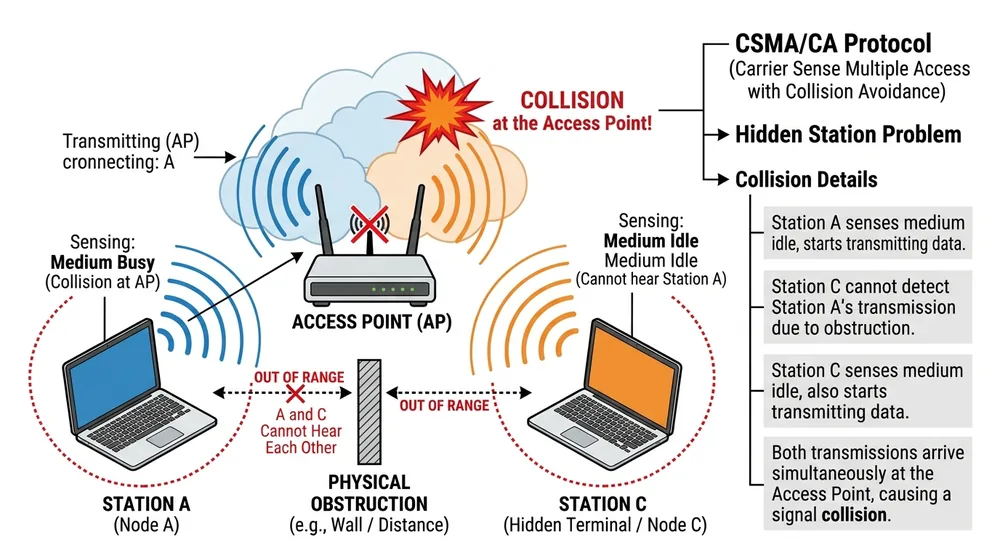{ loading=lazy }
*Illustration: Hidden Station problem and collision at Access Point*

3. **Signal Fading:** Over long distances, a signal may fade so much that a sender at one end cannot hear a collision happening at the other end.

**How CSMA/CA (Collision Avoidance) Solves This:**
Instead of detecting collisions, IEEE 802.11 Distributed Coordination Function (DCF) tries to **avoid** them using a 4-way handshake (`RTS` $\rightarrow$ `CTS` $\rightarrow$ `Data` $\rightarrow$ `ACK`) and a silence timer called **NAV (Network Allocation Vector)**:

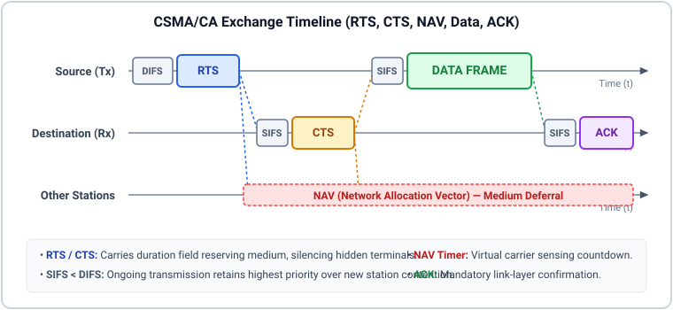
*Illustration: CSMA/CA 4-way handshake exchange and NAV channel reservation timeline*

1. **Sense & Send RTS:** The sender checks that the air is idle, waits for a time period called **DIFS (Distributed Interframe Space)**, and sends a short **RTS (Request to Send)** control frame. This RTS announces how long the upcoming data transmission will take.
2. **Reply with CTS:** The destination receives the RTS, waits a very short gap called **SIFS (Short Interframe Space)**, and replies with a **CTS (Clear to Send)** frame, which again repeats the time duration needed.
3. **Other Stations Set NAV Timer:** Any station (even a hidden station near the destination) that hears either the RTS or the CTS reads the duration field and sets an internal countdown timer called **NAV (Network Allocation Vector)**. While NAV is counting down, those stations are forbidden from transmitting or checking the channel.
4. **Send Data & Receive ACK:** The source waits **SIFS** and sends the **Data** frame. Finally, the destination waits **SIFS** and sends back an **ACK** frame because wireless senders cannot know their frame arrived safely without an explicit acknowledgment.

## Q2. Explain Basic Service Set (BSS) and Extended Service Set (ESS) in IEEE 802.11, along with the three types of station mobility. <small>(5 marks · Mid Sem · Module 1)</small>

*Module 1 — Wired vs. Wireless LAN: Terminologies & Concepts*

IEEE 802.11 builds wireless LANs using two architectural blocks:

1. **Basic Service Set (BSS):** This is the smallest building block of a wireless LAN. It consists of a group of stationary or mobile wireless stations and an optional central base station called an **Access Point (AP)**.
    - **Ad Hoc BSS (Independent BSS):** A BSS *without* an AP. Stations find each other and talk directly peer-to-peer inside a single room, but they cannot send data to outside networks.
    - **Infrastructure BSS:** A BSS *with* an AP. All wireless stations talk through the central AP, which connects them to the wired network.
2. **Extended Service Set (ESS):** When a single BSS is too small (like across a university campus), two or more Infrastructure BSSs with APs are connected together by a backbone network called a **Distribution System (DS)** (usually a wired Ethernet LAN).
    - Inside an ESS, mobile computers are normal moving stations inside each BSS, while the APs act as stationary stations connected to the wired backbone.

**Three Types of Station Mobility in 802.11:**

- **No-transition mobility:** The device is either completely stationary (desktop) or moves only inside a single BSS room.
- **BSS-transition mobility:** The device moves from one BSS (AP) to another BSS, but stays inside the same overall campus ESS.
- **ESS-transition mobility:** The device moves from one ESS to a completely different ESS (e.g., walking from one building's network to another's; continuous connection is not guaranteed here).

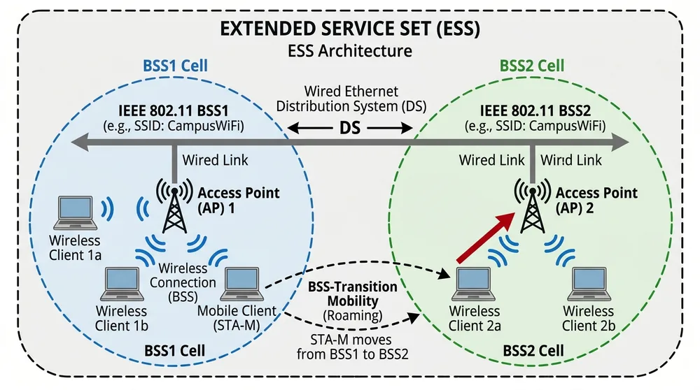{ loading=lazy }
*Illustration: Basic Service Set (BSS) and Extended Service Set (ESS) with Access Point distribution*

## Q3. Compare FDM, WDM, and TDM (Synchronous vs. Statistical TDM). <small>(5 marks · Mid Sem · Module 1)</small>

*Module 1 — Wired vs. Wireless LAN: Terminologies & Concepts*

**Multiplexing** is a technique that lets multiple signals share a single high-bandwidth physical link (cable or air) by dividing it into multiple logical **channels**.

1. **FDM (Frequency-Division Multiplexing — Analog):**
    - Used when the link's bandwidth (in $\text{Hz}$) is bigger than the sum of all signals' bandwidths.
    - Each sender shifts (modulates) its signal onto a different carrier frequency ($f_1, f_2, f_3$), separated by unused strips of frequency called **guard bands** so they don't overlap. Example: AM/FM radio and TV broadcasting.
2. **WDM (Wavelength-Division Multiplexing — Analog/Optical):**
    - Works on the exact same principle as FDM, but for **light (optical) signals** traveling through fiber-optic cables.
    - A prism bends and combines narrow beams of different light frequencies (colors) into one wide beam of light on a single fiber, and another prism splits them apart at the receiver.
3. **TDM (Time-Division Multiplexing — Digital):**
    - Instead of splitting frequency, digital connections share the whole link by taking turns in **time slots**.
    - **Synchronous TDM:** Every input line gets a reserved time slot in every frame, even if that line has nothing to send. Idle lines create wasted **empty slots**. It requires a $1\text{-bit}$ **synchronization (framing) bit** per frame, but needs **no destination address** inside slots because slot positions are fixed.
    - **Statistical TDM:** Slots are given out dynamically (round-robin) *only* when an input line actually has data to send, preventing empty slots. Because slots are not fixed to specific lines, every slot must carry a **destination address** ($n = \log_2 N\text{ bits}$ for $N$ outputs), and **no synchronization bit** is needed.

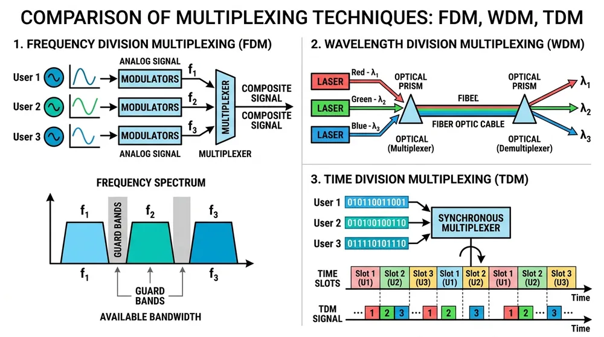{ loading=lazy }
*Illustration: Frequency-Division, Wavelength-Division, and Time-Division Multiplexing*

## Q4. What is Spread Spectrum? Explain how FHSS and DSSS work and why they are used in Wireless LANs. <small>(5 marks · Mid Sem · Module 1)</small>

*Module 1 — Wired vs. Wireless LAN: Terminologies & Concepts*

In wireless communication, signals travel through the open air where anyone can eavesdrop or jam the signal with noise. **Spread Spectrum (SS)** solves this by taking a signal of required bandwidth $B$ and intentionally expanding it into a much wider bandwidth $B_{ss}$ ($B_{ss} \gg B$) using an independent **spreading code** (a pattern that looks random). This adds protective redundancy for **privacy** and **antijamming**.

1. **FHSS (Frequency Hopping Spread Spectrum):**
    - Uses $M$ different carrier frequencies. A **pseudorandom noise (PN)** code generator outputs a $k\text{-bit}$ pattern ($M = 2^k$) during every brief hopping period ($T_h$).
    - A frequency table matches that $k\text{-bit}$ pattern to a specific carrier frequency (e.g., $101 \rightarrow 700\text{ kHz}$, then $111 \rightarrow 900\text{ kHz}$).
    - The transmitter hops from frequency to frequency rapidly and repeats the cycle after $M$ hops. An eavesdropper or jammer who does not know the hopping pattern can only catch or jam a tiny fraction of a second.
2. **DSSS (Direct Sequence Spread Spectrum):**
    - Instead of hopping frequencies, DSSS replaces every single data bit (`0` or `1`) with a sequence of $n\text{ bits}$ called **chips** generated by a chip generator.
    - If each bit is replaced by an $11\text{-chip}$ **Barker sequence** (like `10110111000` in IEEE 802.11), the transmission rate and required bandwidth become $11\text{ times}$ larger than the original signal. Only a receiver that knows the exact $11\text{-chip}$ code can multiply and recover the original bit.

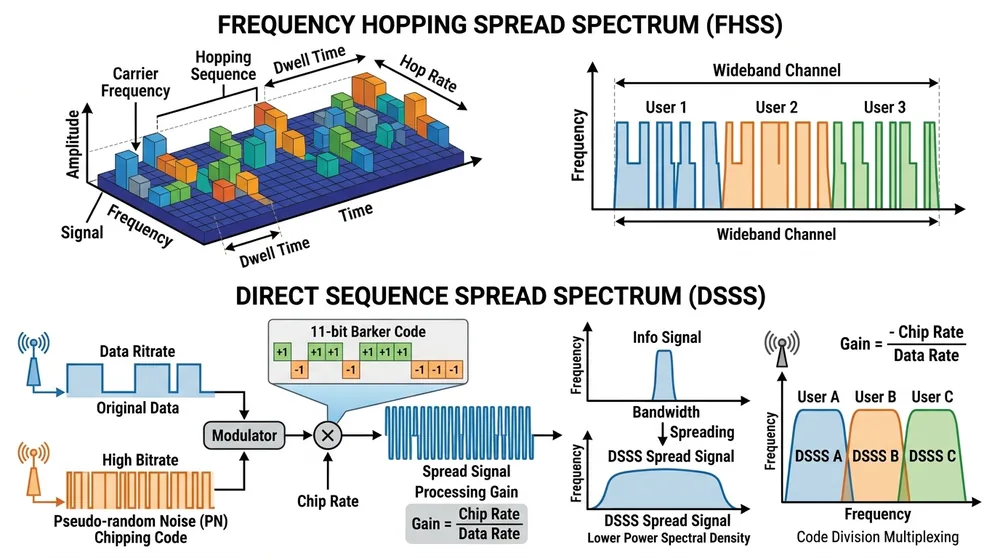{ loading=lazy }
*Illustration: Frequency Hopping (FHSS) vs. Direct Sequence Spread Spectrum (DSSS)*

## Q5. What is a Virtual LAN (VLAN)? How are stations grouped into VLANs, how do switches communicate VLAN tags, and what are its advantages? <small>(5 marks · Mid Sem · Module 1)</small>

*Module 1 — Wired vs. Wireless LAN: Terminologies & Concepts*

- **Definition:** A normal LAN groups computers physically by which switch they are wired into. A **Virtual LAN (VLAN)** uses **software** (not physical wiring) to divide one or more physical switches into logical broadcast groups. Broadcast messages sent by a computer in `VLAN 1` are heard only by other members of `VLAN 1`, even if they are sitting in different buildings connected to different switches.
- **5 Ways to Define VLAN Membership:** Administrators can group stations (manually, automatically, or semiautomatically) by:
    1. **Switch Port/Interface Numbers** (e.g., Ports $1, 2, 3 \rightarrow \text{VLAN } 1$).
    2. **48-bit MAC Addresses**.
    3. **32-bit IP Addresses**.
    4. **Multicast IP Addresses**.
    5. **A Combination** of the above.
- **3 Ways Switches Communicate VLANs Across a Backbone:**
    1. **Table Maintenance:** Switches build a membership table when stations send broadcasts and exchange tables periodically.
    2. **Frame Tagging (IEEE 802.1Q):** When a frame travels on the trunk wire between two switches, the sending switch inserts an extra VLAN tag header into the MAC frame so the receiving switch knows which VLAN it belongs to.
    3. **Time-Division Multiplexing (TDM):** Each VLAN is given its own dedicated time-slot channel on the trunk cable between switches.
- **Advantages:** (1) **Saves Cost & Time** (moving an employee between teams is done in software without rewiring cables), (2) **Creates Virtual Workgroups** across buildings, and (3) **Improves Security** by isolating sensitive broadcast traffic to specific groups.

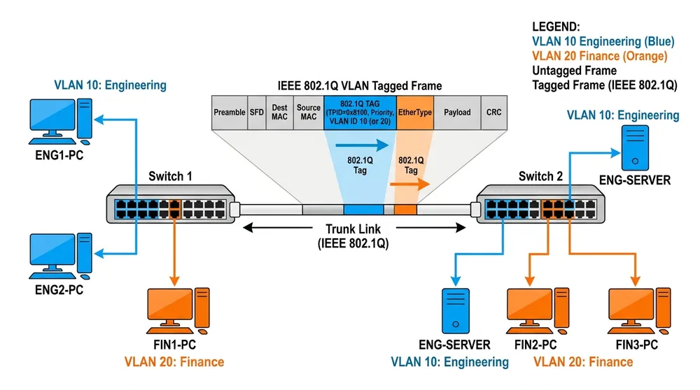{ loading=lazy }
*Illustration: Logical VLAN workgroup segmentation across physical switches with trunk tagging*

## Q6. Differentiate between the Hidden Station Problem and the Exposed Station Problem. <small>(2 marks · Mid Sem · Module 1)</small>

*Module 1 — Wired vs. Wireless LAN: Terminologies & Concepts*

- **Hidden Station:** Station B is sending to Station A. Station C (out of B's range) cannot hear B, assumes the channel is free, and sends to A at the same time—causing a collision at A. Solved using `RTS/CTS`.
- **Exposed Station:** Station A is sending to B. Station C hears A's `RTS` and wants to send to Station D (which is far away from B and wouldn't interfere). However, C stays silent unnecessarily, wasting channel capacity. `RTS/CTS` does *not* fix this.

## Q7. Compare SIFS, PIFS, and DIFS in IEEE 802.11. <small>(2 marks · Mid Sem · Module 1)</small>

*Module 1 — Wired vs. Wireless LAN: Terminologies & Concepts*

In wireless LANs, priority is set by how long a device waits after the air becomes silent (shorter wait = higher priority):

- **SIFS (Short Interframe Space):** Shortest wait $\rightarrow$ **Highest Priority** (used for immediate `ACK`, `CTS`, and poll replies).
- **PIFS (PCF Interframe Space):** Medium wait $\rightarrow$ **Medium Priority** (used by the Access Point for contention-free polling in PCF mode).
- **DIFS (DCF Interframe Space):** Longest wait $\rightarrow$ **Lowest Priority** (used by normal stations competing to send `RTS`/data in DCF mode).

## Q8. How does Synchronous TDM handle input lines with different data rates? <small>(2 marks · Mid Sem · Module 1)</small>

*Module 1 — Wired vs. Wireless LAN: Terminologies & Concepts*

1. **Multilevel Multiplexing:** Combines slower lines (e.g., two $20\text{ kbps}$ lines) into one faster line ($40\text{ kbps}$) to match other $40\text{ kbps}$ inputs.
2. **Multiple-Slot Allocation:** Gives a faster line (e.g., $50\text{ kbps}$) two slots per frame while $25\text{ kbps}$ lines get one slot.
3. **Pulse Stuffing (Bit Padding):** Adds dummy bits to a non-multiple slow line (e.g., padding a $46\text{ kbps}$ line up to $50\text{ kbps}$) so all inputs have the exact same rate.

## Q9. (Numerical) Five channels, each with a $100\text{-kHz}$ bandwidth, are multiplexed using FDM. What is the minimum link bandwidth if a $10\text{-kHz}$ guard band is needed between channels? <small>(2 marks · Mid Sem · Module 1)</small>

*Module 1 — Wired vs. Wireless LAN: Terminologies & Concepts*

- For $5$ channels, we need $5 - 1 = 4\text{ guard bands}$ between them.
- $\text{Minimum Bandwidth} = (5 \times 100\text{ kHz}) + (4 \times 10\text{ kHz}) = 500 + 40 = \mathbf{540\text{ kHz}}$.

## Q10. (Numerical) How is the $1.544\text{ Mbps}$ data rate of a T-1 (DS-1) telephone line calculated? <small>(2 marks · Mid Sem · Module 1)</small>

*Module 1 — Wired vs. Wireless LAN: Terminologies & Concepts*

- A T-1 line multiplexes $24$ voice channels (each sampled $8000\text{ times/sec}$ at $8\text{ bits/sample} = 64\text{ kbps}$).
- Each T-1 frame holds $24\text{ slots} \times 8\text{ bits} + 1\text{ synchronization bit} = \mathbf{193\text{ bits/frame}}$.
- Sending $8000\text{ frames/sec}$ gives: $8000 \times 193\text{ bits} = 1,544,000\text{ bps} = \mathbf{1.544\text{ Mbps}}$ (which includes $8\text{ kbps}$ of sync overhead).

## Q11. (a) Draw and explain the IEEE 802.11 MAC Layer Frame Format and its Frame Control (FC) subfields. (b) Explain the 4-Address Mechanism (`To DS` and `From DS`) with all 4 cases in detail. <small>(10 marks · Mid Sem · Module 2)</small>

*Module 2 — OSI Model (Data-Link & Network Layer; Congestion Control & Sliding Window)*

**(a) IEEE 802.11 MAC Frame Format**
At the Data-Link layer, wireless data is packaged into a MAC frame with 9 fields ($34\text{ bytes}$ of header + trailer, plus up to $2312\text{ bytes}$ of payload):

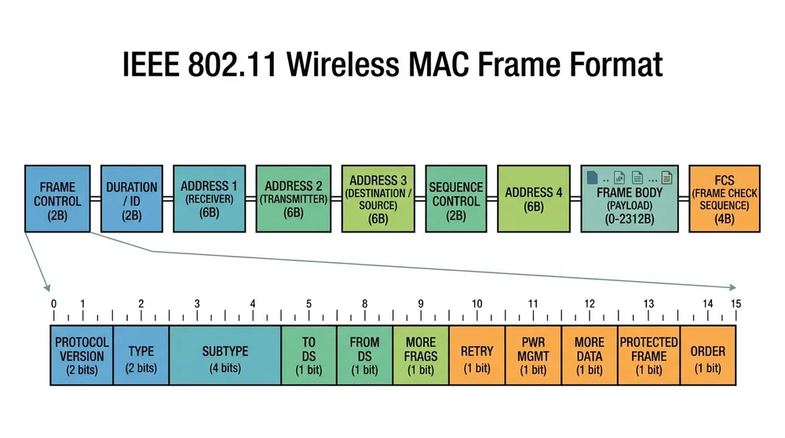{ loading=lazy }
*Illustration: IEEE 802.11 wireless MAC frame format overview*

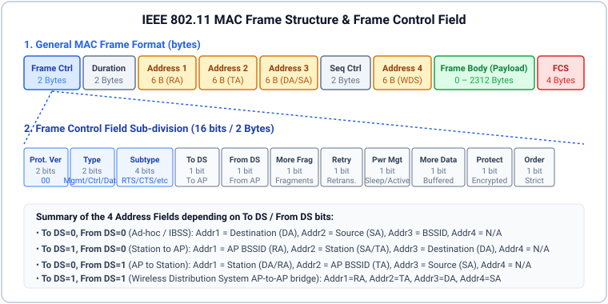
*Illustration: IEEE 802.11 MAC frame layout and 16-bit Frame Control breakdown*

- **FC (Frame Control — $2\text{ bytes}$):** Holds 11 small subfields that describe the frame:
    - *Protocol Version ($2\text{ bits}$):* Currently `0`.
    - *Type ($2\text{ bits}$):* Identifies Management (`00`), Control (`01`), or Data (`10`) frame.
    - *Subtype ($4\text{ bits}$):* Specifies exact control frame (`1011` = RTS, `1100` = CTS, `1101` = ACK).
    - *To DS ($1\text{ bit}$) & From DS ($1\text{ bit}$):* Tell whether the frame is going to or coming from the Distribution System (backbone), which controls what Addresses 1–4 mean.
    - *More Frag ($1\text{ bit}$):* Set to `1` if a large frame was chopped into smaller fragments and more fragments follow.
    - *Retry ($1\text{ bit}$):* Set to `1` if this is a retransmitted frame.
    - *Pwr Mgt ($1\text{ bit}$):* Set to `1` if the station is entering power-saving sleep mode.
    - *More Data ($1\text{ bit}$):* Set to `1` to tell a sleeping station that more buffered data is waiting for it.
    - *WEP ($1\text{ bit}$) & Rsvd ($1\text{ bit}$):* `WEP` = `1` means encryption is turned on; `Rsvd` is reserved.
- **D (Duration — $2\text{ bytes}$):** Tells other stations how long this transmission will occupy the air so they can set their **NAV** timer.
- **Addresses 1, 2, 3, and 4 ($6\text{ bytes}$ each):** Hold $48\text{-bit}$ MAC addresses of stations or Access Points (APs).
- **SC (Sequence Control — $2\text{ bytes}$):** First $4\text{ bits}$ give the **Fragment Number**; last $12\text{ bits}$ give the **Sequence Number** (used to reassemble fragmented frames and detect duplicate frames).
- **Frame Body ($0\text{ to }2312\text{ bytes}$):** The payload carrying upper-layer data.
- **FCS (Frame Check Sequence — $4\text{ bytes}$):** Contains a **CRC-32** error-detection code.

**(b) The 4-Address Mechanism (`To DS` and `From DS`)**
Why does an 802.11 frame have **four** MAC address slots when wired Ethernet only has two (Source and Destination)? Because in wireless networks, frames often hop through intermediate **Access Points (APs)** connected to a **Distribution System (DS)**.

**Golden Rule to Memorize:**

- **Address 1** is ALWAYS the **next immediate device** that will receive the wireless frame right now.
- **Address 2** is ALWAYS the **previous device** that just transmitted the wireless frame into the air.
- **Address 3** holds whichever end-station address (Final Destination or Original Source) was left out of Address 1 and 2 (or the `BSS ID` in ad-hoc mode).
- **Address 4** is only used when the backbone Distribution System itself is wireless (AP-to-AP).

| Case | `To DS` | `From DS` | Scenario Explained Simply | Address 1 (Immediate Receiver) | Address 2 (Immediate Sender) | Address 3 | Address 4 |
| :--- | :---: | :---: | :--- | :--- | :--- | :--- | :--- |
| **Case 1** | `0` | `0` | **Ad-hoc (Within one BSS):** Station A sends directly to Station B without using any AP or DS. | Destination Station (B) | Source Station (A) | `BSS ID` | Not Used (`N/A`) |
| **Case 2** | `0` | `1` | **From AP to Station:** Frame comes out of the wired DS through an AP to a wireless Station B. | Destination Station (B) | Sending AP | Original Source (A) | Not Used (`N/A`) |
| **Case 3** | `1` | `0` | **From Station to AP:** Wireless Station A sends a frame to its AP to enter the wired DS. | Receiving AP | Source Station (A) | Final Destination (B) | Not Used (`N/A`) |
| **Case 4** | `1` | `1` | **Wireless DS (AP-to-AP):** AP 1 forwards a frame wirelessly to AP 2 across a wireless bridge. | Receiving AP (AP 2) | Sending AP (AP 1) | Final Destination (B) | Original Source (A) |

## Q12. (a) Explain how the TCP Sliding Window manages flow control using Sender and Receiver buffers (including Sliding, Expanding, and Shrinking). (b) Explain Congestion Control (Slow Start, Additive Increase, and Multiplicative Decrease) with a neat graph. <small>(10 marks · Mid Sem · Module 2)</small>

*Module 2 — OSI Model (Data-Link & Network Layer; Congestion Control & Sliding Window)*

**(a) TCP Sliding Window (Byte-Oriented Flow Control)**
Suppose a fast computer sends data to a slow computer. If the sender floods the receiver faster than the receiving application can read the bytes, the receiver's memory buffer overflows and drops data. TCP prevents this using a **byte-oriented Sliding Window**:

1. **Receiver Buffer & Receiver Window ($rwnd$):** The receiver has a circular memory buffer. Part of it is occupied by bytes waiting to be read by the application, and the rest is **empty space**. The number of empty bytes available right now is advertised back to the sender in the TCP header's `Window Size` field (called the **Receiver Window**).
2. **Sender Buffer & Sender Window:** The sender's buffer holds three types of bytes:
    - *Bytes already sent and acknowledged* (can be recycled/deleted).
    - *Bytes sent, but not yet acknowledged* (must be kept in case retransmission is needed).
    - *Bytes waiting in the buffer that can be sent immediately*.
    The **Sender Window** is a sliding box covering the bytes the sender is allowed to have "in flight" + "ready to send." Its total width is set equal to the **Receiver Window size** (or smaller if the network is congested).

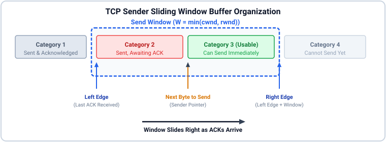
*Illustration: Sender buffer sliding window states and category boundaries*

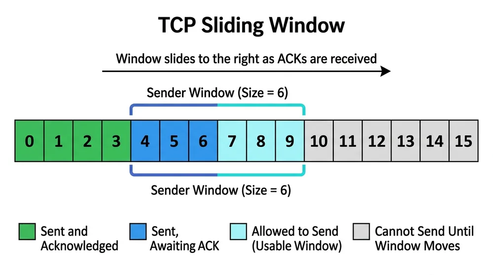{ loading=lazy }
*Illustration: Byte sequence stream and dynamic sender window sliding*

3. **Three Movements of the Sender Window:**
    - **Sliding the Window (Moves Right):** When the receiver sends an `ACK` confirming it got bytes `200`, `201`, and `202`, the **left wall** of the sender window moves right by $3\text{ bytes}$ (and if the window size stays the same, the right wall also shifts right by $3\text{ bytes}$, allowing bytes `209–211` to be sent).
    - **Expanding the Window (Right Wall Moves Right):** If the receiving application reads a lot of data and frees up extra buffer space, it announces a *larger* window size, so the sender's **right wall stretches to the right**.
    - **Shrinking the Window (Right Wall Moves Left):** If the receiver reduces the advertised window size, the sender's **right wall pulls to the left** (strongly discouraged in practice so already-sent bytes aren't invalidated).

**(b) Congestion Control (Slow Start, Additive Increase, Multiplicative Decrease)**
While flow control protects the *receiver*, **Congestion Control** protects the *intermediate network routers* from getting overloaded. TCP assumes that whenever a segment time-out occurs, a router queue overflowed due to **network congestion**. To avoid making congestion worse, TCP controls its **Congestion Window ($cwnd$)** using three strategies:

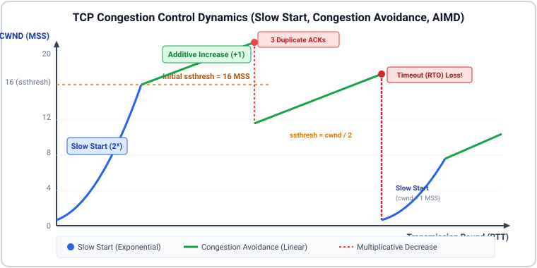
*Illustration: TCP CWND vs. Transmission Round showing Slow Start, Congestion Avoidance (AIMD), and Multiplicative Decrease*

1. **Slow Start (Exponential Increase):** When a connection begins, TCP does not know how much traffic the network can handle. It starts safely with a Congestion Window of **$1\text{ segment}$** and **doubles** the window size every time segments are acknowledged ($1 \rightarrow 2 \rightarrow 4 \rightarrow 8 \rightarrow 16$) until it hits a preset safety ceiling called the **Threshold** (e.g., $16\text{ segments}$).
2. **Additive Increase (Linear Growth):** Once the window reaches the Threshold ($16$), doubling is too risky. TCP switches to **Additive Increase**, growing the window slowly in a straight line (e.g., adding $1$ or $2$ segments per step: $16 \rightarrow 18 \rightarrow 20$) to gently probe for maximum capacity.
3. **Multiplicative Decrease (When Time-Out Happens):** Suppose a segment is lost (Time-out) when the congestion window is at **$20\text{ segments}$**. TCP immediately:
    - Cuts the **Threshold in half**: $\text{New Threshold} = \frac{20}{2} = \mathbf{10\text{ segments}}$.
    - Drops the **Congestion Window all the way back to $1\text{ segment}$**.
    - Starts **Slow Start** again ($1 \rightarrow 2 \rightarrow 4 \rightarrow 8 \rightarrow 10$), and switches to **Additive Increase** once it hits the new threshold of $10$.

## Q13. Explain Bluetooth (IEEE 802.15) L2CAP Segmentation & Reassembly and the Baseband Layer Frame Format (1-slot, 3-slot, and 5-slot payloads). <small>(5 marks · Mid Sem · Module 2)</small>

*Module 2 — OSI Model (Data-Link & Network Layer; Congestion Control & Sliding Window)*

- **Why Segmentation & Reassembly is Needed in Bluetooth (L2CAP Layer):**
    - In Bluetooth, the **L2CAP (Logical Link Control and Adaptation Protocol)** layer sits right above the Baseband (MAC) layer.
    - Upper application layers (like IP) can hand down huge data packets up to **$65,535\text{ bytes}$** long. The L2CAP packet wraps this with a $2\text{-byte}$ `Length` field and a $2\text{-byte}$ `Channel ID (CID)`.
    - However, a Bluetooth Baseband radio frame can carry a maximum payload of only **$2,774\text{ bits}$ ($343\text{ bytes}$)**. Because $4\text{ bytes}$ are used for packet headers/length, only **$339\text{ bytes}$** of upper-layer packet can fit inside a single baseband frame.
    - Therefore, **L2CAP segments (chops)** large packets (up to $65,535\text{ bytes}$) into $339\text{-byte}$ chunks at the sender, tags their positions, and **reassembles** them back into the original packet at the receiver.

- **Bluetooth Baseband Frame Format & Slot Payload Math:**
  Bluetooth uses TDD-TDMA where each frequency-hopping time slot lasts **$625\ \mu\text{s}$** (at $1\text{ Mbps}$, $1\ \mu\text{s} = 1\text{ bit}$). Turning the radio to hop to a new frequency takes **$259\ \mu\text{s}$** ($259\text{ bits}$ of dead time):
    - **1-Slot Frame:** Total time $= 625 - 259 = \mathbf{366\text{ bits}}$. Subtracting $126\text{ bits}$ of Access Code + Header leaves **$N = 240\text{ bits}$** of Payload.
    - **3-Slot Frame:** Stays on the same frequency for $3\text{ slots}$: Total $= (3 \times 625) - 259 = \mathbf{1616\text{ bits}}$ $\rightarrow$ Payload **$N = 1490\text{ bits}$**.
    - **5-Slot Frame:** Stays on the same frequency for $5\text{ slots}$: Total $= (5 \times 625) - 259 = \mathbf{2866\text{ bits}}$ $\rightarrow$ Payload **$N = 2740\text{ bits}$**.

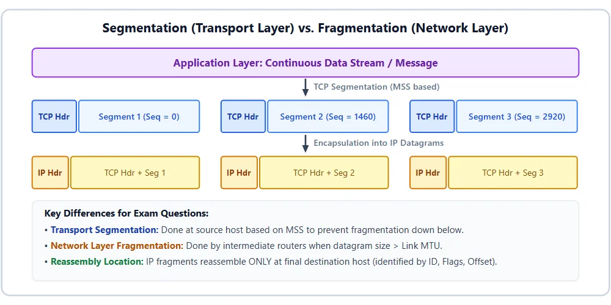{ loading=lazy }
*Illustration: L2CAP segmentation into Bluetooth Baseband time slots*

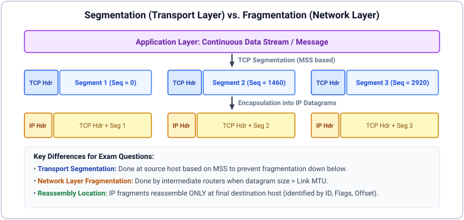
*Illustration: Transport layer segmentation vs. Network layer IP fragmentation*

- **Access Code ($72\text{ bits}$):** Synchronizes clocks and identifies the Primary of the piconet.
- **Header ($54\text{ bits}$):** An $18\text{-bit}$ pattern **repeated 3 times** so the receiver can compare all 3 copies bit-by-bit (majority rule forward error correction). Contains: `Address` ($3\text{ bits}$ for secondaries $1\text{ to }7$, or `0` for broadcast), `Type` ($4\text{ bits}$), `F` ($1\text{-bit}$ flow control buffer-full flag), `A` ($1\text{-bit}$ Stop-and-Wait ACK), `S` ($1\text{-bit}$ Sequence number), and `HEC` ($8\text{-bit}$ Header Error Checksum).

## Q14. Explain how a Transparent Learning Switch builds its table, why redundant switches cause a Loop Problem, and how the Spanning Tree Algorithm (IEEE 802.1d) prevents loops. <small>(5 marks · Mid Sem · Module 2)</small>

*Module 2 — OSI Model (Data-Link & Network Layer; Congestion Control & Sliding Window)*

- **How a Learning Switch Builds Its Table Automatically:**
  When a link-layer switch is first turned on, its switching table is completely empty. Suppose Station A (on Port $1$) sends a frame to Station D (on Port $4$):
    1. **Inspect Source MAC (Learning):** The switch reads the **Source MAC address (A)** arriving on Port $1$ and writes `Station A -> Port 1` into its table. Now it knows where A lives for all future frames!
    2. **Inspect Destination MAC (Filtering/Flooding):** Because the switch does not yet have an entry for **Destination D**, it **floods** (broadcasts) the frame out of all other ports ($2, 3, 4$).
    3. When Station D replies to A, the switch reads **Source MAC (D)** on Port $4$, records `Station D -> Port 4`, and sends the frame **only** out of Port $1$ (filtering).

- **The Loop Problem with Redundant Switches:**
  To prevent a single switch failure from breaking the network, admins connect two LANs using **two switches in parallel**. If Station A on `LAN 1` sends a frame to an unknown Station D on `LAN 2`:
    - Both Switch 1 and Switch 2 flood the frame onto `LAN 2`, creating **two copies** on `LAN 2`.
    - Switch 1 sees Switch 2's copy on `LAN 2` (and vice versa), still doesn't know where D is, regenerates the frame, and floods it *back* onto `LAN 1`. The copies bounce back and forth forever, crashing the network!

- **How Spanning Tree Algorithm (IEEE 802.1d) Solves It:**
  Switches run the Spanning Tree software to create a loop-free logical tree in 4 steps:
    1. **Select Root Switch:** Every switch broadcasts its unique built-in ID; the switch with the **smallest ID** is elected the **Root Switch**.
    2. **Calculate Shortest Paths:** Every switch calculates the shortest path (lowest hop cost) from the Root Switch to every other switch and LAN using Dijkstra's algorithm.
    3. **Form the Spanning Tree:** The shortest paths combine to form a single tree where there is **only one path** between any two LANs.
    4. **Set Forwarding & Blocking Ports:** Ports that lie on the spanning tree are marked as **Forwarding Ports** (pass traffic normally). Redundant ports that are *not* part of the tree are marked as **Blocking Ports** (disabled from forwarding frames unless a primary switch fails).

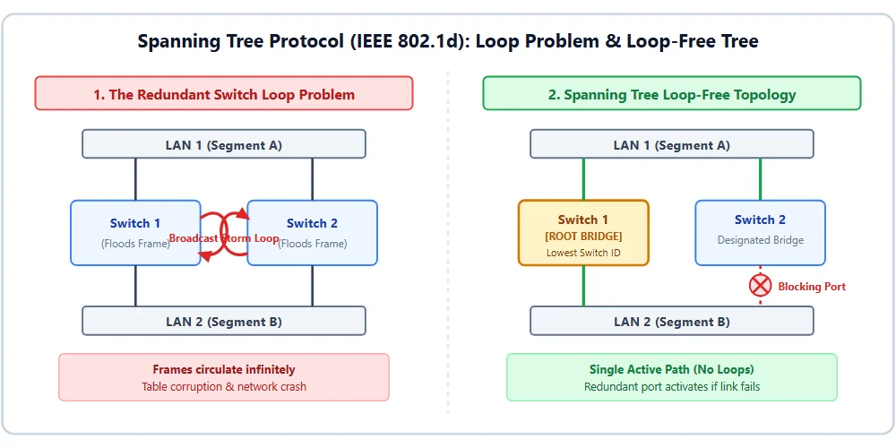{ loading=lazy }
*Illustration: Switch broadcast storm loop problem and Spanning Tree blocking port resolution*

## Q15. Compare a Hub, a Link-Layer Switch, and a Router in terms of OSI layers and MAC addresses. <small>(2 marks · Mid Sem · Module 2)</small>

*Module 2 — OSI Model (Data-Link & Network Layer; Congestion Control & Sliding Window)*

- **Hub (Repeater):** Operates at **Layer 1 (Physical)**. Has no MAC address, does not read MAC addresses, and blindly broadcasts signals out of all ports.
- **Link-Layer Switch:** Operates at **Layers 1 & 2 (Physical + Data-Link)**. Reads source and destination MAC addresses to filter frames, and **never changes** the MAC addresses inside the frame.
- **Router:** Operates at **Layers 1, 2 & 3 (Physical + Data-Link + Network)**. Has its own IP and MAC address on each interface, and **rewrites (changes) both the Source and Destination MAC addresses** when forwarding a packet to the next hop.

## Q16. Differentiate between SCO and ACL links in Bluetooth. <small>(2 marks · Mid Sem · Module 2)</small>

*Module 2 — OSI Model (Data-Link & Network Layer; Congestion Control & Sliding Window)*

- **SCO (Synchronous Connection-Oriented):** Used for real-time voice/audio ($64\text{ kbps}$) where low delay is more important than errors. Reserves fixed slots, bypasses L2CAP, and **never retransmits** damaged frames.
- **ACL (Asynchronous Connectionless Link):** Used for data transfer (up to $721\text{ kbps}$) where accuracy is critical. Uses L2CAP and **retransmits** corrupted frames.

## Q17. What are the three criteria of a Transparent Switch under IEEE 802.1d? <small>(2 marks · Mid Sem · Module 2)</small>

*Module 2 — OSI Model (Data-Link & Network Layer; Congestion Control & Sliding Window)*

A transparent switch is invisible to end stations (stations need no reconfiguration when a switch is added) and must: (1) **Forward** frames between stations, (2) Automatically **learn** its forwarding table from source MAC movements, and (3) Prevent **loops** using Spanning Tree.

## Q18. What is the difference between a Piconet and a Scatternet in Bluetooth? <small>(2 marks · Mid Sem · Module 2)</small>

*Module 2 — OSI Model (Data-Link & Network Layer; Congestion Control & Sliding Window)*

- **Piconet:** A single Bluetooth network with $1\text{ Primary}$ station and up to $7\text{ active Secondary}$ stations (maximum $8\text{ active nodes}$; extra nodes remain in a *parked* state).
- **Scatternet:** Two or more piconets linked together when a secondary station in one piconet acts as the primary station in another piconet.

## Q19. What is Silly Window Syndrome in TCP? <small>(2 marks · Mid Sem · Module 2)</small>

*Module 2 — OSI Model (Data-Link & Network Layer; Congestion Control & Sliding Window)*

It is a performance problem in TCP Sliding Window where either the sender transmits tiny segments (e.g., $1\text{ byte}$ of data inside a $40\text{-byte}$ TCP+IP header) or the slow receiver reads $1\text{ byte}$ at a time and advertises a tiny $1\text{-byte}$ window, wasting almost all network bandwidth on headers.

## Q20. (a) Draw and explain the TCP Segment Header format and its 6 Control Flags. (b) Explain the Pseudoheader used in TCP Checksum calculation. (c) Solve: A TCP connection transfers a file of 6,000 bytes. The first byte is numbered 10,010. What are the sequence numbers for each segment if data is sent in 5 segments (the first four carry 1,000 bytes each, and the last carries 2,000 bytes)? <small>(10 marks · Mid Sem · Module 3)</small>

*Module 3 — TCP/IP (TCP Packet Format, IP Addressing, Subnetting, CIDR & Tunneling)*

**(a) TCP Segment Header Format & Control Flags**
TCP wraps application data into **segments**. The standard TCP header is $20\text{ bytes}$ long (and can grow up to $60\text{ bytes}$ with Options):

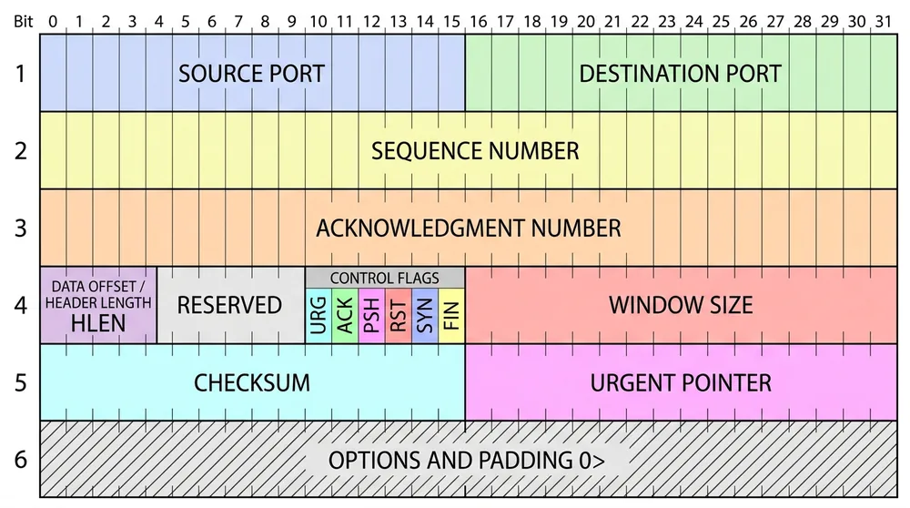{ loading=lazy }
*Illustration: Complete 32-bit word alignment of TCP segment header and flags*

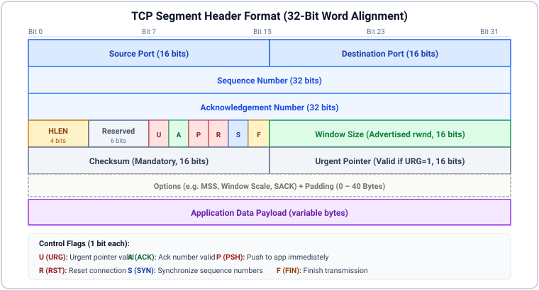
*Illustration: 32-bit aligned TCP segment header format and 6 control flags*

- **Source Port ($16\text{ bits}$) & Destination Port ($16\text{ bits}$):** Identify the sending and receiving application processes (e.g., Port $23$ for Telnet Server).
- **Sequence Number ($32\text{ bits}$):** Holds the byte number of the **first byte of data** carried inside this segment. (During connection setup, the initial sequence number is generated randomly).
- **Acknowledgment Number ($32\text{ bits}$):** Holds the byte number of the **very next byte** the receiver expects to receive. It is **cumulative** (saying `ACK 1601` means every byte up to `1600` has been safely received).
- **HLEN ($4\text{ bits}$):** Header Length in $4\text{-byte}$ words (between $5$ and $15$, meaning $20\text{ to }60\text{ bytes}$).
- **Reserved ($6\text{ bits}$):** Reserved for future use.
- **Control Field ($6\text{ bits}$ — The 6 Flags):**
    1. `URG`: Urgent pointer is valid (segment contains high-priority urgent data).
    2. `ACK`: Acknowledgment number field is valid.
    3. `PSH`: Request for push (deliver data to the application immediately without waiting for the buffer to fill).
    4. `RST`: Reset the connection (aborts an abnormal or refused connection).
    5. `SYN`: Synchronize sequence numbers (used during 3-way handshake connection setup).
    6. `FIN`: Terminate the connection (sender has finished sending data).
- **Window Size ($16\text{ bits}$):** Tells the other side how many bytes of free receiver buffer space are available for flow control (up to $65,535\text{ bytes}$, or larger if the *Window Scale Factor* option is used).
- **Checksum ($16\text{ bits}$) & Urgent Pointer ($16\text{ bits}$):** Checksum detects errors across header and data; Urgent Pointer adds to the sequence number to mark the end of urgent data.
- **Options ($0\text{ to }40\text{ bytes}$):** Includes single-byte options (`End of option`, `No operation` for padding/alignment) and multiple-byte options (`Maximum Segment Size (MSS)`, `Window Scale Factor`, `Timestamp`).

**(b) Pseudoheader in TCP Checksum Calculation**
To verify that a TCP segment was not only undamaged in transit but also delivered to the **correct IP address and transport protocol**, TCP temporarily attaches a $12\text{-byte}$ **Pseudoheader** (borrowed from the IPv4 header) before computing the $16\text{-bit}$ Checksum:

- $32\text{-bit}$ Source IP Address
- $32\text{-bit}$ Destination IP Address
- $8\text{ bits}$ of All Zeros (`00000000`)
- $8\text{-bit}$ Protocol Number (`6` for TCP)
- $16\text{-bit}$ TCP Total Length ($\text{Header} + \text{Data}$)

**(c) Step-by-Step Numerical Solution**

- First byte number $= 10,010$. Total bytes $= 6,000$.
- **Rule:** A segment's Sequence Number is the number of its **first byte**, and if a segment starts at byte $X$ and carries $L\text{ bytes}$, its last byte is $X + L - 1$, and the next segment starts at $X + L$:
    - **Segment 1 ($1,000\text{ bytes}$):** Sequence Number $= \mathbf{10,010}$ (carries bytes $10,010\text{ to }11,009$).
    - **Segment 2 ($1,000\text{ bytes}$):** Sequence Number $= 10,010 + 1,000 = \mathbf{11,010}$ (carries bytes $11,010\text{ to }12,009$).
    - **Segment 3 ($1,000\text{ bytes}$):** Sequence Number $= 11,010 + 1,000 = \mathbf{12,010}$ (carries bytes $12,010\text{ to }13,009$).
    - **Segment 4 ($1,000\text{ bytes}$):** Sequence Number $= 12,010 + 1,000 = \mathbf{13,010}$ (carries bytes $13,010\text{ to }14,009$).
    - **Segment 5 ($2,000\text{ bytes}$):** Sequence Number $= 13,010 + 1,000 = \mathbf{14,010}$ (carries bytes $14,010\text{ to }16,009$).

## Q21. Explain IPv4 Addressing, CIDR (Classless Inter-Domain Routing), and Subnetting from scratch. Then solve two complete Subnetting Examples: <small>(10 marks · Mid Sem · Module 3)</small>

*Module 3 — TCP/IP (TCP Packet Format, IP Addressing, Subnetting, CIDR & Tunneling)*

- **Example A (Equal Subnets):** An organization is given the IPv4 block `192.168.10.0/24` and needs to divide it into **4 equal subnets**. Find the new CIDR prefix, subnet mask, total addresses per subnet, usable hosts per subnet, and the Network ID, Broadcast ID, and Usable Host Range for all 4 subnets.
- **Example B (Finding Details of a Given CIDR IP):** A host has the IP address `172.16.45.140/26`. Find its Subnet Mask, Network Address, Broadcast Address, First Usable Host, Last Usable Host, and Total Usable Hosts.

### Answer

**(a) IPv4 Addressing, Subnetting, and CIDR Explained Simply**

- **IPv4 Logical Address:** Every device on the Internet gets a $32\text{-bit}$ logical IPv4 address written as 4 decimal numbers (octets of $8\text{ bits}$ each, from $0\text{ to }255$) separated by dots, like `192.168.10.1`.
- **Network Part vs. Host Part:** Every IP address is split into two pieces:
    1. **Network (Prefix) Bits ($n\text{ bits}$):** Identifies *which network/street* the computer belongs to.
    2. **Host (Suffix) Bits ($h = 32 - n\text{ bits}$):** Identifies *which specific house/computer* on that street.
- **What is CIDR (`/n` notation)?** Older "Classful" addressing forced networks into rigid sizes (Class A $=/8$, Class B $=/16$, Class C $=/24$), which wasted millions of IP addresses. **CIDR (Classless Inter-Domain Routing)** allows the boundary between Network bits and Host bits to be placed at **any bit position**, written as `/n` (for example, `/26` means the first $26\text{ bits}$ are the Network part and the remaining $32 - 26 = 6\text{ bits}$ are the Host part).
- **What is Subnetting?** Borrowing a few bits ($s\text{ bits}$) from the **Host part** and adding them to the **Network part** so one big network can be split into $2^s$ smaller sub-networks (subnets).
- **3 Golden Formulas for Any Subnet:**
    1. **Number of Host bits:** $h = 32 - \text{Prefix } (/n)$.
    2. **Total IP Addresses (Block Size) in the Subnet:** $2^h$.
    3. **Total Usable Host IPs:** $2^h - 2$ (because the **very first address** where all host bits are `0` is reserved as the **Network ID**, and the **very last address** where all host bits are `1` is reserved as the **Broadcast Address**).

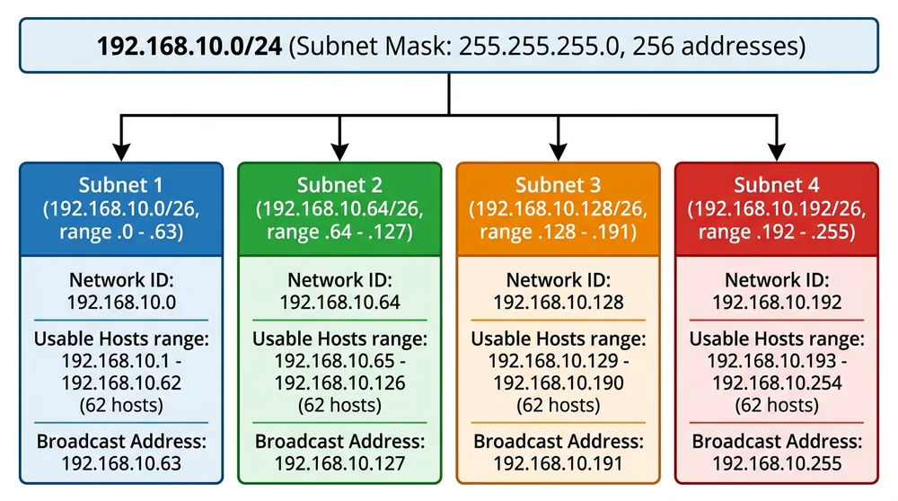{ loading=lazy }
*Illustration: Partitioning /24 address block into 4 equal /26 subnets with usable host ranges*

**(b) Solution to Subnetting Example A (`192.168.10.0/24` into 4 Subnets)**

- **Step 1 — How many bits to borrow ($s$)?**
  To create $4\text{ subnets}$, we solve $2^s = 4 \implies \mathbf{s = 2\text{ bits}}$ borrowed from the host part.
- **Step 2 — New CIDR Prefix & Subnet Mask:**
    - Old prefix $= /24$. New prefix $= 24 + 2 = \mathbf{/26}$.
    - In binary, `/26` means twenty-six `1`s followed by six `0`s: `11111111.11111111.11111111.11000000`.
    - Since the last octet `11000000` in binary equals $128 + 64 = 192$, the **New Subnet Mask is `255.255.255.192`**.
- **Step 3 — Block Size (Addresses per Subnet) & Usable Hosts:**
    - Remaining host bits: $h = 32 - 26 = 6\text{ bits}$.
    - **Total IPs per subnet (Block Size):** $2^6 = \mathbf{64\text{ addresses}}$ (so each subnet jumps by $+64$ in the last octet: $0, 64, 128, 192$).
    - **Usable Hosts per subnet:** $2^6 - 2 = 64 - 2 = \mathbf{62\text{ usable hosts}}$.
- **Step 4 — Table of All 4 Subnets:**

| Subnet # | Network ID (First IP) | Usable Host IP Range (First $+1$ to Last $-1$) | Broadcast Address (Next Subnet $-1$) |
| :--- | :--- | :--- | :--- |
| **Subnet 1** | `192.168.10.0/26` | `192.168.10.1` to `192.168.10.62` | `192.168.10.63` |
| **Subnet 2** | `192.168.10.64/26` | `192.168.10.65` to `192.168.10.126` | `192.168.10.127` |
| **Subnet 3** | `192.168.10.128/26` | `192.168.10.129` to `192.168.10.190` | `192.168.10.191` |
| **Subnet 4** | `192.168.10.192/26` | `192.168.10.193` to `192.168.10.254` | `192.168.10.255` |

**(c) Solution to Subnetting Example B (Host `172.16.45.140/26`)**

- **1. Subnet Mask:** Prefix is `/26`, so $26\text{ ones}$ and $6\text{ zeros}$ $\rightarrow$ **`255.255.255.192`**.
- **2. Block Size:** Host bits $h = 32 - 26 = 6 \implies \text{Block size} = 2^6 = \mathbf{64}$.
- **3. Find Which Multiple of 64 Contains `.140`:**
  The multiples of $64$ in the fourth octet are: $0, 64, \mathbf{128}, \mathbf{192}$. Since $140$ sits between $128$ and $191$:
    - **Network Address:** **`172.16.45.128/26`**
    - **Broadcast Address:** One less than the next block ($192 - 1 = 191$) $\rightarrow$ **`172.16.45.191`**
    - **First Usable Host:** $\text{Network ID} + 1 \rightarrow$ **`172.16.45.129`**
    - **Last Usable Host:** $\text{Broadcast ID} - 1 \rightarrow$ **`172.16.45.190`**
    - **Total Usable Hosts:** $2^6 - 2 = \mathbf{62\text{ hosts}}$.

## Q22. Explain TCP Connection Establishment (3-Way Handshaking), Connection Termination (4-Way Handshaking), and Error Recovery (Lost Segment vs. Lost ACK). <small>(5 marks · Mid Sem · Module 3)</small>

*Module 3 — TCP/IP (TCP Packet Format, IP Addressing, Subnetting, CIDR & Tunneling)*

- **1. Three-Way Handshaking (Connection Setup):**
  Before sending data, client and server synchronize their starting sequence numbers using 3 segments:
    1. **`SYN` (Client $\rightarrow$ Server):** Client sends a segment with the `SYN` flag set and its starting sequence number (e.g., `seq: 1200`).
    2. **`SYN + ACK` (Server $\rightarrow$ Client):** Server replies with both `SYN` and `ACK` flags set, announcing its own starting sequence number (`seq: 4800`) and acknowledging the client's `SYN` by adding $1$ (`ack: 1201`).
    3. **`ACK` (Client $\rightarrow$ Server):** Client acknowledges the server's `SYN` by sending `seq: 1201, ack: 4801`. Both enter the `ESTABLISHED` state.

- **2. Four-Way Handshaking (Connection Termination):**
  Because TCP connections are full-duplex (two one-way pipes), each direction must be closed separately:
    1. **`FIN` (Sender $\rightarrow$ Receiver):** Sender finishes sending and transmits `FIN` (`seq: 2500`).
    2. **`ACK` (Receiver $\rightarrow$ Sender):** Receiver acknowledges (`seq: 7000, ack: 2501`).
    3. **`FIN` (Receiver $\rightarrow$ Sender):** Once the receiver finishes sending its remaining data, it sends its own `FIN` (`seq: 7001, ack: 2501`).
    4. **`ACK` (Sender $\rightarrow$ Receiver):** Original sender replies with `ACK` (`seq: 2501, ack: 7002`), closing the connection completely.

- **3. Error Control (Lost Segment vs. Lost Acknowledgment):**
    - **Lost (or Corrupted) Segment:** Sender transmits Segment 1 (`seq: 1201`, $200\text{B}$), Segment 2 (`seq: 1401`, $200\text{B}$), and Segment 3 (`seq: 1601`, $200\text{B}$). Receiver gets 1 and 2 (sends `ack: 1601`), but Segment 3 is lost or corrupted. The sender's **Retransmission Timer** expires (**Time-out**), so the sender resends Segment 3 (`seq: 1601`), and the receiver replies `ack: 1801`.
    - **Lost Acknowledgment:** Suppose `ack: 1601` gets lost in transit, but Segment 3 (`seq: 1601`, $200\text{B}$) reaches the receiver and triggers `ack: 1801`. Because TCP ACKs are **cumulative**, receiving `ack: 1801` before the timer expires tells the sender that all bytes up to `1800` arrived safely—so nothing needs to be resent!

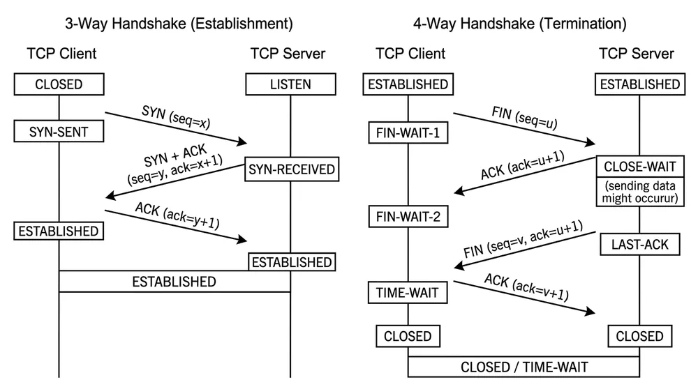{ loading=lazy }
*Illustration: TCP connection establishment (3-Way) and connection termination (4-Way) lifelines*

## Q23. Differentiate between Logical Address (IP) and Physical Address (MAC), and explain how Virtual Tunneling works at the Network Layer. <small>(5 marks · Mid Sem · Module 3)</small>

*Module 3 — TCP/IP (TCP Packet Format, IP Addressing, Subnetting, CIDR & Tunneling)*

- **Logical Address (IP) vs. Physical Address (MAC):**

| Feature | Physical Address (MAC Address) | Logical Address (IP Address) |
| :--- | :--- | :--- |
| **OSI Layer & Size** | **Data-Link Layer (Layer 2)**; $48\text{-bit}$ ($6\text{-byte}$) hexadecimal address burned into the NIC (e.g., `71:2B:13:45:61:42`). | **Network Layer (Layer 3)**; $32\text{-bit}$ (IPv4) or $128\text{-bit}$ (IPv6) address assigned by software/DHCP (e.g., `181.34.23.67`). |
| **Scope / Jurisdiction** | **Local to a single LAN only.** Used by switches to deliver frames from one hop to the next on the same LAN. | **Global across the Internet.** Used by routers to guide packets from the original source network to the final destination network. |
| **Does It Change in Transit?** | **Yes!** Every router along the path strips off the old MAC addresses and puts new Source and Destination MAC addresses for the next link. | **No!** The original Source IP and final Destination IP stay the same from end to end (unless NAT or Tunneling is used). |

- **What is Virtual Tunneling (IP Encapsulation)?**
  Suppose two private branch offices (or two IPv6 islands) want to send packets to each other across the public IPv4 Internet, which cannot directly route private IPs or IPv6 packets. **Virtual Tunneling** creates a virtual point-to-point "pipe" (tunnel) through the public Internet:

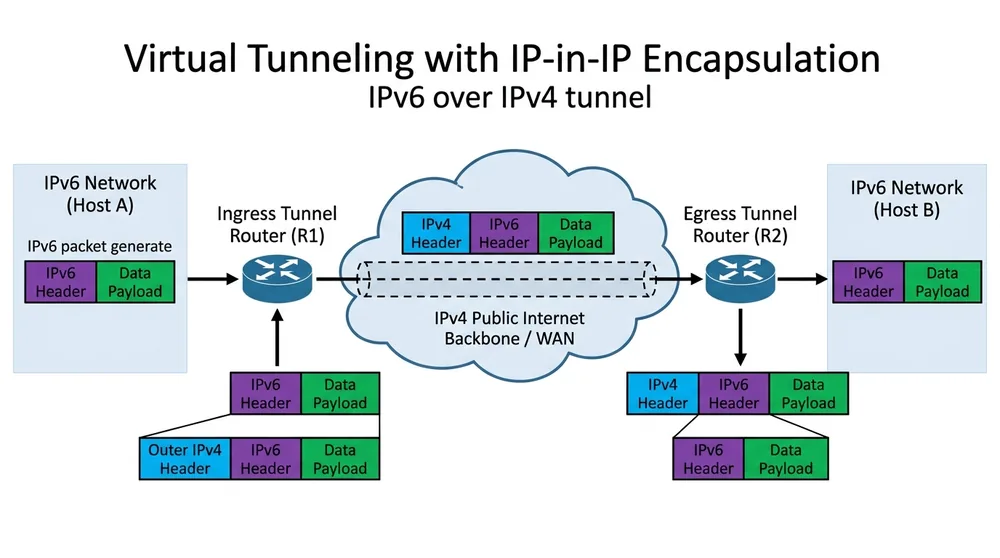{ loading=lazy }
*Illustration: IPv6 datagram encapsulated inside transit IPv4 header*

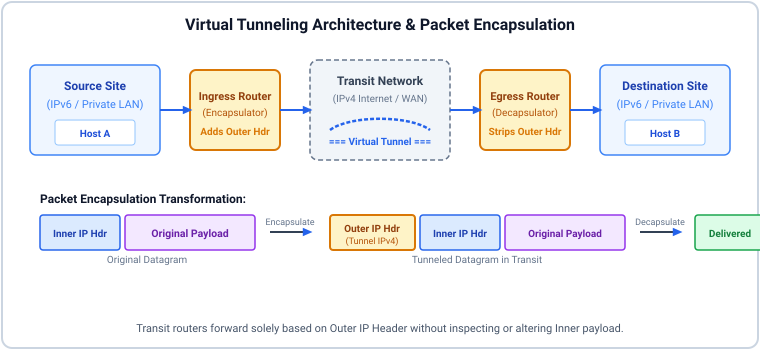
*Illustration: Packet encapsulation and decapsulation across an intermediary transit network*

1. **Encapsulation at Tunnel Entry (Router R1):** When Host A sends a private/IPv6 packet to Host B, Branch 1's border router (`R1`) does *not* throw away the original IP header. Instead, it wraps the **entire original IP packet inside the payload of a brand-new Outer Public IPv4 Header** (where `Outer Source IP = R1` and `Outer Destination IP = R2`).
2. **Transit Across the Internet:** Public Internet routers only read the **Outer IP Header** and route the packet normally from `R1` to `R2`.
3. **Decapsulation at Tunnel Exit (Router R2):** Branch 2's border router (`R2`) strips off the outer IP header, reveals the original inner packet (`Src: A -> Dst: B`), and delivers it locally to Host B.

## Q24. Name the four TCP Timers. <small>(2 marks · Mid Sem · Module 3)</small>

*Module 3 — TCP/IP (TCP Packet Format, IP Addressing, Subnetting, CIDR & Tunneling)*

1. **Retransmission Timer:** Waits for an acknowledgment after sending a segment; if it expires, the segment is retransmitted.
2. **Persistence Timer:** Prevents deadlock when the receiver advertises a zero-size window (`rwnd = 0`) and the later window-update ACK gets lost.
3. **Keepalive Timer:** Checks if an idle connection's other end is still alive or has crashed.
4. **Time-Waited Timer ($2\text{ MSL}$):** Keeps a closing connection in the `TIME-WAIT` state briefly so any delayed duplicate segments die out on the network.

## Q25. Quick Subnetting Reference Table (Memorize for 2-Mark Questions): <small>(2 marks · Mid Sem · Module 3)</small>

*Module 3 — TCP/IP (TCP Packet Format, IP Addressing, Subnetting, CIDR & Tunneling)*

| CIDR Prefix | Subnet Mask | Host Bits ($h = 32 - n$) | Block Size ($2^h$) | Usable Hosts ($2^h - 2$) |
| :---: | :--- | :---: | :---: | :---: |
| `/24` | `255.255.255.0` | $8$ | $256$ | $254$ |
| `/25` | `255.255.255.128` | $7$ | $128$ | $126$ |
| `/26` | `255.255.255.192` | $6$ | $64$ | $62$ |
| `/27` | `255.255.255.224` | $5$ | $32$ | $30$ |
| `/28` | `255.255.255.240` | $4$ | $16$ | $14$ |
| `/29` | `255.255.255.248` | $3$ | $8$ | $6$ |
| `/30` | `255.255.255.252` | $2$ | $4$ | $2$ (Point-to-point router links) |

## Q26. What are the 5 TCP Options shown in your lecture notes? <small>(2 marks · Mid Sem · Module 3)</small>

*Module 3 — TCP/IP (TCP Packet Format, IP Addressing, Subnetting, CIDR & Tunneling)*

- **Single-byte options:** (1) `End of option` (Code `0`, used for padding at the end), (2) `No operation / NO-OP` (Code `1`, used to align options to $4\text{-byte}$ boundaries).
- **Multiple-byte options:** (3) `Maximum Segment Size / MSS` (Code `2`, Length `4`), (4) `Window Scale Factor` (Code `3`, Length `3`), and (5) `Timestamp` (Code `8`, Length `10`).

## Q27. What is a Transmission Control Block (TCB) in the TCP package? <small>(2 marks · Mid Sem · Module 3)</small>

*Module 3 — TCP/IP (TCP Packet Format, IP Addressing, Subnetting, CIDR & Tunneling)*

To track multiple simultaneous connections, TCP maintains a table of **Transmission Control Blocks (TCBs)**. Each TCB stores the connection's current **State** (e.g., `ESTABLISHED`, `LISTEN`), the **Process**, a **Pointer**, and the **Buffers**.

## Q28. (a) Define DHCP and explain its 3 IP allocation mechanisms. (b) Explain the 7-packet DHCP Address Discovery sequence (DORA + ARP). (c) Draw the DHCP Frame encapsulation and explain the DHCP Header and Options fields. <small>(10 marks · Mid Sem · Module 4)</small>

*Module 4 — Application Layer Services (SMTP, POP, DNS, DHCP)*

**(a) DHCP Definition & 3 Allocation Mechanisms**
The **Dynamic Host Configuration Protocol (DHCP)** is an Application Layer protocol (running over UDP) that evolved from **BOOTP**. While BOOTP required an administrator to manually type every computer's hardware address and IP into a static server table, DHCP dynamically leases IP addresses and automatically configures a computer's **subnet mask**, **default gateway (router)**, and **DNS, time, and printer server addresses**.

DHCP supports **3 IP allocation mechanisms**:

1. **Automatic Allocation:** DHCP assigns a **permanent** IP address to a client.
2. **Dynamic Allocation:** DHCP leases an IP address to a client for a **limited time period** (a lease). When the lease expires or the client leaves, the IP is recovered and reused for new hosts.
3. **Manual Allocation:** The network administrator manually picks the IP address for a specific client MAC address, and DHCP is simply used to deliver that address to the client automatically.

**(b) The 7-Packet DHCP Address Discovery Process**
When a new computer boots up (or its lease expires), it has no IP address and uses **7 packets** ($4\text{ DHCP} + 3\text{ ARP}$) to get configured:

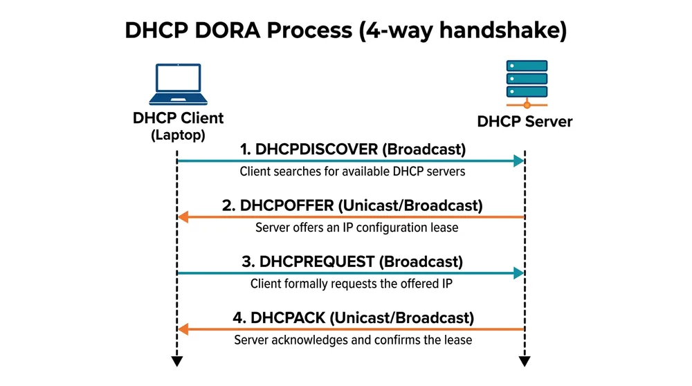{ loading=lazy }
*Illustration: DHCP 4-way DORA sequence between client and DHCP server*

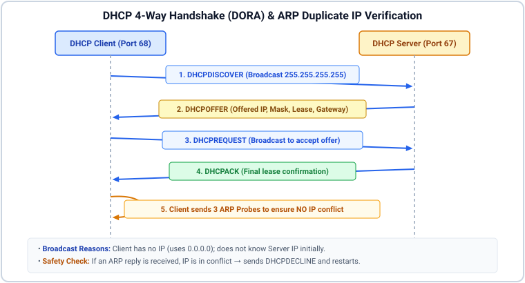
*Illustration: 4-way DORA sequence and post-lease ARP duplicate address detection*

1. **`DHCPDISCOVER` (Client $\rightarrow$ Server, Broadcast, Msg Type 1):** Because the client has no IP and doesn't know the server's address, it broadcasts a Discover packet to IP `255.255.255.255` and the MAC broadcast address. Its `Client Identifier` is based on its MAC address (and if it was on the network before, it can ask for its last preferred IP).
2. **`DHCPOFFER` (Server $\rightarrow$ Client, Unicast, Msg Type 2):** Every DHCP server that hears the Discover responds with an Offer packet containing an offered IP in the `Your IP Address` field and the server's unique **Server Identifier** in the options field.
3. **`DHCPREQUEST` (Client $\rightarrow$ Server, Broadcast, Msg Type 3):** A client might receive offers from multiple DHCP servers. It picks one and **broadcasts** a Request packet containing the chosen **Server ID**—this tells the winning server "I accept your offer" and simultaneously tells all other servers "You can take back your unused offers."
4. **`DHCPACK` (Server $\rightarrow$ Client, Unicast, Msg Type 4):** The selected server sends an Acknowledgment packet locking in the lease and delivering the requested parameters (e.g., Subnet Mask `255.255.0.0`, Default Gateway `10.0.0.1`, DNS Server `10.0.0.1`).
5. **3 ARP Packets (Client Validation):** Finally, the client sends **3 ARP packets** onto the LAN to verify that no other machine is already using the newly assigned IP address.

**(c) DHCP Frame Encapsulation & Header Structure**

- **Frame Encapsulation:** DHCP messages are carried inside **UDP** (Port 67 Server, Port 68 Client), which is inside **IPv4**, which is inside an Ethernet **MAC Frame**:

```text
|<------ Byte 1 ------>|<------ Byte 2 ------>|<------ Byte 3 ------>|<------ Byte 4 ------>|
+----------------------+----------------------+----------------------+----------------------+
|    Opcode (1B)       |  Hardware Type (1B)  | HW Addr Length (1B)  |    Hop Count (1B)    |
+----------------------+----------------------+----------------------+----------------------+
|                                   Transaction ID (4 Bytes)                                |
+---------------------------------------------+---------------------------------------------+
|           Number of Seconds (2B)            |                 Flags (2B)                  |
+---------------------------------------------+---------------------------------------------+
|                                 Client IP Address (4 Bytes)                               |
+-------------------------------------------------------------------------------------------+
|                                  Your IP Address (4 Bytes)                                |
+-------------------------------------------------------------------------------------------+
|                                 Server IP Address (4 Bytes)                               |
+-------------------------------------------------------------------------------------------+
|                                Gateway IP Address (4 Bytes)                               |
+-------------------------------------------------------------------------------------------+
|                            Client Hardware Address (16 Bytes)                             |
+-------------------------------------------------------------------------------------------+
|                                Server Host Name (64 Bytes)                                |
+-------------------------------------------------------------------------------------------+
|                                 Boot Filename (128 Bytes)                                 |
+-------------------------------------------------------------------------------------------+
|                       Data / Options Field (Variable: Magic Cookie + 53)                  |
+-------------------------------------------------------------------------------------------+
```

## Q29. (a) Explain how Email Services work end-to-end using SMTP and POP3 (Why do we need both a Push protocol and a Pull protocol?). (b) Explain how DNS (Domain Name System) translates domain names into IP addresses using Recursive and Iterative queries. <small>(10 marks · Mid Sem · Module 4)</small>

*Module 4 — Application Layer Services (SMTP, POP, DNS, DHCP)*

**(a) How Email Works End-to-End: SMTP (Push) vs. POP3 (Pull)**
Suppose Alice (`alice@gmail.com`) sends an email from her laptop to Bob (`bob@yahoo.com`). Because Bob's laptop might be turned off when Alice hits "Send", Alice's laptop cannot deliver the email directly to Bob's laptop. Instead, email uses three components—**User Agents (UA)** (email apps like Outlook/Gmail), **Mail Transfer Agents (MTA)** (always-on mail servers), and **Message Access Agents (MAA)**—across two protocols:

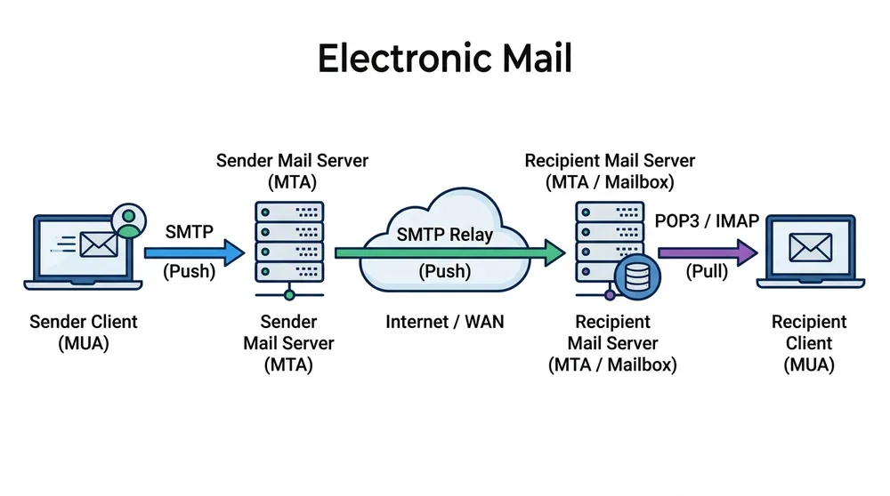{ loading=lazy }
*Illustration: End-to-end email transfer from Sender UA through MTAs to Receiver UA*

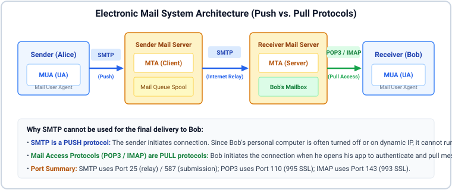
*Illustration: End-to-end email message flow: SMTP push vs. POP3/IMAP pull retrieval*

1. **Step 1 — Alice to Her Mail Server (Uses SMTP):** Alice writes the email in her User Agent (UA). Her laptop uses **SMTP (Simple Mail Transfer Protocol)** over **TCP Port 25** to **push** the email to her own provider's Mail Server (`gmail.com`).
2. **Step 2 — Alice's Mail Server to Bob's Mail Server (Uses SMTP):** Alice's mail server acts as an SMTP client and **pushes** the email across the Internet to Bob's always-on Mail Server (`yahoo.com`), which stores the email in Bob's mailbox queue.
3. **Step 3 — Bob Retrieves His Email (Uses POP3):** Why can't SMTP be used for this last step? Because **SMTP is a Push protocol**—to receive a push, Bob's personal laptop would have to stay powered on $24/7$ running an SMTP server! Instead, when Bob opens his laptop later, he uses a **Pull protocol** called **POP3 (Post Office Protocol v3, TCP Port 110)** to connect to his mail server, authenticate with his username/password, and **pull (download)** his waiting emails.
    - *POP3 Two Modes:* **Delete Mode** (the email is deleted from the server as soon as Bob downloads it to his laptop) and **Keep Mode** (the email stays on the server after downloading so he can check it again later).

| Feature | SMTP (Simple Mail Transfer Protocol) | POP3 (Post Office Protocol v3) |
| :--- | :--- | :--- |
| **Direction / Type** | **Push Protocol** (used to *send/forward* mail). | **Pull Protocol** (used by recipient to *retrieve/download* mail). |
| **Where It Is Used** | (1) Sender's PC $\rightarrow$ Sender's Mail Server, AND (2) Sender's Mail Server $\rightarrow$ Receiver's Mail Server. | Between the **Receiver's Mail Server** and the **Receiver's PC**. |
| **Transport & Port** | Runs over **TCP** (Port $25$ / $587$). | Runs over **TCP** (Port $110$). |

**(b) How DNS (Domain Name System) Works**
Humans remember website names like `www.google.com`, but routers only understand IP addresses like `142.250.190.46`. **DNS** is a distributed, hierarchical phonebook that automatically translates human-friendly **Domain Names into IP Addresses** (and vice versa).

**1. The 3-Level Hierarchy of DNS Name Servers:**
No single server holds every domain name in the world. Instead, DNS splits names into a tree of servers read from right to left (`www.amazon.com.`):

- **Root Name Servers ($13\text{ logical root clusters}$):** Sit at the top of the tree; they know the IP addresses of all Top-Level Domain (TLD) servers.
- **Top-Level Domain (TLD) Servers:** Manage top-level extensions like `.com`, `.org`, `.edu`, and country codes like `.in`, `.uk`. They know the Authoritative server for each domain bought under them.
- **Authoritative Name Servers:** Owned by the specific organization/company (e.g., `amazon.com`'s own DNS server) that holds the final, official IP address for `www.amazon.com`.

**2. Recursive vs. Iterative DNS Queries (Step-by-Step Resolution):**
When you type `www.example.com` into your browser:

- **Recursive Query (Your Laptop $\rightarrow$ Local ISP DNS Resolver):** Your laptop sends **1 query** to your Local DNS Server asking, *"Find me the final IP address of `www.example.com`—do all the work and just give me the final answer."*
- **Iterative Queries (Local DNS Resolver $\rightarrow$ Root $\rightarrow$ TLD $\rightarrow$ Authoritative):** If the Local DNS Server doesn't have the answer cached, it asks the hierarchy step-by-step, where each server replies with a referral (*"I don't know the final IP, but go ask this next server"*):
    1. Local DNS asks **Root Server** $\rightarrow$ Root replies: *"Ask the `.com` TLD Server at IP $X$."*
    2. Local DNS asks **`.com` TLD Server** $\rightarrow$ TLD replies: *"Ask `example.com`'s Authoritative Server at IP $Y$."*
    3. Local DNS asks **`example.com` Authoritative Server** $\rightarrow$ Authoritative Server replies with the exact IP address (`93.184.216.34`).
    4. Local DNS caches the IP (for future speed) and returns it to your laptop!

## Q30. Explain the four additional DHCP packet types (`DHCPNAK`, `DHCPDECLINE`, `DHCPRELEASE`, and `DHCPINFORM`) and state how DHCP differs from BOOTP. <small>(5 marks · Mid Sem · Module 4)</small>

*Module 4 — Application Layer Services (SMTP, POP, DNS, DHCP)*

Beyond the 4 basic discovery packets (`DISCOVER`, `OFFER`, `REQUEST`, `ACK`), DHCP uses **4 additional packets** to handle errors, lease cancellations, and partial configurations:

1. **`DHCPNAK` (Negative Acknowledgment — Server $\rightarrow$ Client):** Sent by the DHCP server to tell the client that its requested IP address is invalid/incorrect (for example, the laptop physically moved to a new subnet) or that its IP lease has expired.
2. **`DHCPDECLINE` (Client $\rightarrow$ Server):** Sent by the client to the server when the client runs its 3 ARP validation checks and discovers that the IP address offered by the server is **already in use** by another computer on the network.
3. **`DHCPRELEASE` (Client $\rightarrow$ Server):** Sent by the client when it wants to voluntarily give up (relinquish) its IP address and cancel its remaining lease before the lease timer expires (e.g., during a clean system shutdown).
4. **`DHCPINFORM` (Client $\rightarrow$ Server):** Sent when a client *already* has an externally configured (static) IP address, and only wants to ask the DHCP server for local configuration parameters like the DNS server or default gateway.

**How DHCP Differs from BOOTP:**

- **BOOTP** was designed for **static, manual pre-configuration**—an administrator had to manually enter every host's information into a server database ahead of time.
- **DHCP** maintains backward compatibility with BOOTP, but adds **dynamic allocation** of IP addresses from a pool to newly attached hosts, plus a **leasing mechanism** that automatically recovers and reallocates IP addresses when hosts leave.

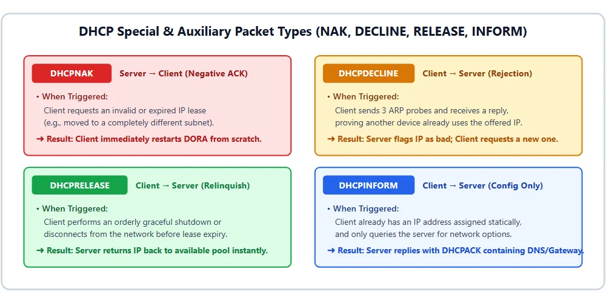{ loading=lazy }
*Illustration: Scenarios for DHCPNAK, DHCPDECLINE, DHCPRELEASE, and DHCPINFORM packets*

## Q31. Map the Application Layer protocols (SMTP, FTP, TELNET, TFTP, DNS, SNMP, BOOTP/DHCP) to their Transport Layer protocols (TCP vs. UDP) as shown in the TCP/IP suite, and explain *why* each uses TCP or UDP. <small>(5 marks · Mid Sem · Module 4)</small>

*Module 4 — Application Layer Services (SMTP, POP, DNS, DHCP)*

In the TCP/IP protocol suite diagram from your notes, Application Layer protocols sit on top of either **TCP** (connection-oriented, reliable stream) or **UDP** (connectionless, fast, low-overhead datagrams):

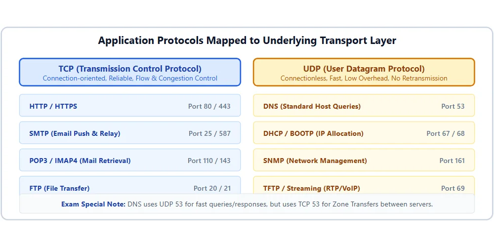{ loading=lazy }
*Illustration: Protocol suite mapping to TCP (reliable) and UDP (fast/broadcast) transports*

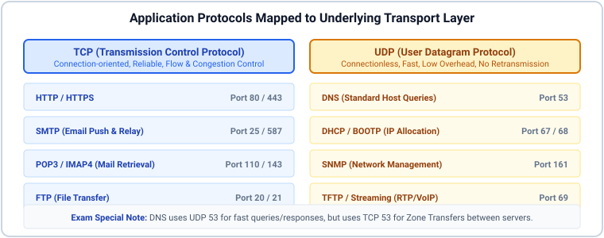
*Illustration: Mapping of DNS, DHCP, SMTP, POP3, and HTTP to underlying transport protocols and ports*

1. **Protocols Using TCP (`SMTP`, `FTP`, `TELNET`):**
    - **Why TCP?** Sending an email (`SMTP`), transferring a file (`FTP`), or typing remote terminal commands (`TELNET`, Server Port $23$) requires **100% reliability**—not a single byte can be lost, duplicated, or delivered out of order. Therefore, they rely on TCP's connection setup, byte numbering, acknowledgments, and retransmission.
2. **Protocols Using UDP (`BOOTP/DHCP`, `TFTP`, `SNMP`):**
    - **Why UDP?**
        - **`BOOTP` / `DHCP`:** When a computer boots up, it doesn't even have an IP address yet and must **broadcast** `DHCPDISCOVER`. TCP does *not* support broadcasting (it requires a 1-to-1 three-way handshake between known IPs), so DHCP *must* use UDP!
        - **`TFTP` (Trivial File Transfer Protocol) & `SNMP` (Simple Network Management Protocol):** Use UDP to avoid TCP handshake overhead for small, quick messages or boot-time ROM code.
3. **Why `DNS` Uses Both UDP and TCP (Port 53):**
    - **UDP for Normal Queries:** Looking up a domain name is a tiny 1-packet question and 1-packet answer. Using UDP avoids the delay of a 3-way TCP handshake, making web browsing fast.
    - **TCP for Large Responses / Zone Transfers:** When a DNS response is larger than $512\text{ bytes}$ or when a secondary DNS server copies an entire database from a primary server (**Zone Transfer**), DNS switches to **TCP** for reliable bulk transfer.

## Q32. What is the "Magic Cookie" and Option 53 in a DHCP packet? <small>(2 marks · Mid Sem · Module 4)</small>

*Module 4 — Application Layer Services (SMTP, POP, DNS, DHCP)*

- **Magic Cookie (`0x63.82.53.63`):** The fixed $4\text{-byte}$ number that always marks the beginning of the variable-length `Data / Options` field in a DHCP packet (which ends with `0xFF`).
- **DHCP Option 53 (Message Type):** A required option inside the Options field that defines the purpose of the DHCP packet (`1` = Discover, `2` = Offer, `3` = Request, `4` = ACK).

## Q33. Why is `DHCPDISCOVER` and `DHCPREQUEST` sent as a Broadcast, while `DHCPOFFER` and `DHCPACK` are Unicast (in standard configurations)? <small>(2 marks · Mid Sem · Module 4)</small>

*Module 4 — Application Layer Services (SMTP, POP, DNS, DHCP)*

- **`DHCPDISCOVER` is Broadcast (`255.255.255.255`)** because the newly booted client has no IP address and does not know the IP address of any DHCP server on the LAN.
- **`DHCPREQUEST` is Broadcast** so that *all* DHCP servers that sent offers can see which server's offer the client accepted (identified by the Server ID option) and release their unaccepted offered IPs back to their pools.

## Q34. What is the role of the `Flags` field and `Hop Count` field in the DHCP Header? <small>(2 marks · Mid Sem · Module 4)</small>

*Module 4 — Application Layer Services (SMTP, POP, DNS, DHCP)*

- **`Flags` ($2\text{ bytes}$):** The client sets the very first bit of the `Flags` field to `1` if its software cannot accept unicast MAC layer frames before its IP stack is completely configured (telling the server to reply via broadcast instead of unicast).
- **`Hop Count` ($1\text{ byte}$):** Set to `0` by the client and used by **DHCP Relay Agents** (`Gateway IP`) when forwarding DHCP requests across routers to a server on another subnet.

## Q35. State four common DNS Record Types (`A`, `NS`, `CNAME`, `MX`). <small>(2 marks · Mid Sem · Module 4)</small>

*Module 4 — Application Layer Services (SMTP, POP, DNS, DHCP)*

- **`A` Record (Address):** Maps a hostname (e.g., `example.com`) to its $32\text{-bit}$ IPv4 address (`AAAA` is used for IPv6).
- **`NS` Record (Name Server):** Specifies the authoritative DNS server for a domain.
- **`CNAME` Record (Canonical Name):** Maps an alias nickname (like `www.example.com`) to its true canonical domain name.
- **`MX` Record (Mail Exchange):** Points to the IP/hostname of the **Mail Server** responsible for accepting emails for that domain.