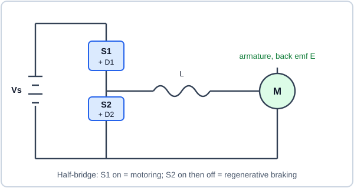
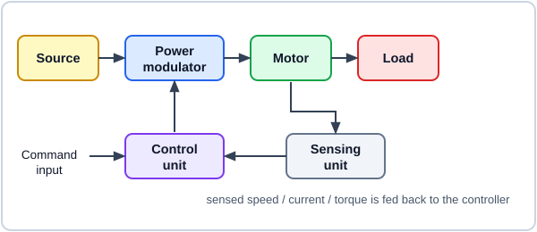
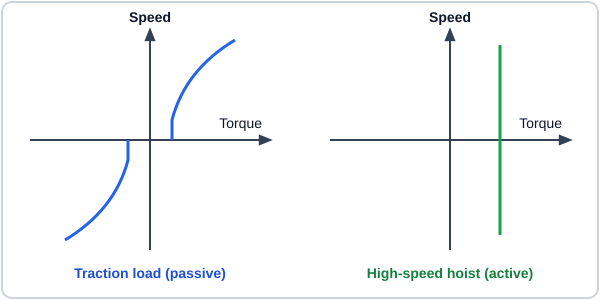
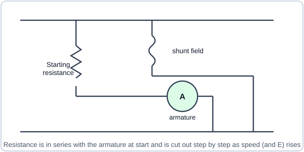
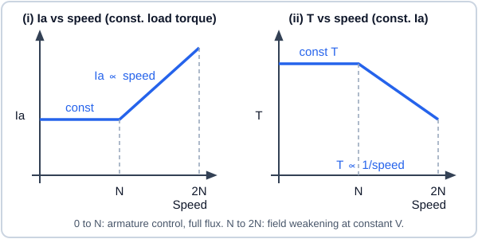
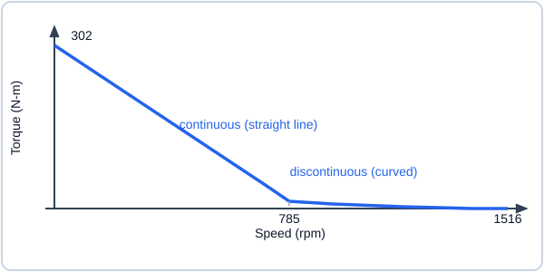
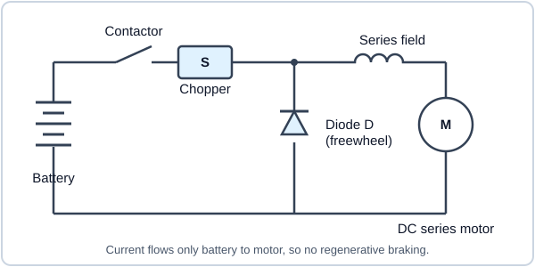

# Electric Drives — End Sem

## Syllabus

1. DC motor characteristics
    - Review of emf and torque equations of DC machine
    - Review of torque-speed characteristics of separately excited dc motor
    - Change in torque-speed curve with armature voltage
    - Example load torque-speed characteristics
    - Operating point
    - Armature voltage control for varying motor speed
    - Flux weakening for high speed operation
2. Chopper fed DC drive
    - Review of dc chopper and duty ratio control
    - Chopper fed dc motor for speed control
    - Steady state operation of a chopper fed drive
    - Armature current waveform and ripple
    - Calculation of losses in dc motor and chopper
    - Efficiency of dc drive
    - Smooth starting
3. Multi-quadrant DC drive
    - Review of motoring and generating modes operation of a separately excited dc machine
    - Four quadrant operation of dc machine
    - Single-quadrant, two-quadrant and four-quadrant choppers
    - Steady-state operation of multi-quadrant chopper fed dc drive
    - Regenerative braking
4. Closed-loop control of DC Drive
    - Control structure of DC drive
    - Inner current loop and outer speed loop
    - Dynamic model of dc motor – dynamic equations and transfer functions
    - Modeling of chopper as gain with switching delay
    - Plant transfer function, for controller design
    - Current controller specification and design
    - Speed controller specification and design
5. Induction motor characteristics
    - Review of induction motor equivalent circuit and torque-speed characteristic
    - Variation of torque-speed curve with (i) applied voltage, (ii) applied frequency and (iii) applied voltage and frequency
    - Typical torque-speed curves of fan and pump loads
    - Operating point
    - Constant flux operation
    - Flux weakening operation
6. Scalar control or constant V/f control of induction motor
    - Review of three-phase voltage source inverter
    - Generation of three-phase PWM signals
    - Sinusoidal modulation
    - Space vector theory
    - Conventional space vector modulation
    - Constant V/f control of induction motor
    - Steady-state performance analysis based on equivalent circuit
    - Speed drop with loading
    - Slip regulation
7. Control of slip ring induction motor
    - Impact of rotor resistance of the induction motor torque-speed curve
    - Operation of slip-ring induction motor with external rotor resistance
    - Starting torque
    - Power electronic based rotor side control of slip ring motor
    - Slip power recovery

**Main textbook:** Fundamentals of Electrical Drives — G.K. Dubey

<!--
TO ADD QUESTIONS: write each question like this (plain Markdown, nothing else needed):

## Q1. Question text here <small>(5 marks · Mid Sem)</small>

Answer text. Math works: $T = K\phi I_a$ or

$$ \omega = \frac{V - I_a R_a}{K\phi} $$

See AGENTS.md section 6 for pictures, video, tables and the rules.
-->

## Q1. What is a translational load? <small>(2 marks · End Sem)</small>

- A translational load is one whose parts move in a **straight line** (e.g. a conveyor, a lift, a train), unlike a rotational load that spins.
- For analysis it is referred to the motor shaft: equivalent inertia $J = m\left(\frac{v}{\omega_m}\right)^2$ and equivalent torque $T = \frac{F v}{\omega_m}$.

## Q2. What is a flywheel? <small>(2 marks · End Sem)</small>

- A flywheel is a heavy wheel with large moment of inertia fitted on the motor shaft to **store kinetic energy**.
- It supplies the peak load energy during short overloads and takes energy back when the load is light, so the motor sees a smoothed load.

## Q3. What is stiction? <small>(2 marks · End Sem)</small>

- Stiction (static friction) is the **extra friction torque at standstill**, higher than the running friction.
- The motor must develop more torque than this to break away from rest; once the shaft moves, the friction torque drops.

## Q4. Describe the equivalent power method for selecting motor rating for intermittent duty. <small>(2 marks · End Sem)</small>

- The varying loss is replaced by an equivalent constant loss: the **average power loss** over the whole cycle (with the idle period weighted by the cooling factor $\beta$) must equal the rated loss of the motor.
- Rating is chosen as the RMS (equivalent) power $P_{eq}=\sqrt{\frac{\sum P_i^2 t_i}{t_{on}+\beta\, t_{off}}}$, then checked against peak load and overload limits.

## Q5. Describe the equivalent power method for selecting motor rating for short time duty. <small>(2 marks · End Sem)</small>

- For a load that runs only for a short time $t$ with a long cool-down, the temperature rise is $\theta=\theta_{ss}(1-e^{-t/\tau_h})$, which is **below** the steady value.
- So the motor can be loaded to $P_{sh}$ above its continuous rating $P_r$: $\frac{P_{sh}}{P_r}=\sqrt{\frac{1}{1-e^{-t/\tau_h}}}$ (loss proportional to power squared).

## Q6. What is the main reason for fitting a flywheel with the motor? <small>(2 marks · End Sem)</small>

- To **equalise the load**: the flywheel supplies the short peak torque so the motor can be rated for the average load only (smaller, cheaper motor).
- It also limits the peak current drawn from the supply and reduces voltage dips.

## Q7. Outline the objectives of selecting motor power rating. <small>(2 marks · End Sem)</small>

- To choose a motor that carries the load **without exceeding its permissible temperature rise** (insulation life) during the whole duty cycle.
- To avoid both under-rating (overheating, failure) and over-rating (higher cost, poor efficiency and power factor).

## Q8. Enlist the four major classes of motor duty and their significance in motor selection. <small>(2 marks · End Sem)</small>

- **Continuous duty** (constant load long enough to reach steady temperature), **short-time duty** (load for a short time, then rest to cool), **intermittent periodic duty** (repeated load and rest) and **intermittent periodic duty with starting and braking**.
- Each class heats the motor differently, so the rating is worked out from the thermal model of that class.

!!! warning "Verify this"
    Textbooks list the classes in slightly different ways; match the list in your class notes.

## Q9. How does heating occur in motor drives? <small>(2 marks · End Sem)</small>

- Losses inside the motor (copper loss $I^2R$, core loss, friction and windage) are converted to heat, raising its temperature.
- The temperature rise follows $\theta=\theta_{ss}(1-e^{-t/\tau_h})+\theta_0 e^{-t/\tau_h}$ until heat produced equals heat given to the surroundings.

## Q10. Why is motor power rating important for a specific application? <small>(2 marks · End Sem)</small>

- A correct rating keeps temperature within insulation limits for the actual duty cycle, giving long life and reliability.
- It gives the right balance of cost, efficiency and power factor; a wrong rating causes burn-out or wasted capital.

## Q11. A 30 A current enters the positive terminal of an 8 V source. Find the power. <small>(2 marks · End Sem)</small>

- Current enters the positive terminal, so the source **absorbs** power: $P = VI = 8 \times 30 = 240$ W.
- The power delivered by the source is therefore $-240$ W (it is acting as a load).

## Q12. For which mode of operation is a Type-A chopper used? <small>(2 marks · End Sem)</small>

- Type-A (class A) chopper gives output voltage and current both **positive**, so it works in the **first quadrant**.
- It is used for forward motoring only (power flows from source to motor), with the diode as freewheeling path.

## Q13. Which converter operation becomes unstable at a large duty ratio? <small>(2 marks · End Sem)</small>

- The options are not given in the question list, so this is a general answer: a **boost (step-up) chopper** output $V_o=\frac{V_s}{1-D}$ rises very fast as $D\to1$, and the regulation becomes unstable.
- So the duty ratio of boost and buck-boost converters is limited (usually below about 0.9).

!!! warning "Verify this"
    The original question has options that are not visible; check which option your sheet has.

## Q14. Which braking method gives the highest braking torque? <small>(2 marks · End Sem)</small>

- **Plugging (reverse-current braking)** gives the highest braking torque because the supply voltage adds to the back emf.
- It needs a series resistance to limit the large current and wastes a lot of energy as heat.

## Q15. Explain a two-quadrant chopper circuit with a schematic. <small>(2 marks · End Sem)</small>

*Illustration: two-quadrant chopper (half-bridge)*

- **Motoring (1st quadrant):** S1 conducts and applies source voltage to the motor; when S1 turns off the current freewheels through D2.
- **Regenerative braking (2nd quadrant):** S2 shorts the motor to build current, then when S2 turns off the current flows through D1 into the source, returning energy.

## Q16. What is back emf in a DC motor and what is its significance? <small>(2 marks · End Sem)</small>

- Back emf $E_b=K\phi\omega$ is the voltage induced in the armature conductors rotating in the field; it **opposes the supply voltage**.
- It makes the motor self-regulating: armature current $I_a=\frac{V-E_b}{R_a}$ adjusts itself to the load, and it limits starting current to a safe value once the motor runs.

## Q17. Why is regenerative braking not possible in a series motor? <small>(2 marks · End Sem)</small>

- The field current is the armature current, so when current reverses in generating action the **flux also reverses** and the induced emf polarity does not change, so it cannot push current back to the supply.
- Also the flux is low at light load, so emf cannot exceed the supply voltage; the field must be reconnected or separately excited.

## Q18. Which motor is preferred for traction work? <small>(2 marks · End Sem)</small>

- The **DC series motor** (and now ac induction motor drives with converters).
- It has very high starting torque ($T\propto I_a^2$) and automatically reduces speed as load rises.

## Q19. Find the average output voltage of a half-wave uncontrolled rectifier for a supply of $23\sin(50t)$. <small>(2 marks · End Sem)</small>

- For a half-wave uncontrolled rectifier $V_{avg}=\frac{V_m}{\pi}$ with $V_m = 23$ V.
- $V_{avg}=\frac{23}{\pi}\approx 7.32$ V (the angular frequency 50 rad/s does not affect the average).

## Q20. Find the average output voltage of a half-wave controlled rectifier for $10\sin(50t)$ at a firing angle of $30^\circ$. <small>(2 marks · End Sem)</small>

- $V_{avg}=\frac{V_m}{2\pi}(1+\cos\alpha)$ with $V_m=10$ V and $\alpha=30^\circ$.
- $V_{avg}=\frac{10}{2\pi}(1+0.866)=2.97$ V.

## Q21. Find the conduction angle for a purely inductive load with a firing angle of $90^\circ$. <small>(2 marks · End Sem)</small>

- For a purely inductive load in a half-wave circuit, the current starts at $\alpha$ and ends at $\beta=2\pi-\alpha$, so conduction angle $=2\pi-2\alpha$.
- For $\alpha=90^\circ$: conduction angle $=360^\circ-180^\circ=180^\circ$.

## Q22. Write the fundamental torque equation of an electrical drive. <small>(2 marks · End Sem)</small>

- $T - T_L = J\frac{d\omega_m}{dt}$, where $T$ is the motor torque, $T_L$ the load torque and $J$ the total inertia.
- (For a variable inertia, $T-T_L=J\frac{d\omega}{dt}+\omega\frac{dJ}{dt}$.)

## Q23. Explain the concept of the fundamental torque equation. <small>(2 marks · End Sem)</small>

- The torque left after supplying the load, $T-T_L$, is the **dynamic (accelerating) torque**, which changes the speed: positive accelerates, negative decelerates.
- At steady state $T=T_L$ and $\frac{d\omega}{dt}=0$, so the speed is constant; this is the equilibrium operating point.

## Q24. Explain each block of the basic block diagram of an electrical drive. <small>(2 marks · End Sem)</small>

*Illustration: basic block diagram of an electrical drive*

- **Source, power modulator and motor:** the source gives energy, the modulator controls the power flow, current and mode (motoring or braking) of the motor, and the motor drives the load.
- **Control and sensing units:** the sensing unit measures speed or current and feeds it back; the control unit compares it with the command and sets the modulator.

## Q25. Draw and explain the torque-speed characteristic of a traction load. <small>(2 marks · End Sem)</small>

*Illustration: traction load (left) and high-speed hoist load (right)*

- A traction load is **passive**: torque starts at a friction (stiction) value and rises with speed, roughly $T_L = T_0 + k\omega^2$ (air resistance), and reverses when the direction reverses.
- The curve lies in quadrants I and III only; on a slope the gravity component adds an **active** part.

## Q26. Draw and explain the torque-speed characteristic of a high-speed hoist load. <small>(2 marks · End Sem)</small>

- A hoist load is **active**: the load torque due to gravity is constant and has the same direction at any speed (the curve in the figure of Q25 is a vertical line).
- At high speed, friction adds to it in the direction opposing motion, so the curve bends slightly with speed; lowering (overhauling) load needs braking.

## Q27. Draw the circuit for starting a DC shunt motor. <small>(2 marks · End Sem)</small>

*Illustration: starter resistance in series with the armature, field connected across the supply*

- A starting resistance is placed in series with the armature and the shunt field is connected directly across the supply, so full flux is present at start.
- The resistance is cut out in steps as the back emf builds up with speed.

## Q28. State the methods of braking for a DC motor. <small>(2 marks · End Sem)</small>

- **Regenerative braking:** the motor runs as a generator and returns energy to the supply (needs speed above no-load speed).
- **Dynamic (rheostatic) braking** (armature across a resistor) and **plugging** (reverse supply voltage).

## Q29. Write the relation between speed and torque of a DC motor at steady state. <small>(2 marks · End Sem)</small>

- $\omega_m=\frac{V}{K\phi}-\frac{R_a}{(K\phi)^2}T$, a straight line of negative slope for a separately excited motor.
- The first term is the no-load speed and the second is the speed drop due to armature resistance.

## Q30. Why should a DC series motor never be started on no load? <small>(2 marks · End Sem)</small>

- The flux is proportional to armature current, which is tiny at no load, so $\omega\approx\frac{V}{K\phi}$ becomes extremely large.
- The motor over-speeds dangerously (runaway) and the rotor can fly apart; a series motor must always be coupled to a load.

## Q31. Mention the classifications of braking. <small>(2 marks · End Sem)</small>

- **Mechanical braking** (friction, e.g. drum or disc brakes) and **electrical braking**.
- Electrical braking is further divided into regenerative, dynamic (rheostatic) and plugging (reverse-current) braking.

## Q32. What are the advantages of electrical braking? <small>(2 marks · End Sem)</small>

- No mechanical wear or brake-lining replacement, so low maintenance and smooth, controllable braking.
- Regenerative braking returns energy to the supply, and electrical braking can be applied remotely and automatically.

## Q33. What are the disadvantages of electrical braking? <small>(2 marks · End Sem)</small>

- It cannot hold the load **at standstill** (torque falls to zero at zero speed), so a mechanical brake is still needed.
- Dynamic braking and plugging waste energy as heat; regeneration needs a source that can accept power and extra converter circuits.

## Q34. Write the average output voltage of a single-phase fully controlled rectifier fed separately excited DC motor in continuous conduction. <small>(2 marks · End Sem)</small>

- $V_o=\frac{2V_m}{\pi}\cos\alpha$ where $V_m$ is the peak of the ac supply and $\alpha$ the firing angle.
- It varies from $+\frac{2V_m}{\pi}$ ($\alpha=0$) to $-\frac{2V_m}{\pi}$ ($\alpha=180^\circ$), allowing inversion (regeneration).

## Q35. Write the average output voltage of a single-phase fully controlled rectifier fed separately excited DC motor in discontinuous conduction. <small>(2 marks · End Sem)</small>

- With $\beta$ the extinction angle and $E$ the motor back emf:

    $$ V_o=\frac{1}{\pi}\left[V_m(\cos\alpha-\cos\beta)+E(\pi+\alpha-\beta)\right] $$

- During the interval when no thyristor conducts the output equals $E$, which gives the second term.

!!! warning "Verify this"
    Check the form and the symbols used for $\beta$ and $E$ against your textbook.

## Q36. What is critical speed? <small>(2 marks · End Sem)</small>

- Critical speed is the speed at the **boundary between continuous and discontinuous conduction** of the armature current for a given firing angle.
- Below it the current is continuous; above it (lighter load, higher back emf) the current becomes discontinuous and the speed regulation worsens.

!!! warning "Verify this"
    Confirm this definition with the section on critical speed in your notes.

## Q37. Write the average output voltage of a single-phase half controlled rectifier fed separately excited DC motor in continuous conduction. <small>(2 marks · End Sem)</small>

- $V_o=\frac{V_m}{\pi}(1+\cos\alpha)$, which varies from $\frac{2V_m}{\pi}$ at $\alpha=0$ to zero at $\alpha=180^\circ$.
- The output voltage never goes negative, so only motoring (one quadrant) is possible.

## Q38. Write the average output voltage of a single-phase half controlled rectifier fed separately excited DC motor in discontinuous conduction. <small>(2 marks · End Sem)</small>

- With $\beta$ the extinction angle where the current falls to zero:

    $$ V_o=\frac{1}{\pi}\left[V_m(\cos\alpha-\cos\beta)+E(\pi+\alpha-\beta)\right] $$

- It is the same form as in the fully controlled case, with $\beta<\pi$ here because of the freewheeling path.

!!! warning "Verify this"
    Check the exact form and the limits of $\beta$ against your notes.

## Q39. Give some applications of DC motors. <small>(2 marks · End Sem)</small>

- Traction (series motors in trains, trams, EVs), cranes, hoists and elevators.
- Rolling mills, paper mills, machine tools and robotics (servo motors), where wide and smooth speed control is needed.

## Q40. What is the relation between speed and flux of a DC motor? <small>(2 marks · End Sem)</small>

- Speed is **inversely proportional to flux**: $N\propto\frac{V-I_aR_a}{\phi}$.
- Reducing the field flux raises speed above the base speed (field weakening).

## Q41. How do you change the direction of rotation of a DC shunt motor? <small>(2 marks · End Sem)</small>

- Reverse the **armature current** (swap the armature terminals) while keeping field direction the same.
- Alternatively reverse the **field current** while keeping the armature connections; reversing both gives no change.

## Q42. Why are series motors used for traction? <small>(2 marks · End Sem)</small>

- They give very high starting torque ($T\propto I_a^2$), which is needed to accelerate heavy trains.
- Speed falls automatically as load or gradient increases, and the load is shared well between motors.

## Q43. What are the classifications of load torque? <small>(2 marks · End Sem)</small>

- **Active loads** (torque independent of speed, due to gravity or tension, e.g. hoists) and **passive loads** (torque always opposes motion, e.g. friction, fans).
- By speed dependence: constant torque, proportional to speed, proportional to speed squared (fans, pumps) and inversely proportional to speed (constant power).

## Q44. Why is a starter necessary for a DC motor? <small>(2 marks · End Sem)</small>

- At start the speed is zero, so the back emf is zero and $I_{st}=\frac{V}{R_a}$ is 10-20 times the rated current because $R_a$ is very small.
- A starter adds series resistance to limit this current and protect the armature, commutator and supply.

## Q45. What are the ways of speed control of DC motors? <small>(2 marks · End Sem)</small>

- **Armature voltage control** (below base speed, constant torque) and **field flux control** (above base speed, constant power).
- **Armature resistance control** (simple but wasteful); modern drives use controlled rectifiers or choppers.

## Q46. Analyse the braking of a DC motor during lowering of a load. <small>(2 marks · End Sem)</small>

- When the load is lowered, gravity drives the motor above its no-load speed, so $E_b>V$, the armature current reverses and the motor works as a generator: this is **regenerative braking**.
- If regeneration is not possible, **dynamic braking** (resistor across the armature) or plugging with series resistance holds the load at a safe speed.

## Q47. What are the different methods of braking applied to an induction motor? <small>(2 marks · End Sem)</small>

- **Regenerative braking** (rotor speed above synchronous speed, power returned to supply) and **plugging** (reverse the phase sequence).
- **Dynamic braking:** ac dynamic braking (single-phase ac supplied) or dc dynamic braking (dc injected into the stator).

## Q48. What are the different methods of speed control of an induction motor? <small>(2 marks · End Sem)</small>

- **Stator side:** stator voltage control, stator frequency control, V/f control, stator current control and pole changing.
- **Rotor side (slip ring motor):** rotor resistance control and slip power recovery (static Kramer and Scherbius drives).

## Q49. What is meant by stator voltage control? <small>(2 marks · End Sem)</small>

- Speed is controlled by varying the **stator voltage at constant frequency**, usually with a phase-controlled ac voltage controller (thyristors).
- Torque varies as $V^2$ ($T\propto sV^2$), so reducing voltage lowers the torque and the speed on a fan-type load.

## Q50. Mention the applications of stator voltage control. <small>(2 marks · End Sem)</small>

- Fans, blowers and centrifugal pumps, where the torque falls with speed.
- Soft starters for squirrel cage motors, small cranes and low-power drives needing a narrow speed range.

## Q51. Mention the applications of ac drives. <small>(2 marks · End Sem)</small>

- Pumps, fans, compressors, conveyors, cranes, elevators and machine tools.
- Traction (locomotives, metro, electric vehicles), rolling mills, textile and paper mills.

## Q52. What are the three regions in the speed-torque characteristic of an induction motor? <small>(2 marks · End Sem)</small>

- **Motoring region** ($0<s<1$), speed below synchronous speed, torque in the direction of rotation.
- **Generating region** ($s<0$, speed above synchronous) and **plugging/braking region** ($1<s<2$, rotor against the field).

## Q53. What are the advantages of the stator voltage control method? <small>(2 marks · End Sem)</small>

- Simple, cheap and compact circuit with smooth control and easy closed-loop operation.
- It also gives soft start with reduced starting current and torque.

## Q54. What is meant by soft start? <small>(2 marks · End Sem)</small>

- Soft start means **raising the motor voltage (or frequency) gradually** from a low value to the rated value instead of applying full voltage at once.
- It limits the high starting current and torque jerk, reducing stress on the supply, motor and mechanical load.

## Q55. List the advantages of a squirrel cage induction motor. <small>(2 marks · End Sem)</small>

- Simple, rugged and cheap, with no brushes or slip rings, so very low maintenance.
- High efficiency and reliability, and suitable for hazardous areas because there are no sparking parts.

## Q56. Define slip. <small>(2 marks · End Sem)</small>

- Slip is the **per-unit difference between synchronous speed and rotor speed**: $s=\frac{N_s-N}{N_s}$.
- It is 1 at standstill and small (about 0.02-0.05) at full load.

## Q57. Define base speed. <small>(2 marks · End Sem)</small>

- Base speed is the speed of the motor at **rated voltage and rated frequency** at full-load torque.
- Below it, the motor works in constant-torque mode; above it, the flux is reduced (constant-power mode).

## Q58. What is meant by frequency control of an induction motor? <small>(2 marks · End Sem)</small>

- The speed is changed by varying the **supply frequency**, since synchronous speed is $N_s=\frac{120f}{P}$.
- It needs an inverter (or cycloconverter); if voltage is not varied with frequency the flux saturates or weakens, so V/f control is used.

## Q59. What is meant by V/f control? <small>(2 marks · End Sem)</small>

- V/f control varies the stator voltage in proportion to the frequency so that the **air-gap flux ($\propto V/f$) stays constant**.
- It is used below base speed, with a boost of voltage at low frequency to compensate the stator resistance drop.

## Q60. What are the advantages of V/f control? <small>(2 marks · End Sem)</small>

- Constant flux gives full torque capability over a wide speed range, with good efficiency and a smooth start.
- Speed can be controlled below and above base speed with a simple open-loop scheme and low starting current.

## Q61. What is meant by stator current control? <small>(2 marks · End Sem)</small>

- The motor is fed from a **current source** (current source inverter) so the stator current is controlled, and with it the torque, almost independent of the voltage.
- It gives good speed control with inherent short-circuit protection and regeneration capability.

## Q62. What are the three regions of an adjustable-frequency induction motor drive characteristic? <small>(2 marks · End Sem)</small>

- **Constant torque region** (below base speed, constant V/f) and **constant power region** (above base speed with voltage fixed, flux falls).
- **High-speed (series motor) region** where the stator frequency rises further at fixed voltage and the torque falls roughly as $1/\omega^2$.

## Q63. What are the advantages of electrical drives? (Dubey 1.1) <small>(5 marks · End Sem)</small>

- **Control:** wide, smooth and accurate speed and torque control, with easy automation and remote operation.
- **Availability:** a very wide range of power ratings and speeds, ready to start at once with no warm-up time.
- **Efficiency and maintenance:** high efficiency, low maintenance, long life and no fuel handling.
- **Environment:** no fumes, low noise, and clean operation even in hazardous locations.
- **Braking:** electrical braking (including regeneration) saves energy and gives quick, controlled stopping.

## Q64. State the essential parts of electrical drives and the functions of a power modulator. (Dubey 1.2) <small>(5 marks · End Sem)</small>

- **Parts:** the electric motor, the load, the power modulator, the electrical source, the control unit and the sensing unit.
- **Modulator function 1:** it controls the power flow from the source to the motor so the motor gives the required speed-torque.
- **Modulator function 2:** it limits the motor current during starting and transients to protect the motor and source.
- **Modulator function 3:** it converts the source into the form the motor needs (voltage, current and frequency).
- **Modulator function 4:** it selects the mode of operation (motoring or braking) and the quadrant according to the command.

## Q65. Write a short note on the motors employed in variable-speed drives. (Dubey 1.3) <small>(5 marks · End Sem)</small>

- **DC motors:** separately excited, series, shunt and compound; easy speed control, used where wide control is needed.
- **Induction motors:** squirrel cage (rugged and cheap) and slip ring (rotor resistance or slip power recovery); the main ac drive motor.
- **Synchronous motors:** wound field and permanent magnet types, with constant speed at a given frequency, used for high power and precise speed.
- **Special motors:** brushless dc, stepper and switched reluctance motors for servo and low-power drives.
- **Choice:** the choice depends on power, speed range, dynamic performance, cost and maintenance.

## Q66. State and explain the functions of the various converters. (Dubey 1.4) <small>(5 marks · End Sem)</small>

- **Controlled rectifier:** converts fixed ac to variable dc, used for DC motor speed control.
- **Dc chopper:** converts fixed dc to variable dc by switching, used for battery-fed and traction drives.
- **Inverter:** converts dc to ac of variable voltage and frequency (VSI or CSI), used for induction and synchronous motors.
- **Ac voltage controller:** converts fixed ac to variable-voltage ac at the same frequency (stator voltage control, soft start).
- **Cycloconverter:** converts ac directly to ac of lower, variable frequency, used for very large low-speed drives.

## Q67. Write a short note on the sources employed in electrical drives. (Dubey 1.5) <small>(5 marks · End Sem)</small>

- **Ac mains:** single-phase for low-power drives and three-phase for medium and high power, at fixed voltage and frequency.
- **Dc sources:** batteries and solar or fuel-cell supplies for vehicles and portable systems.
- **Source constraints:** limited power, fixed voltage and frequency, and voltage drops and harmonics, so converters are needed to adapt it.
- **Source limits on regeneration:** a source must be able to accept power if regenerative braking is to be used (batteries yes, diode-fed lines no).
- **Effect on the supply:** converters draw harmonic currents and reactive power, so filters and power-factor correction may be needed.

## Q68. What are the main factors which decide the choice of electrical drive for a given application? (Dubey 1.6) <small>(5 marks · End Sem)</small>

- **Load and duty:** the torque-speed characteristic, speed range and regulation, and the duty cycle of the load.
- **Power and source:** the power rating required and whether ac or dc supply is available.
- **Starting and braking:** the starting torque and braking needs, including regeneration and reversal.
- **Cost:** initial cost, running cost, efficiency and power factor.
- **Practical factors:** maintenance, reliability, size and weight, noise and the operating environment.

## Q69. What is the current status of dc and ac drives? (Dubey 1.7) <small>(5 marks · End Sem)</small>

- Most variable-speed applications still use **dc drives**, because of their simple control and good performance.
- **Ac drives** are growing fast, helped by thyristors, GTOs, IGBTs, VLSI and microprocessors, which have reduced cost and improved reliability.
- **Induction motor drives** are used from low to high power, and **synchronous motor drives** in very high power (MW) and medium power ranges.
- **Permanent magnet synchronous and brushless dc motor drives** are replacing dc servo motors in the fractional-hp range.
- The trend favours ac drives, but dc drives will remain in use for some time.

## Q70. A drive has motor torque $T=150-0.1N$ and a load torque of 100 N-m. The load torque changes to $-100$ N-m. Find the initial and final equilibrium speeds. (Dubey 2.1) <small>(5 marks · End Sem)</small>

- **Given:** $T=150-0.1N$ N-m ($N$ in rpm); initially $T_L=100$ N-m, finally $T_L=-100$ N-m (active load).
- **Condition:** at equilibrium motor torque equals load torque, $T=T_L$.
- **Initial speed:** $150-0.1N=100\Rightarrow N=500$ rpm.
- **Final speed:** $150-0.1N=-100\Rightarrow N=2500$ rpm.
- **Result:** the speed rises from **500 rpm to 2500 rpm**; the motor speed is stable since the motor slope $-0.1$ is negative and the load torque is constant.

## Q71. Find the equilibrium speeds of a hoist drive in all four quadrants. (Dubey 2.2) <small>(5 marks · End Sem)</small>

- **Given:** in quadrants I, II and IV $T=200-0.2N$; in quadrants II, III and IV $T=-200-0.2N$; loaded hoist $T_L=100$ N-m, unloaded $T_L=-80$ N-m.
- **Quadrant I (loaded hoist rising):** $200-0.2N=100\Rightarrow N=500$ rpm.
- **Quadrant II (unloaded, forward):** $200-0.2N=-80\Rightarrow N=1400$ rpm.
- **Quadrant III (unloaded lowering):** $-200-0.2N=-80\Rightarrow N=-600$ rpm.
- **Quadrant IV (loaded lowering):** $-200-0.2N=100\Rightarrow N=-1500$ rpm.

## Q72. Find the equivalent inertia and the power rating for a motor driving four loads. (Dubey 2.3) <small>(5 marks · End Sem)</small>

- **Given:** motor $J_m=1.2$ kg-m$^2$ at 1000 rpm ($\omega_m=104.72$ rad/s); loads: rotational 7 kg-m$^2$ and 5 kg-m$^2$ at 200 rpm, and translational 10 kg and 20 kg at 10 m/s.
- **Rotational loads:** $J=J_L\left(\frac{N_L}{N_m}\right)^2$, so $7(0.2)^2=0.28$ and $5(0.2)^2=0.20$ kg-m$^2$.
- **Translational loads:** $J=m\left(\frac{v}{\omega_m}\right)^2$, so $10(0.0955)^2=0.0912$ and $20(0.0955)^2=0.1824$ kg-m$^2$.
- **Total inertia:** $J_{eq}=1.2+0.28+0.20+0.0912+0.1824\approx 1.95$ kg-m$^2$.
- **Power rating:** loads need $10(20.94)+6(20.94)+20(10)+30(10)=209.4+125.7+200+300\approx 835$ W, so the motor torque is $\approx 7.97$ N-m at 1000 rpm.

## Q73. A winch lifts 500 kg at 1.5 m/s with the motor at 1000 rpm. Find the motor torque and the equivalent inertia. (Dubey 2.4) <small>(5 marks · End Sem)</small>

- **Given:** $m=500$ kg, $v=1.5$ m/s, $N=1000$ rpm ($\omega_m=104.72$ rad/s), $J_{motor}=0.5$, $J_{winch}=0.3$ kg-m$^2$; with no weight the motor torque is 100 N-m (friction).
- **Load torque:** $T=\frac{mgv}{\omega_m}=\frac{500\times9.81\times1.5}{104.72}=70.26$ N-m.
- **Motor torque:** $T_m=70.26+100\approx170.3$ N-m (load plus friction torque).
- **Equivalent inertia:** $J_{eq}=J_m+J_w+m\left(\frac{v}{\omega_m}\right)^2$ with $\left(\frac{1.5}{104.72}\right)^2=2.05\times10^{-4}$.
- **Result:** $J_{eq}=0.5+0.3+500\times2.05\times10^{-4}\approx0.903$ kg-m$^2$.

!!! warning "Verify this"
    Whether the 100 N-m friction torque is added to the load torque depends on the textbook's reading of this problem; check with your teacher.

## Q74. A motor drives a winch through a gear (a = 0.1) lifting 500 kg. Find the equivalent inertia and the motor torque. (Dubey 2.5) <small>(5 marks · End Sem)</small>

- **Given:** $J_0=0.5$, $J_g=0.15$ (at motor speed), $J_w=1$ kg-m$^2$, $a=0.1$, drum radius 0.2 m, load 500 kg, speed 1500 rpm ($\omega_m=157.08$ rad/s), friction 15 N-m (winch) and 10 N-m (motor shaft), gear efficiency 90%.
- **Linear speed:** $v=0.2\times a\omega_m=3.14$ m/s, so $\frac{v}{\omega_m}=0.02$.
- **Equivalent inertia:** $J_{eq}=0.5+0.15+a^2J_w+m\left(\frac{v}{\omega_m}\right)^2=0.5+0.15+0.01+500(0.02)^2=0.86$ kg-m$^2$.
- **Torque at winch:** $500\times9.81\times0.2+15=996$ N-m.
- **Motor torque:** $T=\frac{a\times996}{0.9}+10=110.7+10\approx120.7$ N-m.

## Q75. Find the speed and power rating of the motor for a take-up roll on a plastic strip line. (Dubey 2.6) <small>(5 marks · End Sem)</small>

- **Given:** mandrel diameter 15 cm growing to 25 cm, tension 1000 N, strip speed 25 m/s, reduction gear $a=0.5$, efficiency 87%.
- **Roll speed:** $\omega=\frac{v}{r}$: 333.3 rad/s (3183 rpm) at 15 cm and 200 rad/s (1910 rpm) at 25 cm.
- **Motor speed:** $\omega_m=\omega/a$: from about 3820 rpm (full roll) to about 6366 rpm (empty mandrel).
- **Load power:** $P=Tv=1000\times25=25$ kW, constant throughout the build-up.
- **Motor power rating:** $P_m=\frac{25}{0.87}\approx28.7$ kW, with the speed range 3820 to 6366 rpm.

## Q76. A conveyor belt moves at 1.2 m/s carrying 100 tonnes per hour; find the load inertia at the motor and the starting torque. (Dubey 2.7) <small>(5 marks · End Sem)</small>

- **Given:** $v=1.2$ m/s, belt 200 m, motor 1200 rpm ($\omega_m=125.66$ rad/s), motor inertia 0.1 kg-m$^2$, acceleration time 8 s.
- **Material on the belt:** time on belt $=\frac{200}{1.2}=166.7$ s, so $m=\frac{100000}{3600}\times166.7\approx4630$ kg.
- **(a) Load inertia:** $J_L=m\left(\frac{v}{\omega_m}\right)^2=4630\times(0.00955)^2\approx0.422$ kg-m$^2$.
- **(b) Acceleration:** $\alpha=\frac{125.66}{8}=15.71$ rad/s$^2$ and $J_{total}=0.1+0.422=0.522$ kg-m$^2$.
- **Torque:** $T=J\alpha\approx8.2$ N-m (friction neglected).

## Q77. How do you define passive and active load torques, and what are the differences between the two? (Dubey 2.8) <small>(5 marks · End Sem)</small>

- **Passive load torque:** it always **opposes** motion, so it changes sign when the speed reverses (e.g. friction, fan, pump, machine tools).
- **Active load torque:** it has the **same sign whatever the direction of motion**, since it comes from gravity, tension or compression (e.g. hoist, crane, elevator).
- **Quadrants:** passive loads work only in quadrants I and III; active loads can be in all four quadrants.
- **Power flow:** a passive load always absorbs power; an active load can deliver power (overhauling load) and needs braking.
- **Equilibrium:** a passive load gives equilibrium only for motoring; an active load can hold equilibrium in a braking quadrant, such as a lowering hoist.

## Q78. Can a motor-load system with a passive load torque have an equilibrium speed in quadrant II? What if the load is active? (Dubey 2.9) <small>(5 marks · End Sem)</small>

- **Quadrant II:** speed is positive and motor torque is negative (braking).
- **Passive load:** at positive speed the load torque is also positive (it opposes motion), so equilibrium requires positive motor torque; there is **no equilibrium in quadrant II**.
- **Reason:** a passive load can only absorb power, so it cannot hold the motor in a braking mode.
- **Active load:** a load torque of negative sign (e.g. a descending hoist) lets $T=T_L$ occur with negative torque at positive speed, so equilibrium **is possible**.
- **Example:** an overhauling load in a lowering hoist is held in a braking quadrant by dynamic or regenerative braking.

## Q79. Find the motor speeds for motoring and braking in the forward direction and the equilibrium speed in quadrant III. (Dubey 2.10) <small>(5 marks · End Sem)</small>

- **Given:** quadrants I and II: $T=400-0.4N$; quadrants III and IV: $T=-400-0.4N$; active load $T_L=\pm200$ N-m.
- **Forward motoring** ($T_L=+200$): $400-0.4N=200\Rightarrow N=500$ rpm.
- **Forward braking** ($T_L=-200$): $400-0.4N=-200\Rightarrow N=1500$ rpm.
- **Quadrant III** ($T_L=-200$): $-400-0.4N=-200\Rightarrow N=-500$ rpm.
- **Result:** the speeds are 500 rpm (motoring), 1500 rpm (braking) and $-500$ rpm (quadrant III).

## Q80. Calculate the starting time of a drive with $J=10$ kg-m$^2$, $T=15+0.5\omega_m$ and $T_L=5+0.6\omega_m$. (Dubey 2.11) <small>(5 marks · End Sem)</small>

- **Dynamic torque:** $T-T_L=10-0.1\omega_m$, and $J\frac{d\omega_m}{dt}=10-0.1\omega_m$.
- **Steady-state speed:** $\omega_{ss}=100$ rad/s (when $T=T_L$), with time constant $\tau=\frac{J}{0.1}=100$ s.
- **Solution:** $\omega_m(t)=100\left(1-e^{-t/100}\right)$, so the speed approaches 100 rad/s exponentially.
- **Starting time:** theoretically infinite, so it is taken as the time to reach about 98% of final speed, $t\approx4\tau=400$ s.
- **Result:** the drive reaches 63% of its speed in 100 s and about 98% in 400 s.

!!! warning "Verify this"
    The torque expressions as printed give a rising motor torque with speed; check the signs against your textbook before using the 400 s figure.

## Q81. Find the time taken by the drive to stop when braked by electrical braking. (Dubey 2.12) <small>(10 marks · End Sem)</small>

- **Given:** $J=10$ kg-m$^2$, motor torque $T=15+0.05N$, load torque $T_L=5+0.06N$ ($N$ in rpm); during braking $T=-10-0.04N$.
- **Initial steady speed:** $T=T_L\Rightarrow15+0.05N=5+0.06N\Rightarrow N_0=1000$ rpm.
- **Dynamic torque in braking:** $T-T_L=-10-0.04N-5-0.06N=-(15+0.1N)$ N-m.
- **Equation:** $J\frac{2\pi}{60}\frac{dN}{dt}=-(15+0.1N)$, so $dt=-\frac{10\times0.10472}{15+0.1N}dN$.
- **Integration:** $t=1.0472\int_{0}^{1000}\frac{dN}{15+0.1N}$.
- **Evaluation:** $t=1.0472\times\frac{1}{0.1}\ln\frac{15+0.1\times1000}{15}$.
- **Numbers:** $t=10.472\times\ln\frac{115}{15}=10.472\times2.037$.
- **Final time:** $t\approx21.3$ s.
- **Check:** the dynamic torque is always negative in braking, so the speed falls steadily to zero.
- **Result:** the drive stops in about **21.3 s**.

## Q82. Find the reversal time of a drive whose motor characteristic is altered for reversal. (Dubey 2.13) <small>(10 marks · End Sem)</small>

- **Given:** $J=1$ kg-m$^2$, motor torque $T=15-0.01N$, passive load $T_L=0.005N$; for reversal the motor characteristic is changed to $T=-15-0.01N$.
- **Initial speed:** $15-0.01N=0.005N\Rightarrow N_0=1000$ rpm.
- **Dynamic torque during reversal:** $T-T_L=-15-0.015N$ N-m.
- **Equation:** $J\frac{2\pi}{60}\frac{dN}{dt}=-(15+0.015N)$.
- **Time to zero speed:** $t_0=0.10472\int_0^{1000}\frac{dN}{15+0.015N}=\frac{0.10472}{0.015}\ln\frac{30}{15}$.
- **Evaluation:** $t_0=6.981\times0.693\approx4.84$ s, when the speed becomes zero.
- **Final speed:** $-15-0.015N=0$ gives $N=-1000$ rpm, reached only asymptotically.
- **Time to reach 98% of reverse speed ($-980$ rpm):** $t=6.981\ln\frac{30}{0.3}=6.981\times4.605\approx32$ s from the start of reversal.
- **Meaning:** the speed crosses zero after 4.84 s and the drive is nearly at full reverse speed after about 32 s.
- **Result:** reversal begins at 4.84 s, and 98% of $-1000$ rpm is reached in about **32 s**.

!!! warning "Verify this"
    The textbook may define "reversal time" as the time to reach zero speed; use 4.84 s in that case.

## Q83. Calculate the starting time from the given speed-torque data. (Dubey 2.14) <small>(10 marks · End Sem)</small>

- **Given:** $J=0.1$ kg-m$^2$; motor torque for speeds from 0 to 1500 rpm as in the table (for example 9.7 N-m at 0, 22.4 at 1000, 36 at 1307 and 0 at 1500 rpm); no load assumed.
- **Equation:** $J\frac{d\omega}{dt}=T$, so $t=J\frac{2\pi}{60}\int\frac{dN}{T(N)}$.
- **Method:** the integral is evaluated numerically (trapezoidal rule) over the speed intervals of the table.
- **Values of $1/T$:** 0.103 (0 rpm), 0.086 (490), 0.067 (725), 0.045 (1000), 0.036 (1090), 0.028 (1222), 0.026 (1280), 0.028 (1307), 0.030 (1338), 0.080 (1448).
- **Interval areas:** 46.4, 18.0, 15.3, 3.6, 4.2, 1.6, 0.7, 0.9 and 6.1 (rpm per N-m), up to 1448 rpm.
- **Sum:** $\int\frac{dN}{T}\approx96.8$ rpm per N-m.
- **Time:** $t=0.10472\times96.8\approx10.1$ s.
- **Remaining part:** the last 52 rpm to 1500 rpm takes much longer, because the torque falls to zero at 1500 rpm.
- **Meaning:** the drive reaches about 97% of no-load speed in about 10 s.
- **Result:** starting time $\approx10$ s (to 1448 rpm).

!!! warning "Verify this"
    The table in the scan is hard to read and the unit of $J$ is printed as N-m; recheck the torque values before relying on the number.

## Q84. Explain what you understand by steady-state stability. What is the main assumption? (Dubey 2.15) <small>(10 marks · End Sem)</small>

- **Equilibrium:** a drive is in equilibrium when motor torque equals load torque, $T=T_L$, so $\frac{d\omega}{dt}=0$.
- **Stability meaning:** an equilibrium is stable if, after a small disturbance, the speed returns to the same operating point.
- **Disturbance example:** if the speed rises slightly, a stable system produces a negative dynamic torque ($T<T_L$) that slows it back.
- **Condition:** for stability $\frac{dT}{d\omega}<\frac{dT_L}{d\omega}$ at the operating point, so the motor torque must fall faster than the load torque.
- **Derivation:** from $J\frac{d\Delta\omega}{dt}=\left(\frac{dT}{d\omega}-\frac{dT_L}{d\omega}\right)\Delta\omega$, a negative bracket gives a decaying $\Delta\omega$.
- **Main assumption 1:** the **electrical transients** of the motor are neglected because the electrical time constant is much smaller than the mechanical one.
- **Main assumption 2:** the motor and load characteristics are treated as steady-state curves and the inertia is constant.
- **Unstable case:** if the bracket is positive, a small speed change grows and the drive moves to another operating point or stalls.
- **Graphical test:** the motor and load curves intersect, and the intersection is stable when the motor curve crosses the load curve from above (it is steeper downward).
- **Importance:** it decides whether an operating point (e.g. on the unstable part of an induction motor curve) can be used.

## Q85. Explain that steady-state stability of a drive depends on the relative characteristics of motor and load, and not just on the motor (or load) characteristic. (Dubey 2.16) <small>(10 marks · End Sem)</small>

- **Statement:** stability depends on the **difference of the slopes** of the motor and load curves at the intersection, not on either curve alone.
- **Criterion:** the point is stable if $\frac{dT}{d\omega}<\frac{dT_L}{d\omega}$.
- **Example 1:** a DC separately excited motor (falling curve) with a constant load is stable, because $\frac{dT}{d\omega}<0=\frac{dT_L}{d\omega}$.
- **Example 2:** an induction motor on the **rising part** of its curve ($\frac{dT}{d\omega}>0$) is unstable with a constant-torque load.
- **Example 3:** the same rising part can be **stable with a fan load**, whose torque rises more steeply than the motor torque.
- **Example 4:** a DC series motor with a rising-speed load of steeper slope is also stable.
- **Case of negative slopes:** if both curves slope downward, stability depends on which is steeper, so a motor curve alone cannot tell.
- **Active load case:** an active load of constant torque makes the criterion depend only on the motor slope.
- **Conclusion:** the same motor can be stable with one load and unstable with another, so the pair must be checked together.
- **Design use:** this is why unstable regions of a motor curve can still be used if the load curve is chosen with a larger slope.

## Q86. Why can a motor of smaller rating be selected for short-time duty? (Dubey 4.1) <small>(5 marks · End Sem)</small>

- **Heating is exponential:** temperature rise is $\theta=\theta_{ss}(1-e^{-t/\tau_h})$, which needs about $4\tau_h$ to reach the steady value.
- **Short duty:** in a short time the temperature reaches only part of the steady value, so the insulation limit is not exceeded.
- **Overload:** the motor can therefore carry a load above its continuous rating for that time.
- **Rating:** the short-time rating is $P_{sh}=P_r\sqrt{\frac{1}{1-e^{-t/\tau_h}}}$, so the continuous rating needed is smaller.
- **Limit:** the overload is limited by the maximum (pull-out) torque and the commutation or mechanical limits.

## Q87. Find the minimum temperature during the duty cycle and the temperature when the motor is loaded continuously. (Dubey 4.2) <small>(5 marks · End Sem)</small>

- **Given:** loaded 20 min, no-load 10 min, maximum rise 60$^\circ$C, $\tau_h=50$ min, $\tau_c=70$ min, continuous no-load rise 10$^\circ$C.
- **(a) No-load period:** the rise falls from 60$^\circ$C toward 10$^\circ$C: $\theta_{min}=10(1-e^{-10/70})+60e^{-10/70}=1.33+52.0=53.3^\circ$C.
- **Loaded period equation:** $60=\theta_{ss}(1-e^{-20/50})+53.3\,e^{-20/50}$.
- **Numbers:** $60=0.3297\,\theta_{ss}+35.75$.
- **(b) Result:** $\theta_{ss}=\frac{60-35.75}{0.3297}\approx73.5^\circ$C is the temperature rise on continuous full load.

!!! warning "Verify this"
    The time constants used during the no-load period depend on the textbook convention; check with your notes.

## Q88. Find the heating time constant and steady-state temperature rise of a motor. (Dubey 4.3) <small>(5 marks · End Sem)</small>

- **Given:** rise is 25$^\circ$C after 25 min and 40$^\circ$C after 50 min on the same load.
- **Equations:** $25=\theta_{ss}(1-x)$ and $40=\theta_{ss}(1-x^2)$ with $x=e^{-25/\tau_h}$.
- **Division:** $\frac{40}{25}=1+x\Rightarrow x=0.6$.
- **Time constant:** $e^{-25/\tau_h}=0.6\Rightarrow\tau_h=\frac{25}{\ln(1/0.6)}=\frac{25}{0.5108}\approx48.9$ min.
- **Steady rise:** $\theta_{ss}=\frac{25}{1-0.6}=62.5^\circ$C.

## Q89. Find the torque and power ratings of a converter-fed DC motor with the given duty cycle. (Dubey 4.4) <small>(5 marks · End Sem)</small>

- **Given:** accelerates 0 to 1000 rpm in 10 s, runs 8 s at 800 N-m, brakes to rest in 10 s, idle for 20 s; $J=100$ kg-m$^2$, forced cooling.
- **Accelerating torque:** $\omega=104.72$ rad/s, $\alpha=10.47$ rad/s$^2$ and $T=J\alpha=1047$ N-m (accelerating) and $-1047$ N-m (braking).
- **RMS torque:** $T_{rms}=\sqrt{\frac{1047^2\times10+800^2\times8+1047^2\times10+0\times20}{48}}$.
- **Calculation:** $T_{rms}=\sqrt{\frac{27.05\times10^6}{48}}\approx751$ N-m.
- **Result:** torque rating $\approx751$ N-m and power rating $\approx751\times104.72\approx78.6$ kW.

## Q90. Find the torque and power ratings if the motor of the previous problem drives a constant active load of 800 N-m. (Dubey 4.5) <small>(5 marks · End Sem)</small>

- **Idea:** the load torque is always present, even at standstill (active load), so it is added in every interval.
- **Torques:** acceleration $1047+800=1847$ N-m (10 s), run 800 N-m (8 s), braking $-1047+800=-247$ N-m (10 s), idle 800 N-m (20 s).
- **RMS torque:** $T_{rms}=\sqrt{\frac{1847^2\times10+800^2\times8+247^2\times10+800^2\times20}{48}}$.
- **Calculation:** $T_{rms}=\sqrt{\frac{52.65\times10^6}{48}}\approx1047$ N-m.
- **Result:** torque rating $\approx1047$ N-m and power rating $\approx1047\times104.72\approx109.7$ kW.

## Q91. Determine the power rating of a constant-speed motor for the given load cycle. (Dubey 4.6) <small>(5 marks · End Sem)</small>

- **Given:** load rising linearly 200 to 500 kW for 4 min, constant 400 kW for 2 min, regeneration falling 400 to 0 kW over 3 min, idle 4 min; loss $\propto P^2$.
- **Ramp formula:** for a linear ramp from $a$ to $b$, $\overline{P^2}=\frac{a^2+ab+b^2}{3}$.
- **Contributions (kW$^2$ min):** ramp 1: $130000\times4=520000$; flat: $400^2\times2=320000$; ramp 2: $\frac{400^2}{3}\times3=160000$; idle: 0.
- **RMS power:** $P_{rms}=\sqrt{\frac{1000000}{13}}\approx277$ kW.
- **Result:** choose a motor of about **277 kW** (the 500 kW peak must be within its overload capacity).

## Q92. Find the load for 10 minutes, the maximum load for short-time periodic duty and for intermittent duty of a 400 kW motor. (Dubey 4.7) <small>(10 marks · End Sem)</small>

- **Given:** $\tau_h=70$ min, $\tau_c=90$ min; at 400 kW the final rise is 50$^\circ$C; loss $\propto P^2$.
- **Basis:** rise at load $P$ would settle at $\theta_{ss}=50\left(\frac{P}{400}\right)^2$.
- **(a) 10 min from zero rise:** $50=\theta_{ss}(1-e^{-10/70})=\theta_{ss}(0.1331)$, so $\theta_{ss}=375.6^\circ$C.
- **Load for (a):** $P=400\sqrt{\frac{375.6}{50}}=400\times2.741\approx1096$ kW.
- **(b) Short-time periodic duty** with full cooling: the temperature restarts from zero each cycle, so the answer is the same, **1096 kW**.
- **(c) Intermittent duty, 10 min on and 15 min off:** $\theta_{max}=\theta_{ss}\frac{1-e^{-10/70}}{1-e^{-10/70}e^{-15/90}}$.
- **Evaluation:** $e^{-10/70}=0.8669$ and $e^{-15/90}=0.8465$, so $\theta_{max}=\theta_{ss}\frac{0.1331}{1-0.7338}=0.5\,\theta_{ss}$.
- **Condition:** $\theta_{max}=50$ gives $\theta_{ss}=100^\circ$C.
- **Load for (c):** $P=400\sqrt{\frac{100}{50}}\approx566$ kW.
- **Result:** (a) about 1096 kW, (b) about 1096 kW and (c) about 566 kW.

## Q93. Calculate the motor rating for short-time periodic and intermittent periodic duty cycles. (Dubey 4.8) <small>(10 marks · End Sem)</small>

- **Given:** $\tau_h=60$ min, $\tau_c=90$ min, 100 kW load for 10 min; loss $\propto P^2$.
- **Principle:** the rated motor must reach its rated rise $\theta_r$ at the end of the duty; at 100 kW the steady rise would be $\theta_r\left(\frac{100}{P_r}\right)^2$.
- **(i) Short-time duty, long rest:** $\theta_r=\theta_r\left(\frac{100}{P_r}\right)^2(1-e^{-10/60})$.
- **Numbers:** $1-e^{-1/6}=0.1535$.
- **Rating (i):** $P_r=100\sqrt{0.1535}\approx39.2$ kW.
- **(ii) Intermittent duty, 10 min on and 10 min off:** $\theta_{max}=\theta_{ss}\frac{1-e^{-10/60}}{1-e^{-10/60}e^{-10/90}}$.
- **Numbers:** $e^{-10/60}=0.8465$ and $e^{-10/90}=0.8948$, so $\theta_{max}=\theta_{ss}\frac{0.1535}{1-0.7575}=0.633\,\theta_{ss}$.
- **Rating (ii):** $\left(\frac{P_r}{100}\right)^2=0.633$, so $P_r=100\sqrt{0.633}\approx79.6$ kW.
- **Comparison:** intermittent duty needs a bigger rating (79.6 kW) than short-time duty (39.2 kW) because the motor cools less.
- **Result:** (i) about 39 kW and (ii) about 80 kW.

## Q94. Find the continuous rating of a mixer motor from its 10-minute rating. (Dubey 4.9) <small>(10 marks · End Sem)</small>

- **Given:** 10-min rating 200 W, $\tau_h=40$ min, maximum efficiency at full (continuous) load.
- **Loss at maximum efficiency:** constant loss equals variable loss at full load, so full-load loss $=2P_c$ ($P_c$ = constant loss).
- **Loss at the short-time load:** with $k=\frac{P_{10}}{P_r}$, the loss is $P_c(1+k^2)$.
- **Heating condition:** the rated rise is reached in 10 min, so $2P_c=P_c(1+k^2)(1-e^{-10/40})$.
- **Value:** $1-e^{-0.25}=0.2212$.
- **Solve for $k$:** $1+k^2=\frac{2}{0.2212}=9.04$, so $k^2=8.04$ and $k=2.836$.
- **Continuous rating:** $P_r=\frac{200}{2.836}\approx70.5$ W.
- **Interpretation:** a short-time rating of 200 W corresponds to about 70 W when operated continuously.
- **Check:** at 70.5 W the loss is $P_c$ plus $P_c$ (full load), which is the rated loss.
- **Result:** continuous rating $\approx70$ W.

## Q95. Find the load that a 100 kW motor can carry in an intermittent periodic load cycle. (Dubey 4.10) <small>(10 marks · End Sem)</small>

- **Given:** continuous rating 100 kW, $\tau_h=50$ min, $\tau_c=70$ min, maximum efficiency at 80% of full load, load 10 min then no-load 10 min.
- **Losses:** at maximum efficiency constant loss $P_c=0.64P_v$ ($P_v$ = full-load variable loss), so rated loss $=1.64P_v$.
- **Loss at load $x$ (per unit):** $P_v(0.64+x^2)$.
- **Cycle factor:** $\theta_{max}=\theta_{ss}\frac{1-e^{-10/50}}{1-e^{-10/50}e^{-10/70}}=\theta_{ss}\frac{0.1813}{1-0.7097}=0.6245\,\theta_{ss}$.
- **Condition:** $\theta_{max}$ must equal the rated rise, so $\frac{0.64+x^2}{1.64}\times0.6245=1$.
- **Solve:** $0.64+x^2=2.626$ and $x^2=1.986$, so $x=1.409$.
- **Load:** $P=1.409\times100\approx141$ kW.
- **Assumption:** during the no-load period the losses are taken as zero (cooling to ambient).
- **Check:** the value is about 1.4 times rated, a reasonable overload for an intermittent duty.
- **Result:** the motor can carry about **141 kW** during the load period.

## Q96. Can an induction motor operate at 100 cycles per hour with the given duty cycle? (Dubey 4.11) <small>(10 marks · End Sem)</small>

- **Given:** 100 kW motor at 80% efficiency, acceleration 10 s with 50 kW-s loss, full load 10 s, braking 10 s with 50 kW-s loss, then idle; $\beta=0.4$; 100 cycles per hour.
- **Rated loss:** input $=\frac{100}{0.8}=125$ kW, so the loss at full load $=25$ kW.
- **Cycle time:** $\frac{3600}{100}=36$ s, so the idle time is $36-30=6$ s.
- **Energy loss per cycle:** $50+25\times10+50=350$ kW-s.
- **Heating equation:** the cycle loss must not exceed $P_{lr}\left(\gamma t_{st}+t_r+\gamma t_b+\beta t_s\right)$ with $\gamma=\frac{1+\beta}{2}=0.7$.
- **Allowed loss:** $25\times(0.7\times10+10+0.7\times10+0.4\times6)=25\times26.4=660$ kW-s.
- **Comparison:** $350<660$ kW-s, so the motor does not overheat.
- **Maximum frequency:** idle time can be zero, giving a 30 s cycle, so up to 120 cycles per hour are possible.
- **Conclusion:** the drive can be operated at 100 cycles per hour.
- **Result:** **Yes**, the drive can be operated at 100 cycles per hour.

## Q97. State and explain the disadvantages of using a motor of wrong rating. (Dubey 4.12) <small>(10 marks · End Sem)</small>

- **Under-rated motor:** it overheats, because the losses exceed the heat it can dissipate.
- **Insulation damage:** insulation life falls roughly by half for every 8-10$^\circ$C above the limit, so the motor fails early.
- **Frequent failures:** overloading causes tripping, breakdowns and costly stoppages of the process.
- **Poor performance:** an under-rated motor cannot give the required starting or peak torque, and may stall.
- **Over-rated motor:** it costs more, and takes more space, weight and capital.
- **Low efficiency:** a lightly loaded motor runs at low efficiency, wasting energy.
- **Low power factor:** an induction motor on light load has a poor power factor, which causes penalty charges and larger supply cables.
- **Converter cost:** the converter and protection for an over-rated motor are also larger and more expensive.
- **Higher running cost:** both cases raise the cost of ownership.
- **Therefore:** the rating must be chosen from the load cycle, thermal model and overload requirement.

## Q98. Which dc motor suits a load with a large short-duration torque followed by a long no-load period, when a flywheel is already on the load shaft? (Dubey 5.1) <small>(5 marks · End Sem)</small>

- **Choice:** a cumulatively compounded dc motor driving the load through the flywheel.
- **Series field:** it gives a large torque rise for the short peak, because torque grows roughly with current squared.
- **Shunt field:** it limits the no-load speed, which a plain series motor cannot do (it would run away).
- **Flywheel action:** during the peak the speed dips and the flywheel gives up stored energy, so the motor sees an averaged load.
- **Benefit:** a smaller motor with a lower peak supply current can be used.

## Q99. Why is a dc series motor better suited to torque overloads than other dc motors? (Dubey 5.2) <small>(5 marks · End Sem)</small>

- **Torque law:** below saturation $T\propto I_a^2$, so torque rises much faster than current.
- **Speed falls:** on overload the speed drops automatically, since $\omega\approx(V-I_aR)/K\phi$ with $\phi$ rising.
- **Power:** because speed falls, the power ($T\omega$) rises only slowly, so the motor and supply are not overloaded.
- **Starting:** a given starting torque needs less current than in a shunt motor.
- **Compare:** a shunt motor has nearly constant flux, so $T\propto I_a$ and a torque overload needs a proportionally large current.

## Q100. A separately excited dc motor runs at 800 rpm with constant load torque and 500 A. Find the speed and armature current if the voltage falls to 50% and the field current to 80%. (Dubey 5.3) <small>(5 marks · End Sem)</small>

- **Given:** $N_1=800$ rpm, $I_{a1}=500$ A, $V_2=0.5V_1$, $\phi_2=0.8\phi_1$; $R_a$ drop and rotational loss neglected.
- **Torque is constant:** $K\phi_1I_{a1}=K\phi_2I_{a2}$.
- **Current:** $I_{a2}=\frac{500}{0.8}=625$ A.
- **Speed:** with $R_a$ neglected $N\propto V/\phi$, so $N_2=800\times\frac{0.5}{0.8}$.
- **Result:** speed **500 rpm** and armature current **625 A**.

## Q101. Repeat the previous problem if the load torque is proportional to speed squared. (Dubey 5.4) <small>(5 marks · End Sem)</small>

- **Speed is fixed by $V/\phi$:** with $R_a$ neglected $N_2=800\times\frac{0.5}{0.8}=500$ rpm, whatever the load.
- **Load torque ratio:** $T_2/T_1=(500/800)^2=0.3906$.
- **Torque equation:** $T=K\phi I_a$, so $I_{a2}=I_{a1}\frac{T_2/T_1}{\phi_2/\phi_1}$.
- **Current:** $I_{a2}=500\times\frac{0.3906}{0.8}\approx244$ A.
- **Result:** speed **500 rpm** and current **about 244 A** (compare 625 A for constant torque).

## Q102. A 220 V, 800 rpm, 80 A separately excited motor with $R_a=0.12\ \Omega$ drives a constant-torque load. Find the speed if the source voltage drops to 200 V. (Dubey 5.5) <small>(5 marks · End Sem)</small>

- **Constant torque and flux:** the armature current stays at 80 A.
- **Initial emf:** $E_1=220-80\times0.12=210.4$ V.
- **New emf:** $E_2=200-9.6=190.4$ V.
- **Speed:** $N\propto E$, so $N_2=800\times\frac{190.4}{210.4}$.
- **Result:** speed **about 724 rpm**.

## Q103. A dc shunt motor at 500 rpm drives a constant-torque load with 90 A. Find the speed and current if the source voltage falls to 80%. (Dubey 5.6) <small>(10 marks · End Sem)</small>

- **Given:** $N_1=500$ rpm, $I_{a1}=90$ A; the $R_a$ drop is neglected and the field circuit is linear.
- **Field current:** in a shunt motor $I_f\propto V$, so the flux becomes $\phi_2=0.8\phi_1$.
- **Torque is constant:** $K\phi_1I_{a1}=K\phi_2I_{a2}$.
- **Armature current:** $I_{a2}=\frac{90}{0.8}=112.5$ A.
- **Back emf:** $E\approx V$, so $E_2=0.8E_1$.
- **Speed:** $N=\frac{E}{K\phi}$, so $N_2=500\times\frac{0.8}{0.8}=500$ rpm.
- **Reason:** both the voltage and the flux fall by the same factor, so the speed does not change.
- **Current rise:** the current rises by 25% to keep the torque.
- **Caution:** 112.5 A may exceed the rating, so the machine may overheat.
- **Result:** speed **500 rpm**, armature current **112.5 A**.

## Q104. A 220 V, 960 rpm, 80 A dc series motor ($R_a=R_f=0.05\ \Omega$) drives a constant-torque load. The terminal voltage is changed from 220 V to $-200$ V and the field turns reduced to 80%. Find the speed and current and say whether the speed reverses. (Dubey 5.7) <small>(10 marks · End Sem)</small>

- **Given:** $R=R_a+R_f=0.1\ \Omega$; linear magnetic circuit; torque is constant.
- **Initial emf:** $E_1=220-80\times0.1=212$ V at 960 rpm.
- **Flux model:** flux is $\propto$ (turns × current), so with 80% turns $\phi_2=0.8k\,I_a$.
- **Torque is constant:** $k I_1^2=0.8k I_2^2$, so $I_2=\frac{80}{\sqrt{0.8}}=89.44$ A (magnitude).
- **New emf:** $|E_2|=200-89.44\times0.1=191.06$ V.
- **Speed:** $E\propto\phi N$, so $N_2=960\times\frac{191.06}{212}\times\frac{80}{0.8\times89.44}$.
- **Evaluation:** $N_2=960\times0.9012\times1.118\approx967$ rpm.
- **Direction:** reversing the supply of a series motor reverses both $I_a$ and flux, so torque keeps its sign; against a passive load the motor then runs backwards.
- **Current:** $-89.4$ A (the sign changes with the supply).
- **Result:** speed **about 967 rpm in the reverse direction** and current of magnitude **89.4 A**.

!!! warning "Verify this"
    The direction depends on the type of load (passive or active). Check how your textbook answers "will the speed reverse".

## Q105. A 230 V, 750 rpm, 25 A dc series motor drives a load with torque proportional to speed squared; $R_a+R_f=1\ \Omega$. Find the terminal voltage and current for 400 rpm and state the assumption. (Dubey 5.8) <small>(10 marks · End Sem)</small>

- **Given:** $V_1=230$ V, $N_1=750$ rpm, $I_1=25$ A, $R=1\ \Omega$.
- **Assumption:** the magnetic circuit is linear (no saturation), so $\phi\propto I_a$ and $T\propto I_a^2$.
- **Load law:** $T_L\propto N^2$, so $I_a^2\propto N^2$ and $I_a\propto N$.
- **Current at 400 rpm:** $I_2=25\times\frac{400}{750}=13.33$ A.
- **Initial emf:** $E_1=230-25\times1=205$ V.
- **Emf law:** $E\propto\phi N\propto I_aN$.
- **New emf:** $E_2=205\times\frac{13.33\times400}{25\times750}=205\times0.2844=58.3$ V.
- **Terminal voltage:** $V_2=E_2+I_2R=58.3+13.33$.
- **Other assumptions:** rotational losses and armature reaction are neglected.
- **Result:** voltage **71.6 V** and current **13.33 A**.

## Q106. State and explain the important features of the various braking methods of dc motors. (Dubey 5.9) <small>(5 marks · End Sem)</small>

- **Regenerative braking:** $E>V$ and current flows back to the source; it saves energy but works only above the speed where $E=V$.
- **Dynamic (rheostatic) braking:** the armature is disconnected from the source and closed on a resistor; it works down to standstill but wastes the energy as heat.
- **Plugging (reverse-voltage braking):** the supply polarity is reversed, so a large current flows and a resistor is needed; the torque is high but a lot of energy is lost, and the motor must be disconnected at zero speed.
- **Torque and speed:** dynamic and regenerative braking torque falls with speed, while plugging gives torque even at standstill.
- **Choice:** regeneration for large drives with energy recovery, dynamic braking for simple drives, plugging where the fastest stop is needed.

## Q107. A 230 V, 870 rpm, 100 A separately excited motor ($R_a=0.05\ \Omega$) is coupled to an overhauling load of 400 N-m. Find the speed at which regenerative braking holds the load. (Dubey 5.10) <small>(5 marks · End Sem)</small>

- **Motor constant:** $E=230-100\times0.05=225$ V at $\omega=91.1$ rad/s, so $K\phi=2.470$ V-s/rad.
- **Armature current:** $I_a=\frac{T}{K\phi}=\frac{400}{2.470}=162$ A.
- **Regenerative emf:** $E=V+I_aR_a=230+162\times0.05=238.1$ V.
- **Speed:** $\omega=\frac{238.1}{2.470}=96.4$ rad/s.
- **Result:** the load is held at **about 921 rpm**.

## Q108. A 230 V, 960 rpm, 200 A separately excited motor ($R_a=0.02\ \Omega$) drives an overhauling load whose torque varies from zero to rated. Flux can be changed and saturates at 1.2 times rated. Find the speed range of regenerative holding without exceeding twice rated current. (Dubey 5.11) <small>(5 marks · End Sem)</small>

- **Rated constants:** $E=230-4=226$ V, so $K\phi_r=\frac{226}{100.5}=2.248$ and $T_r=449.6$ N-m.
- **Lowest speed:** at zero torque ($I_a=0$) with the maximum flux $1.2\phi_r$: $\omega=\frac{230}{1.2\times2.248}=85.3$ rad/s, which is 814 rpm.
- **Highest speed:** at rated torque with 400 A, the flux must be $\frac{200}{400}\phi_r$, so $K\phi=1.124$.
- **Emf at that point:** $E=230+400\times0.02=238$ V, so $\omega=211.7$ rad/s.
- **Result:** regenerative holding is possible from **about 814 rpm to about 2022 rpm**.

!!! warning "Verify this"
    The upper limit uses rated torque with the 2× current limit. Lighter loads could in principle go faster; match the upper limit your textbook uses.

## Q109. The motor of the previous problem must hold the rated load torque by dynamic braking at 1200 rpm with emf not above 230 V. Find the external resistance across the armature. (Dubey 5.12) <small>(5 marks · End Sem)</small>

- **Flux limit:** $E=K\phi\,\omega\le230$ with $\omega=125.7$ rad/s, so $K\phi\le1.830$ (flux about 81% of rated).
- **Armature current:** $I_a=\frac{T_r}{K\phi}=\frac{449.6}{1.830}=245.7$ A.
- **Total resistance:** $R_a+R_B=\frac{E}{I_a}=\frac{230}{245.7}=0.936\ \Omega$.
- **External resistance:** $R_B=0.936-0.02$.
- **Result:** $R_B\approx0.92\ \Omega$ (the current is 1.23 times rated).

## Q110. A 220 V, 100 A dc series motor ($R_a=0.04$, $R_f=0.06\ \Omega$) gave a no-load test as a separately excited generator at 1000 rpm. It is dynamically braked with 1.5 Ω. Find the current and torque at 800 rpm. (Dubey 5.13) <small>(10 marks · End Sem)</small>

- **Test data (1000 rpm):** $I_f$ = 25, 50, 75, 100, 125, 150, 175 A gives $E$ = 66.5, 124, 158.5, 181, 198.5, 211, 221.5 V.
- **Circuit:** in series dynamic braking the machine self-excites, so $E=I_a(R_a+R_f+R_B)=I_a\times1.6$.
- **Emf at 800 rpm:** $E=0.8\,E_{1000}(I_a)$.
- **Equation:** $0.8\,E_{1000}(I_a)=1.6\,I_a$, that is $E_{1000}(I_a)=2I_a$.
- **Trial at 75 A:** $E_{1000}=158.5$ against $2I_a=150$, so $E$ is still higher.
- **Trial at 100 A:** $E_{1000}=181$ against 200, so $E$ is lower.
- **Interpolation:** the crossing is at $I_a\approx82.7$ A.
- **Emf:** $E=0.8\times165.5\approx132.4$ V.
- **Torque:** $T=\frac{EI_a}{\omega}=\frac{132.4\times82.7}{83.8}$.
- **Result:** current **about 82.7 A** and torque **about 131 N-m**.

## Q111. Find the speed when the series motor of the previous problem holds an overhauling load of 250 N-m with a 1 Ω braking resistance. (Dubey 5.14) <small>(10 marks · End Sem)</small>

- **Total resistance:** $R=0.04+0.06+1=1.1\ \Omega$.
- **Self-excitation condition:** $E=1.1\,I_a$, with $E=E_{1000}(I_a)\frac{N}{1000}$ from the 1000 rpm test curve.
- **Speed in terms of current:** $N=\frac{1000\times1.1\,I_a}{E_{1000}(I_a)}$.
- **Torque equation:** $T=\frac{EI_a}{\omega}=\frac{1.1I_a^2}{\omega}=250$ N-m.
- **Eliminate $\omega$:** $\omega=\frac{2\pi N}{60}$ links the two equations, so $I_a$ must be found by trial.
- **Trial $I_a=100$ A:** $E_{1000}=181$ V, so $N=608$ rpm and $\frac{1.1\times100^2}{63.6}=173$ N-m, which is too small.
- **Trial $I_a=150$ A:** $E_{1000}=211$ V, so $N=782$ rpm and $\frac{1.1\times150^2}{81.9}=302$ N-m, which is too large.
- **Interpolation:** the torque equals 250 N-m at $I_a\approx130$ A, where $E_{1000}\approx201$ V and $E=143$ V.
- **Speed:** $N=\frac{1000\times143}{201}\approx712$ rpm.
- **Result:** the load is held at **about 712 rpm** with a current of about 130 A.

!!! warning "Verify this"
    The answer comes from interpolating the magnetization table, so it may differ by a few rpm from your textbook value.

## Q112. Draw the speed-torque characteristic of dynamic braking of a dc series motor. Why does the torque become zero at a finite speed? (Dubey 5.15) <small>(10 marks · End Sem)</small>

- **Connection:** the armature is disconnected from the supply and closed on a resistor $R_B$, with the field connected so that it is excited by the same current.
- **Reversal:** the field connections are reversed (or the armature) so that the current still produces flux in the same direction and the machine self-excites as a generator.
- **Equation:** $E=I_a(R_a+R_f+R_B)$ with $E=K\phi\omega$ and $\phi$ following the magnetization curve.
- **Torque:** $T=K\phi I_a$, which is braking torque; it rises with the current at first.
- **Curve shape:** the torque is zero at a certain speed, rises to a maximum at a higher speed and then falls as the magnetic circuit saturates.
- **Self-excitation needs a minimum speed:** the slope of the magnetization curve must exceed the resistance line $R=R_a+R_f+R_B$.
- **Critical speed:** below $\omega_c=\frac{R}{\text{slope of the }E\text{–}I\text{ curve (per unit speed)}}$ the emf is smaller than $I_aR$, so the current cannot build up.
- **Result at low speed:** the current and hence the torque are zero, only the residual flux remains.
- **Remedy:** a smaller $R_B$ lowers the critical speed so braking works down to a lower speed.
- **Conclusion:** the torque is zero at a finite speed because the series generator cannot self-excite below the critical speed.

## Q113. A dc shunt motor is braked by self-excited dynamic braking with $R_B=0.5\ \Omega$. Find the braking torque at 1200 rpm. (Dubey 5.16) <small>(10 marks · End Sem)</small>

- **Connection:** the armature is disconnected from the source and joined to $R_B$, while the field winding stays across the armature terminals, so the motor self-excites.
- **Armature circuit:** $E=V_t+I_aR_a$ with $V_t$ the terminal voltage across $R_B$ and the field.
- **Field flux:** $\phi$ follows $I_f=\frac{V_t}{R_f}$ through the magnetization curve at the given speed.
- **Emf at speed:** $E(\omega)=E_{\text{table}}(I_f)\times\frac{N}{N_{\text{test}}}$.
- **Armature current:** $I_a=V_t\left(\frac{1}{R_B}+\frac{1}{R_f}\right)$.
- **Step 1:** assume $I_f$, read $E$ from the magnetization curve scaled to 1200 rpm.
- **Step 2:** compute $V_t=I_fR_f$ and $I_a$, then check $E=V_t+I_aR_a$; repeat until they match.
- **Torque:** $T=\frac{EI_a}{\omega}$ at the matched point.
- **Existence:** a solution exists only when 1200 rpm is above the critical speed of the self-excited generator.
- **Result:** use the table data of your textbook example (not printed in this question) and finish steps 1 to 3.

!!! warning "Verify this"
    This question points to a textbook example whose data is not in the question bank scan. The method is correct; the final number needs that example's data. The same method is used numerically in the next question.

## Q114. A dc shunt motor has $R_a=0.2\ \Omega$ and $R_f=120\ \Omega$. It holds an overhauling load of 50 N-m by self-excited dynamic braking with $R_B=10\ \Omega$. Find the speed. (Dubey 5.17) <small>(10 marks · End Sem)</small>

- **Magnetization at 1000 rpm:** $I_f$ = 0.2, 0.3, 0.4, 0.5, 0.75, 1, 1.5, 2.0 A gives $E$ = 80, 120, 150, 170, 200, 220, 245, 263 V.
- **Circuit:** $R_B$ and the field are both across the armature, so $V_t=120I_f$ and $I_a=V_t\left(\frac{1}{10}+\frac{1}{120}\right)=13\,I_f$.
- **Armature emf:** $E=V_t+I_aR_a=120I_f+0.2\times13I_f=122.6\,I_f$.
- **Torque equation:** $T=\frac{EI_a}{\omega}$, so $\omega=\frac{122.6I_f\times13I_f}{50}=31.9\,I_f^2$.
- **Emf-speed relation:** $E=E_{1000}(I_f)\frac{N}{1000}$, so $N=\frac{122600\,I_f}{E_{1000}(I_f)}$.
- **Solve:** both give the same $N$ when $I_f=1.62$ A, with $E_{1000}=249.2$ V.
- **Check:** $N=\frac{122600\times1.62}{249.2}\approx795$ rpm and $\omega=31.9\times1.62^2=83.7$ rad/s.
- **Armature current:** $I_a=13\times1.62=21$ A and $E=198.6$ V.
- **Torque check:** $\frac{198.6\times21}{83.3}\approx50$ N-m.
- **Result:** the motor holds the load at **about 795 rpm**.

## Q115. For the motor of the previous problem, find $R_B$ to hold the overhauling load of 50 N-m at 900 rpm. (Dubey 5.18) <small>(10 marks · End Sem)</small>

- **Same method:** with a general $R_B$, $V_t=120I_f$ and $I_a=V_t\left(\frac{1}{R_B}+\frac{1}{120}\right)$.
- **Emf factor:** $E=V_t\left[1+0.2\left(\frac{1}{R_B}+\frac{1}{120}\right)\right]=kV_t$.
- **Torque:** $T=\frac{EI_a}{\omega}=50$ N-m at $N=900$ rpm ($\omega=94.25$ rad/s), so $EI_a=4712$ W.
- **Emf-speed relation:** $E=E_{1000}(I_f)\times0.9$.
- **Trial $R_B=10\ \Omega$:** this gave 795 rpm, which is too low, so $R_B$ must be larger.
- **Trial $R_B=12\ \Omega$:** it gives 877 rpm, still low.
- **Trial $R_B=13\ \Omega$:** it gives about 914 rpm, which is now too high.
- **Interpolation:** 900 rpm lies between 12 and 13 Ω.
- **Refined value:** $R_B\approx12.6\ \Omega$ with $I_f\approx1.92$ A.
- **Result:** $R_B\approx12.6\ \Omega$ (a larger $R_B$ gives a higher holding speed).

## Q116. Dynamic braking brings a 220 V, 1500 rpm, 50 A separately excited motor ($R_a=0.5\ \Omega$, $L_a=50$ mH, $J=2$ kg-m$^2$) to rest from 1600 rpm; load torque is proportional to speed and equals 20% of rated torque at 1500 rpm. Find the braking resistance for twice rated current, the speed expression, and the braking time. (Dubey 5.19) <small>(5 marks · End Sem)</small>

- **Constants:** $K\phi=\frac{220-25}{157.1}=1.241$ V-s/rad, $T_r=62.07$ N-m, and load coefficient $B=\frac{0.2\times62.07}{157.1}=0.0790$ N-m-s/rad.
- **(a) Braking resistance:** at 1600 rpm $E=1.241\times167.55=208$ V; for 100 A, $R_a+R_B=\frac{208}{100}=2.08$, so **$R_B=1.58\ \Omega$**.
- **(b) Equations:** $L\frac{di}{dt}+Ri=-K\phi\omega$ (with $R=2.08$) and $J\frac{d\omega}{dt}=-K\phi i-B\omega$ give a second-order equation $\frac{d^2\omega}{dt^2}+\left(\frac{R}{L}+\frac{B}{J}\right)\frac{d\omega}{dt}+\frac{RB+(K\phi)^2}{JL}\omega=0$.
- **Roots:** $s=-41.2$ and $s=-0.414$ s$^{-1}$, so $\omega(t)=A e^{-0.414t}+Be^{-41.2t}$ with the fast term dying in a few ms.
- **(c) Braking time:** the speed decays with $\tau\approx\frac{1}{0.414}=2.4$ s, falling to 5% in about 7.3 s and to 2% in about 9.5 s.

!!! warning "Verify this"
    With load torque proportional to speed the speed only decays exponentially, so there is no exact stopping time. The practical time to near-zero speed is quoted above.

## Q117. Solve the previous problem for a constant load torque equal to 20% of rated torque. (Dubey 5.20) <small>(5 marks · End Sem)</small>

- **Load torque:** $T_L=0.2\times62.07=12.41$ N-m, constant and opposing rotation.
- **Braking equation (L neglected):** $J\frac{d\omega}{dt}=-\frac{(K\phi)^2}{R}\omega-T_L$ with $R=2.08\ \Omega$.
- **Time constant:** $\tau=\frac{JR}{(K\phi)^2}=\frac{2\times2.08}{1.541}=2.70$ s.
- **Offset term:** $a=\frac{T_LR}{(K\phi)^2}=16.76$ rad/s, so $\omega(t)=(\omega_0+a)e^{-t/\tau}-a$ with $\omega_0=167.6$ rad/s.
- **Result:** setting $\omega=0$ gives $t=\tau\ln\frac{\omega_0+a}{a}=2.70\ln\frac{184.3}{16.76}\approx6.5$ s.

## Q118. The motor of Q116 is plugged from 1500 rpm with load torque proportional to speed and equal to 25% of rated torque at 1500 rpm. Find the braking resistance for 3 times rated current, expressions for speed and current, and the braking time. (Dubey 5.21) <small>(5 marks · End Sem)</small>

- **(a) Resistance:** at 1500 rpm $E=195$ V, so $I=\frac{220+195}{R}=150$ A gives $R=2.767\ \Omega$ and **$R_B=2.27\ \Omega$**.
- **(b) Equations:** $L\frac{di}{dt}+Ri=V+K\phi\omega$ and $J\frac{d\omega}{dt}=-K\phi i-B\omega$ with $B=0.0988$; the characteristic roots are $-55.1$ and $-0.33$ s$^{-1}$, so the electrical term dies quickly.
- **Quasi-steady current:** $i=\frac{V+K\phi\omega}{R}$ falls from 150 A as the speed falls.
- **(c) Braking time:** $t=\frac{J}{K^2/R+B}\ln\frac{K V/R+(K^2/R+B)\omega_0}{KV/R}$ gives about **2.18 s**.
- **Effect of inductance:** solving the full second-order model gives the same 2.18 s, so $L_a$ can be neglected.

## Q119. Solve the previous problem neglecting armature inductance. (Dubey 5.22) <small>(5 marks · End Sem)</small>

- **Model:** with $L_a=0$, $i=\frac{V+K\phi\omega}{R}$, so $J\frac{d\omega}{dt}=-\frac{K\phi V}{R}-\left(\frac{(K\phi)^2}{R}+B\right)\omega$.
- **Values:** $K\phi=1.241$, $V=220$ V, $R=2.767\ \Omega$, so $\frac{K\phi V}{R}=98.7$ N-m and $\frac{(K\phi)^2}{R}+B=0.557+0.0988=0.656$.
- **Time constant:** $\tau=\frac{J}{0.656}=3.05$ s.
- **Stopping time:** $t=\tau\ln\left(1+\frac{0.656\times157.1}{98.7}\right)=3.05\ln2.044$.
- **Result:** $t\approx2.18$ s, with $R_B=2.27\ \Omega$ (the same as with inductance).

## Q120. Derive the energy dissipated in the armature circuit of a separately excited motor accelerating from standstill to $\omega_{m1}$ with constant load torque $T_L$, when $\omega_{m2}$ is the steady-state speed. (Dubey 5.23) <small>(10 marks · End Sem)</small>

- **Equations:** $V=K\phi\omega+I_aR_a$ and $J\frac{d\omega}{dt}=K\phi I_a-T_L$ ($L_a$ and friction neglected).
- **Time constant and offset:** $\tau=\frac{JR_a}{(K\phi)^2}$ and $a=\frac{T_LR_a}{(K\phi)^2}$.
- **Speed:** $\omega=\omega_{m2}\left(1-e^{-t/\tau}\right)$.
- **Current:** $I_a=\frac{K\phi}{R_a}(\omega_\infty-\omega)=\frac{K\phi}{R_a}\left(a+\omega_{m2}e^{-t/\tau}\right)$, with $\omega_\infty=V/K\phi$.
- **Time to reach $\omega_{m1}$:** $t_1=\tau\ln\frac{\omega_{m2}}{\omega_{m2}-\omega_{m1}}$.
- **Energy:** $W=R_a\int_0^{t_1}I_a^2dt=\frac{(K\phi)^2}{R_a}\int_0^{t_1}(a+\omega_{m2}e^{-t/\tau})^2dt$.
- **Integration:**

    $$\begin{aligned}W=J\Big[&a^2\ln\frac{\omega_{m2}}{\omega_{m2}-\omega_{m1}}+2a\omega_{m1}\\&+\omega_{m1}\omega_{m2}-\frac{\omega_{m1}^2}{2}\Big]\end{aligned}$$

- **Use $\frac{(K\phi)^2\tau}{R_a}=J$:** and the integral of the squared current gives the bracket above, with $a=\frac{T_LR_a}{(K\phi)^2}$.
- **Substitute $a$:**

    $$\begin{aligned}W&=J\omega_{m1}^2\left(\frac{\omega_{m2}}{\omega_{m1}}-\frac12\right)+\frac{2R_aJT_L}{(K\phi)^2}\omega_{m1}\\&\quad+\frac{JR_a^2T_L^2}{(K\phi)^4}\ln\frac{\omega_{m2}}{\omega_{m2}-\omega_{m1}}\end{aligned}$$

- **Conclusion:** this is the required expression, and the first term alone is the loss at no load.

## Q121. Two identical separately excited motors drive loads that are similar except for inertia. Can any motor parameter be varied so that their speed transients are identical? (Dubey 5.24) <small>(10 marks · End Sem)</small>

- **Setup:** both armatures are on the same bus, so both see the same voltage change $V(t)$; the loads are not coupled.
- **Response:** with friction neglected the speed obeys $\tau\frac{d\omega}{dt}+\omega=\omega_\infty(t)$, where $\tau=\frac{JR_a}{(K\phi)^2}$.
- **Same final speed:** $\omega_\infty=V/K\phi$, so $K\phi$ must be the same in both motors to reach the same speed.
- **Requirement:** the two time constants must also be equal, $\frac{J_1R_{a1}}{(K\phi)^2}=\frac{J_2R_{a2}}{(K\phi)^2}$, so $J_1R_{a1}=J_2R_{a2}$.
- **Heavier motor:** it has the larger $J$, so its armature resistance would have to be smaller, which cannot be made by adding resistance.
- **Lighter motor:** add a series resistance so that $R_{a1}+R_{ext}=R_{a1}\frac{J_2}{J_1}$.
- **Result:** yes, the transients can be matched by inserting external resistance in the armature circuit of the motor with the smaller inertia.
- **Side effect:** the extra resistance gives a larger IR drop, so the final speeds differ slightly under load.
- **Flux alternative:** changing the flux changes the final speed too, so it cannot match both.
- **Conclusion:** adjust armature resistance, not flux.
## Q122. State and explain how armature current and speed of a separately excited motor change for each of five operating-condition changes. (Dubey 5.25) <small>(5 marks · End Sem)</small>

- **(i) Halve $V$ and field current, torque constant:** flux halves, so $I_a=\frac{T}{K\phi}$ doubles; speed $\approx\frac{V}{K\phi}$ is unchanged (slightly lower because the $I_aR_a$ drop doubles).
- **(ii) Halve $V$, flux constant, power constant:** speed halves ($\omega\approx V/K\phi$); with $P=T\omega$ constant, the torque and hence $I_a$ double.
- **(iii) Double flux, $V$ and torque constant:** $I_a$ halves, and the speed halves.
- **(iv) Halve both $V$ and flux, power constant:** speed is unchanged, so torque is constant and $I_a=\frac{T}{K\phi}$ doubles.
- **(v) Halve $V$, flux constant, load $\propto\omega^2$:** the speed halves, the torque falls to one quarter, so $I_a$ falls to one quarter.

## Q123. Why must flux be varied in small steps only when varying speed by field control? (Dubey 5.26) <small>(5 marks · End Sem)</small>

- **Large field inductance:** the field winding has a large time constant, so the flux responds slowly.
- **Emf lags the flux:** the speed cannot change instantly (inertia), so a sudden flux change shifts $E=K\phi\omega$ at once.
- **Current surge:** $I_a=\frac{V-E}{R_a}$, and $R_a$ is small, so a step in $E$ gives a large armature current surge.
- **Commutation and heating:** the current surge causes sparking and heating, and a torque jerk on the load.
- **Therefore:** the flux is changed in small steps (or slowly) so the armature current stays within limits.

## Q124. A separately excited motor runs on no load with weak field and the field current is increased. Explain the operations before it settles at a new speed. (Dubey 5.27) <small>(5 marks · End Sem)</small>

- **Initial state:** at weak field the no-load speed is high, with $E=V$ (approximately).
- **Flux rises:** the field current, and so the flux, increases at a rate set by the field time constant.
- **Regenerative braking:** speed cannot change at once, so $E=K\phi\omega>V$; the armature current reverses and the machine acts as a generator feeding the source.
- **Speed falls:** the braking torque decelerates the rotor until $E$ equals $V$ again.
- **Settling:** the motor then returns to motoring (almost no-load) at the lower speed $\omega=\frac{V}{K\phi_{new}}$.

## Q125. A separately excited motor is used over 0 to $2N$ rpm, using armature voltage control (0 to $N$, full flux) and field weakening ($N$ to $2N$, constant $V$). Draw $I_a$ vs speed for constant load torque and torque vs speed for constant $I_a$. (Dubey 5.28) <small>(5 marks · End Sem)</small>

- **Constant-torque region (0 to $N$):** flux is constant, so for a constant load torque $I_a=\frac{T_L}{K\phi}$ is constant.
- **Field-weakening region ($N$ to $2N$):** flux $\propto\frac1\omega$, so for constant $T_L$, $I_a\propto\omega$ and reaches $2I_a$ at $2N$.
- **Torque at constant $I_a$ up to $N$:** $T=K\phi I_a$ is constant (constant-torque drive).
- **Torque at constant $I_a$ above $N$:** $T\propto\phi\propto\frac1\omega$, so it falls to half at $2N$ (constant-power drive).
- **Conclusion:** the motor delivers constant torque below base speed and constant power above it.

## Q126. Why is field control used for speeds above rated and armature voltage control for speeds below rated? (Dubey 5.29) <small>(10 marks · End Sem)</small>

- **Voltage limit:** the armature voltage cannot be raised above its rated value, so speed above rated cannot come from voltage control.
- **Flux can only be weakened:** the machine is already near saturation at rated flux, so only a reduction of flux is possible.
- **Field weakening raises speed:** $\omega\approx\frac{V}{K\phi}$ rises as $\phi$ falls.
- **Below base speed:** reducing $V$ with full flux keeps $K\phi$ high, so rated torque is obtained at rated current.
- **Reducing flux below base speed would be wasteful:** to get the same torque the armature current has to rise, causing overheating.
- **Power loss:** the field circuit carries little current, so field control is efficient and cheap.
- **Constant torque below base:** the drive gives constant torque at rated current (power rises with speed).
- **Constant power above base:** with fixed voltage and falling flux, power is nearly constant and torque falls as $\frac1\omega$.
- **Armature voltage control:** this needs a variable-voltage converter rated for the full armature power, which only makes sense for the lower range.
- **Conclusion:** armature control up to base speed and field control above it use the machine within its voltage, current and flux limits.

## Q127. A 220 V, 200 A, 750 rpm separately excited motor ($R_a=0.05\ \Omega$) drives a load $T_L=500-0.25N$ N-m. Find the terminal voltage and current at 400 rpm, and the flux as a percent of rated at 1500 rpm. (Dubey 5.30) <small>(10 marks · End Sem)</small>

- **Rated constant:** $E=220-200\times0.05=210$ V at 78.54 rad/s, so $K\phi=2.674$ V-s/rad.
- **Below rated, torque at 400 rpm:** $T_L=500-0.25\times400=400$ N-m.
- **Armature current:** $I_a=\frac{400}{2.674}=149.6$ A (full field).
- **Emf at 400 rpm:** $E=2.674\times41.89=112.0$ V.
- **Terminal voltage:** $V=112.0+149.6\times0.05=119.5$ V.
- **Above rated, torque at 1500 rpm:** $T_L=500-375=125$ N-m, with $V=220$ V.
- **Voltage equation:** $220=K\phi'\times157.1+\frac{125}{K\phi'}\times0.05$, so $157.1(K\phi')^2-220K\phi'+6.25=0$.
- **Solution:** $K\phi'=1.372$ V-s/rad (the other root, 0.029, is absurdly small).
- **Flux ratio:** $\frac{1.372}{2.674}=51.3\%$ of rated flux.
- **Result:** 400 rpm needs **119.5 V and 149.6 A**; 1500 rpm needs **51.3% flux**.

## Q128. What factors limit the maximum speed of field-controlled dc motors? (Dubey 5.31) <small>(10 marks · End Sem)</small>

- **Mechanical strength:** centrifugal forces on the armature winding, wedges and commutator rise with speed squared.
- **Commutator limit:** the peripheral speed and the segment voltage are limited.
- **Commutation:** reactance voltage is proportional to speed times current, while the commutating flux falls with weak field, so sparking increases.
- **Armature reaction:** at weak field, armature reaction is relatively larger and distorts the flux.
- **Voltage between segments:** a weak field with high speed raises the emf between adjacent bars, risking flashover.
- **Stability:** a very weak field can make the speed unstable (the motor may run away on light load).
- **Bearings and balance:** the bearings and the rotor balance must be good for high speed.
- **Noise and vibration:** they increase with speed.
- **Brush wear:** higher speed shortens brush and commutator life.
- **Typical limit:** field weakening is normally limited to about 2 to 4 times base speed, set by the maker.

## Q129. A 230 V, 1000 rpm, 105 A separately excited motor has $R_a=0.06\ \Omega$. Find the flux as a percent of rated at 1500 rpm when the developed power stays at its rated value. (Dubey 5.32) <small>(10 marks · End Sem)</small>

- **Rated emf:** $E_1=230-105\times0.06=223.7$ V.
- **Rated developed power:** $P=E_1I_{a1}=223.7\times105=23.49$ kW.
- **Condition above rated speed:** $V=230$ V is constant, so $P=(230-0.06I_a)I_a=23.49$ kW.
- **Solving:** $0.06I_a^2-230I_a+23490=0$ has the roots $I_a=105$ A and a very large one, so $I_a=105$ A.
- **New emf:** the same current and voltage give $E_2=223.7$ V.
- **Emf law:** $E=K\phi\omega$ with $\omega$ rising from 1000 to 1500 rpm.
- **Flux ratio:** $\frac{\phi_2}{\phi_1}=\frac{E_2}{E_1}\times\frac{N_1}{N_2}=\frac{1000}{1500}$.
- **Torque check:** $T\propto\phi I_a$ falls to two thirds, so power stays constant.
- **Meaning:** this is the constant-power region of field control.
- **Result:** the flux is **66.7% of rated**.

## Q130. Two separately excited motors cover 500 to 1000 rpm by field control. Motor A drives a constant-power load and motor B a constant-torque load. Find the armature currents at the other end of the range. (Dubey 5.33) <small>(10 marks · End Sem)</small>

- **Assumptions:** $R_a$ drop and armature reaction are neglected, the magnetic circuit is linear, and $V$ is constant.
- **Developed power:** $P=EI_a\approx VI_a$.
- **Motor A (constant power):** $VI_a$ is constant, so $I_a$ is constant at all speeds.
- **Motor B (constant torque):** $E\approx V=K\phi\omega$, so $\phi\propto\frac1\omega$.
- **Motor B current:** $T=K\phi I_a$ constant with $\phi\propto\frac{1}{\omega}$ gives $I_a\propto\omega$.
- **(a) Powers equal at 1000 rpm, 200 A each:** motor A stays at **200 A** at 500 rpm.
- **Motor B at 500 rpm:** $I_a=200\times\frac{500}{1000}=100$ A.
- **(b) Powers equal at 500 rpm, 800 A each:** motor A stays at **800 A** at 1000 rpm.
- **Motor B at 1000 rpm:** $I_a=800\times\frac{1000}{500}=1600$ A.
- **Comment:** the constant-torque load needs a motor rated for a much larger current at high speed.

## Q131. A series motor drives a fan load. At 400 V it takes 20 A at 250 rpm; the combined resistance is 1 Ω. Find the voltage for 350 rpm and the speed for 250 V. (Dubey 5.34) <small>(10 marks · End Sem)</small>

- **Fan law:** $T\propto N^2$, and $T\propto I_a^2$ for a linear series motor, so $I_a\propto N$.
- **Initial emf:** $E_1=400-20\times1=380$ V.
- **Emf law:** $E\propto\phi N\propto I_aN$, so $E\propto N^2$.
- **(a) Current at 350 rpm:** $I=20\times\frac{350}{250}=28$ A.
- **Emf at 350 rpm:** $E=380\times\left(\frac{350}{250}\right)^2=744.8$ V.
- **Voltage needed:** $V=744.8+28\times1=772.8$ V.
- **(b) Voltage equation:** $V=E+I_aR$ with $E=0.00608N^2$ and $I=0.08N$.
- **Equation:** $0.00608N^2+0.08N=250$.
- **Solution:** $N=\frac{-0.08+\sqrt{0.0064+6.08}}{0.01216}=196.3$ rpm.
- **Result:** (a) **772.8 V** and (b) **about 196 rpm**.

## Q132. A 2-pole series motor runs at 750 rpm taking 100 A from 220 V with its two field coils in series ($R_a=0.06\ \Omega$, each coil 0.04 Ω). The coils are put in parallel. Find the speed for (a) same torque and (b) same output power. (Dubey 5.35) <small>(10 marks · End Sem)</small>

- **Series connection:** $R=0.06+0.08=0.14\ \Omega$, $E_1=220-14=206$ V, flux $\phi=cI$.
- **Parallel connection:** each coil carries $I/2$ so $\phi=\frac{cI}{2}$ and $R=0.06+0.02=0.08\ \Omega$.
- **Torque law:** series $T=kcI^2$; parallel $T'=\frac{kcI'^2}{2}$.
- **(a) Same torque:** $I'=\sqrt2\times100=141.4$ A.
- **Emf (a):** $E'=220-141.4\times0.08=208.7$ V.
- **Speed (a):** $\frac{N'}{N}=\frac{E'/(I'/2)}{E/I}=\frac{208.7\times100}{206\times70.7}=1.433$, so $N'\approx1074$ rpm.
- **(b) Same output power:** $E'I'=206\times100=20600$ W, so $0.08I'^2-220I'+20600=0$ and $I'=97.06$ A.
- **Emf (b):** $E'=220-97.06\times0.08=212.2$ V.
- **Speed (b):** $\frac{N'}{N}=\frac{212.2\times100}{206\times48.53}=2.123$, so $N'\approx1592$ rpm.
- **Result:** (a) **about 1074 rpm** and (b) **about 1592 rpm**.

## Q133. A 220 V, 1500 rpm, 10 A separately excited motor ($R_a=2\ \Omega$) is fed by a single-phase fully-controlled rectifier from 230 V, 50 Hz, with continuous conduction. Find the firing angle for (a) half rated torque at 500 rpm, (b) rated torque at $-1000$ rpm. (Dubey 5.36) <small>(5 marks · End Sem)</small>

- **Constants:** $K\phi=\frac{220-20}{157.1}=1.273$; the rectifier output is $V_d=\frac{2\sqrt2}{\pi}\times230\cos\alpha=207.1\cos\alpha$.
- **(a) Operating point:** $I_a=5$ A and $E=1.273\times52.36=66.7$ V.
- **Required output:** $V_d=66.7+5\times2=76.7$ V.
- **Angle (a):** $\cos\alpha=\frac{76.7}{207.1}=0.370$, so **$\alpha=68.3^\circ$**.
- **(b) Operating point:** $I_a=10$ A and $E=-133.3$ V, so $V_d=-133.3+20=-113.3$ V and $\cos\alpha=-0.547$, giving **$\alpha=123.2^\circ$** (inverter mode).

## Q134. For the drive of the previous problem let $L_a=50$ mH. Find no-load speeds and the speed and torque on the boundary of continuous and discontinuous conduction for $\alpha=60^\circ$ and $120^\circ$. (Dubey 5.37) <small>(5 marks · End Sem)</small>

- **Constants:** $V_m=325.3$ V, $Z=\sqrt{R^2+(\omega L)^2}=15.83\ \Omega$, $\varphi=\tan^{-1}\frac{\omega L}{R}=82.7^\circ$.
- **No-load speed:** $E_0=V_m$ for $\alpha\le90^\circ$ and $V_m\sin\alpha$ above, so $N_0=\frac{E_0}{K\phi}$ is **2440 rpm** at $60^\circ$ and **2113 rpm** at $120^\circ$.
- **Boundary emf:** the current just reaches zero at the firing instant, giving $E_b=\frac{RV_m}{Z}\sin(\varphi-\alpha)\coth\frac{\pi}{2\tan\varphi}$.
- **At $\alpha=60^\circ$:** $E_b=80.5$ V, so the boundary speed is **about 604 rpm** with $I_a=11.5$ A and torque **14.7 N-m**.
- **At $\alpha=120^\circ$:** $E_b=-126$ V, so the boundary speed is **about $-945$ rpm** (inverter mode) with $I_a=11.2$ A and torque **14.3 N-m**.

!!! warning "Verify this"
    These come from the exact conduction formula checked by simulation. Check the form of the boundary equation your class uses, since the book may use a different but equivalent form.

## Q135. A 220 V, 1200 rpm, 15 A separately excited motor ($R_a=1.8\ \Omega$, $L_a=32$ mH) is fed by a single-phase fully-controlled rectifier from 230 V, 50 Hz. Identify the mode and find the torque for (i) $\alpha=60^\circ$ at 450 rpm and (ii) $\alpha=60^\circ$ at 1500 rpm. (Dubey 5.38) <small>(5 marks · End Sem)</small>

- **Constants:** $K\phi=\frac{220-27}{125.7}=1.536$ and the boundary emf at $60^\circ$ is $E_b=71.0$ V (about 442 rpm).
- **Rule:** if $E<E_b$ the conduction is continuous, otherwise it is discontinuous.
- **(i) 450 rpm:** $E=72.4$ V, just above $E_b$, so the mode is **discontinuous**; solving the current waveform gives $I_a\approx17.9$ A and torque **about 27.5 N-m**.
- **(ii) 1500 rpm:** $E=241.3$ V, well above $E_b$, so the mode is **discontinuous**; the average current is about 2.56 A and torque **about 3.9 N-m**.
- **Note:** in continuous conduction one would use $V_d=207.1\cos\alpha$ and $T=K\phi\frac{V_d-E}{R_a}$.

!!! warning "Verify this"
    Case (i) is almost on the boundary (450 rpm against 442 rpm), so the answer is sensitive. The torque values come from solving the current waveform, not a closed formula.

## Q136. For the drive of the previous problem find the mode and the speed for $\alpha=45^\circ$ at (a) 40 N-m and (b) 10 N-m. (Dubey 5.39) <small>(5 marks · End Sem)</small>

- **Boundary at $45^\circ$:** $E_b=119.5$ V, with boundary current 14.9 A and torque 22.9 N-m.
- **Rule:** a torque above 22.9 N-m means continuous conduction; below it means discontinuous.
- **(a) 40 N-m:** $I_a=\frac{40}{1.536}=26.0$ A, so it is **continuous**; $V_d=207.1\cos45^\circ=146.4$ V and $E=146.4-26.0\times1.8=99.5$ V.
- **Speed (a):** $N=\frac{99.5}{1.536\times0.1047}\approx$ **619 rpm**.
- **(b) 10 N-m:** $I_a=6.51$ A, so it is **discontinuous**; matching the average current to 6.51 A gives $E\approx195.2$ V, so $N\approx$ **1214 rpm**.

## Q137. A 230 V, 960 rpm, 20 A separately excited motor ($R_a=1.2\ \Omega$, $L_a=50$ mH) is fed by a single-phase half-controlled rectifier from 230 V, 50 Hz. Find no-load speeds and boundary speeds and torques for $\alpha=45^\circ$, $90^\circ$, $135^\circ$, and plot the speed-torque curve for $\alpha=45^\circ$. (Dubey 5.40) <small>(10 marks · End Sem)</small>

- **Constants:** $K\phi=\frac{230-24}{100.5}=2.049$, $V_m=325.3$ V and the continuous-mode output is $V_d=\frac{V_m}{\pi}(1+\cos\alpha)$.
- **No-load speed:** $E_0=V_m$ for $\alpha\le90^\circ$ and $V_m\sin\alpha$ above, so $N_0=$ **1516 rpm** at $45^\circ$ and $90^\circ$, and **1072 rpm** at $135^\circ$.
- **Boundary at $45^\circ$:** $E_b=168.5$ V, so the speed is **785 rpm** with $I_a=6.86$ A and torque **14.1 N-m**.
- **Boundary at $90^\circ$:** $E_b=95.7$ V, so the speed is **446 rpm** with $I_a=6.51$ A and torque **13.3 N-m**.
- **Boundary at $135^\circ$:** $E_b=27.4$ V, so the speed is **128 rpm** with $I_a=2.45$ A and torque **5.0 N-m**.
- **Continuous region ($45^\circ$):** $T=\frac{K\phi(V_d-E)}{R_a}$ with $V_d=176.7$ V, a straight line from 302 N-m at standstill to 14.1 N-m at 785 rpm.
- **Discontinuous region:** the curve bends and reaches zero torque at the no-load speed of 1516 rpm.
- **Plot points ($45^\circ$):** (0 rpm, 302 N-m), (233, 216), (466, 131), (699, 46), (785, 14), (932, 8.9), (1165, 3.2), (1398, 0.4), (1516, 0).

- **Observation:** the speed regulation is poor in the discontinuous region.
- **Conclusion:** the drive behaves like a stiff source in the continuous mode and a soft one when current is discontinuous.

## Q138. A 230 V, 650 rpm, 100 A separately excited motor ($R_a=0.08\ \Omega$, $L_a=8$ mH) is controlled by a single-phase half-controlled rectifier from 230 V, 50 Hz. Find the mode and speed for (a) $\alpha=60^\circ$ and (b) $\alpha=120^\circ$, each at 1000 N-m. (Dubey 5.41) <small>(10 marks · End Sem)</small>

- **Constants:** $K\phi=\frac{230-8}{68.07}=3.261$ V-s/rad, so 1000 N-m needs $I_a=\frac{1000}{3.261}=306.6$ A.
- **Output voltage (continuous):** $V_d=\frac{V_m}{\pi}(1+\cos\alpha)=103.5(1+\cos\alpha)$.
- **Boundary at $60^\circ$:** $E_b=151.6$ V, with boundary current 46.5 A (torque 152 N-m).
- **Mode (a):** 1000 N-m is above 152 N-m, so conduction is **continuous**.
- **Speed (a):** $V_d=155.3$ V, so $E=155.3-306.6\times0.08=130.8$ V and $N=\frac{130.8}{3.261\times0.1047}\approx$ **383 rpm**.
- **Boundary at $120^\circ$:** $E_b=49.8$ V, with boundary current 24.7 A (torque 80 N-m).
- **Mode (b):** 1000 N-m is above 80 N-m, so conduction is **continuous**.
- **Speed (b):** $V_d=51.8$ V, so $E=51.8-24.5=27.3$ V and $N\approx$ **80 rpm**.
- **Observation:** the highly inductive circuit stays continuous even at large firing angles.
- **Result:** (a) **383 rpm** and (b) **80 rpm**, both in continuous conduction.

## Q139. For the drive of the previous problem find the mode and torque for (a) $\alpha=60^\circ$ at 200 rpm and (b) $\alpha=120^\circ$ at 200 rpm. (Dubey 5.42) <small>(10 marks · End Sem)</small>

- **Emf at 200 rpm:** $E=3.261\times20.94=68.3$ V.
- **(a) Mode at $60^\circ$:** $E<E_b=151.6$ V, so conduction is **continuous**.
- **Output voltage (a):** $V_d=\frac{325.3}{\pi}(1+0.5)=155.3$ V.
- **Current (a):** $I_a=\frac{155.3-68.3}{0.08}=1087$ A.
- **Torque (a):** $T=3.261\times1087\approx$ **3547 N-m**, which is a huge overload (so the point is mostly of academic interest).
- **(b) Mode at $120^\circ$:** $E=68.3$ V is above $E_b=49.8$ V, so conduction is **discontinuous**.
- **Method (b):** continuous-mode formulas do not apply, so the average current is found from the current waveform.
- **Current (b):** $I_a\approx16.4$ A.
- **Torque (b):** $T=3.261\times16.4\approx$ **53 N-m**.
- **Result:** (a) continuous, about 3550 N-m; (b) discontinuous, about 53 N-m.

## Q140. A 220 V, 750 rpm, 200 A separately excited motor ($R_a=0.05\ \Omega$, $R_f=20\ \Omega$) drives $T_L=500-0.2N$ N-m. Armature is fed from a 3-phase fully-controlled rectifier (170 V line), field from a single-phase half-controlled rectifier (250 V). Find the firing angles for 600 rpm and 1200 rpm. (Dubey 5.43) <small>(10 marks · End Sem)</small>

- **Constants:** $K\phi=\frac{220-10}{78.54}=2.674$; full field is 220 V (11 A); the armature rectifier gives $V_d=\frac{3\sqrt2}{\pi}\times170\cos\alpha=229.6\cos\alpha$.
- **(a) 600 rpm, torque:** $T_L=500-120=380$ N-m with full field.
- **Current:** $I_a=\frac{380}{2.674}=142.1$ A and $E=2.674\times62.83=168.0$ V.
- **Armature voltage:** $V_a=168.0+142.1\times0.05=175.1$ V.
- **Armature firing angle (a):** $\cos\alpha=\frac{175.1}{229.6}=0.763$, so **$\alpha_a=40.3^\circ$**.
- **Field rectifier (a):** full field needs 220 V from $\frac{250\sqrt2}{\pi}(1+\cos\alpha_f)=112.5(1+\cos\alpha_f)$, so $\cos\alpha_f=0.955$ and $\alpha_f=17.3^\circ$.
- **(b) 1200 rpm:** $T_L=500-240=260$ N-m, and the armature stays at rated voltage 220 V, so $\cos\alpha_a=\frac{220}{229.6}$ and **$\alpha_a=16.6^\circ$**.
- **Flux needed:** with $x=K\phi'$, $220=125.7x+\frac{0.05\times260}{x}$ gives $125.7x^2-220x+13=0$, so $x=1.689$ V-s/rad (63.2% of rated).
- **Field current and voltage:** $I_f=0.632\times11=6.95$ A, so $V_f=139$ V and $\cos\alpha_f=\frac{139}{112.5}-1=0.235$.
- **Field firing angle (b):** **$\alpha_f=76.4^\circ$**.

## Q141. A 220 V, 600 rpm, 500 A separately excited motor ($R_a=0.02\ \Omega$, $R_f=10\ \Omega$) is fed from a 440 V three-wire supply: armature through a Y-Δ transformer and 3-phase full converter, field through a single-phase transformer and half-controlled rectifier. Find the transformer ratios, and the armature firing angles for rated torque and field at (i) 400 rpm and (ii) $-400$ rpm. (Dubey 5.44) <small>(10 marks · End Sem)</small>

- **Armature ratio:** at $\alpha=0$ the converter gives $1.3505V_{L}=220$ V, so the secondary line voltage is $162.9$ V and the turns ratio is $\frac{440}{162.9}=2.70$.
- **Field rectifier ratio:** at $\alpha=0$ the half-controlled rectifier gives $\frac{2\sqrt2}{\pi}V_s=0.9V_s=220$ V, so $V_s=244.4$ V and the ratio is $\frac{440}{244.4}=1.80$.
- **Motor constant:** $K\phi=\frac{220-10}{62.83}=3.342$ V-s/rad.
- **(i) 400 rpm:** $E=3.342\times41.89=140.0$ V.
- **Armature voltage (i):** $V_a=140+500\times0.02=150$ V.
- **Firing angle (i):** $\cos\alpha=\frac{150}{220}=0.682$, so **$\alpha=47.0^\circ$**.
- **(ii) $-400$ rpm:** $E=-140.0$ V, so $V_a=-140+10=-130$ V.
- **Firing angle (ii):** $\cos\alpha=\frac{-130}{220}=-0.591$, so **$\alpha=126.2^\circ$** (inverter mode, reverse driving).
- **Note:** the motor is driven in the reverse direction by the same current direction, so converter operation changes from rectifying to inverting.
- **Result:** ratios 2.70 and 1.80; angles 47.0° and 126.2°.

## Q142. A 220 V, 750 rpm, 200 A separately excited motor ($R_a=0.05\ \Omega$) is fed from a 3-phase non-circulating-current dual converter (400 V line). Find the firing angles of both converters for (i) motoring at rated torque and 600 rpm and (ii) regeneration at rated torque and 600 rpm. (Dubey 5.45) <small>(10 marks · End Sem)</small>

- **Converter output:** $V_d=\frac{3\sqrt2}{\pi}\times400\cos\alpha=540.2\cos\alpha$.
- **Motor constant:** $K\phi=\frac{220-10}{78.54}=2.674$, so $E=2.674\times62.83=168.0$ V at 600 rpm.
- **(i) Motoring:** converter A rectifies, with $V_a=E+I_aR_a=168+10=178$ V.
- **Firing angle A:** $\cos\alpha_A=\frac{178}{540.2}=0.3295$, so **$\alpha_A=70.8^\circ$**.
- **Converter B (idle):** in the non-circulating scheme B is blocked while A conducts.
- **(ii) Regeneration:** the current reverses, so converter B conducts as an inverter.
- **Armature voltage:** $V_a=E-I_aR_a=168-10=158$ V.
- **Firing angle B:** $\cos\alpha_B=-\frac{158}{540.2}=-0.2925$, so **$\alpha_B=107.0^\circ$**.
- **Converter A (idle):** now A is blocked.
- **Result:** (i) $\alpha_A=70.8^\circ$ and (ii) $\alpha_B=107.0^\circ$.
## Q143. A 220 V, 24 A, 1000 rpm separately excited motor ($R_a=2\ \Omega$) is controlled by a 500 Hz chopper from 230 V. Find the duty ratio for 1.2 times rated torque at 500 rpm. (Dubey 5.51) <small>(5 marks · End Sem)</small>

- **Motor constant:** $E=220-24\times2=172$ V at 104.7 rad/s, so $K\phi=1.642$ V-s/rad.
- **Armature current:** the torque is 1.2 times rated, so $I_a=1.2\times24=28.8$ A.
- **Emf at 500 rpm:** $E=1.642\times52.36=86.0$ V.
- **Average output:** $V_a=E+I_aR_a=86.0+28.8\times2=143.6$ V.
- **Duty ratio:** $d=\frac{V_a}{V}=\frac{143.6}{230}=$ **0.624**.

!!! warning "Verify this"
    The scan shows "100 rpm" for the rated speed. It is read here as 1000 rpm, because 500 rpm would otherwise be five times the rated speed.

## Q144. A 230 V, 50 A, 800 rpm separately excited motor ($R_a=0.4\ \Omega$) is controlled by a 500 Hz chopper from 230 V in continuous conduction. Plot the speed-torque characteristics for motoring at duty ratios 0.3 and 0.6 and for regenerative braking at 0.7 and 0.4. (Dubey 5.52) <small>(5 marks · End Sem)</small>

- **Motor constant:** $E=230-20=210$ V at 83.78 rad/s, so $K\phi=2.507$ V-s/rad; each line is $\omega=\frac{V_a}{K\phi}\mp\frac{R_a}{(K\phi)^2}T$.
- **Motoring $d=0.3$:** $V_a=69$ V; no-load speed 263 rpm and stall torque 432 N-m (a straight line between them).
- **Motoring $d=0.6$:** $V_a=138$ V; no-load speed 526 rpm and stall torque 865 N-m.
- **Regeneration $d=0.7$:** $V_a=161$ V; the line starts at 613 rpm at zero torque and rises by $0.608$ rpm per N-m of braking torque.
- **Regeneration $d=0.4$:** $V_a=92$ V; starts at 350 rpm at zero torque and rises by the same 0.608 rpm per N-m.

!!! warning "Verify this"
    For regeneration the average motor voltage is taken as $V_a=dV$. Check which duty-ratio definition your textbook uses for the regenerative chopper.

## Q145. A 230 V, 1000 rpm, 30 A separately excited motor ($R_a=0.7\ \Omega$, $L_a=50$ mH) is braked regeneratively by an 800 Hz chopper from 230 V. Answer five questions on duty ratio, speed, power and field current. (Dubey 5.53) <small>(5 marks · End Sem)</small>

- **Constant:** $E=230-21=209$ V, so $K\phi=1.996$ V-s/rad; in regeneration $V_a=dV$ and $E=V_a+I_aR_a$.
- **(i) Rated torque at 800 rpm:** $E=1.996\times83.78=167.2$ V, so $V_a=167.2-21=146.2$ V and the duty ratio is $d=\frac{146.2}{230}=$ **0.636**.
- **(ii) $d=0.6$ at rated torque:** $V_a=138$ V, so $E=138+21=159$ V and the speed is **761 rpm**.
- **(iii) and (iv) $d_{max}=0.9$, $I_{max}=60$ A:** $E=207+60\times0.7=249$ V gives a maximum speed of **1191 rpm** and the power fed to the source is $V_aI_a=207\times60=$ **12.4 kW**.
- **(v) Field control with $d=0.9$ at 1500 rpm and 30 A:** $E=207+21=228$ V, so $K\phi=\frac{228}{157.1}=1.451$, which is 72.7% of rated, and the field current is $0.727\times0.5=$ **0.364 A**.

## Q146. A 230 V, 1200 rpm, 15 A separately excited motor ($R_a=1.2\ \Omega$) is dynamically braked by a chopper with a 20 Ω braking resistance. Find (i) the duty ratio for 1000 rpm and braking torque 1.5 times rated and (ii) the speed for duty ratio 0.5 at rated torque. (Dubey 5.54) <small>(5 marks · End Sem)</small>

- **Chopper model:** the chopper shorts $R_B$ for a fraction $d$ of the time, so the effective resistance is $R_{eff}=(1-d)R_B$.
- **Motor constant:** $E=230-18=212$ V at 125.7 rad/s, so $K\phi=1.687$ V-s/rad.
- **(i) Current and emf:** the torque is 1.5 times rated, so $I_a=22.5$ A, and $E=1.687\times104.7=176.7$ V.
- **Resistance (i):** $R_a+R_{eff}=\frac{176.7}{22.5}=7.85\ \Omega$, so $R_{eff}=6.65\ \Omega$ and $d=1-\frac{6.65}{20}=$ **0.667**.
- **(ii) $d=0.5$, rated torque:** $R_{eff}=10\ \Omega$, so $E=15\times(1.2+10)=168$ V and the speed is $\frac{168}{1.687}=99.6$ rad/s, which is **951 rpm**.

## Q147. A 220 V, 300 A dc series motor ($R=0.04\ \Omega$) is chopper-controlled from 220 V. Using its magnetization curve at 600 rpm, find the speed for duty ratio 0.8 at 300 A, and the torque for 500 rpm and $d=0.8$. (Dubey 5.55) <small>(10 marks · End Sem)</small>

- **Magnetization at 600 rpm:** $I_f$ = 50, 100, 150, 250, 300, 350 A gives $E$ = 66.5, 124, 158.5, 198.5, 211, 221.5 V.
- **Average input:** $V_a=0.8\times220=176$ V.
- **(i) Emf at 300 A:** $E=176-300\times0.04=164$ V.
- **Reference:** at 300 A the test curve gives 211 V at 600 rpm.
- **Speed (i):** $N=600\times\frac{164}{211}=$ **466 rpm**.
- **(ii) Condition at 500 rpm:** $E=E_{600}(I)\times\frac{500}{600}$ and $E=176-0.04I$.
- **Interpolation:** trying $I=250$ A gives $165.4+10=175.4$ V against 176 V, so the match is at $I\approx252$ A.
- **Emf:** $E_{600}(252)=199.0$ V, so $E=165.9$ V.
- **Torque:** $T=\frac{EI}{\omega}=\frac{165.9\times252.3}{52.36}$.
- **Result:** (i) **466 rpm** and (ii) **about 800 N-m** (at about 252 A).

## Q148. The series motor of the previous problem is controlled in regenerative braking by a chopper from 220 V. Find (i) the speed for $d=0.8$ at rated braking torque, (ii) the torque for $d=0.85$ at 610 rpm, (iii) the maximum speed for 300 A and $d=0.95$, (iv) the resistance needed for 1500 rpm at rated current. (Dubey 5.56) <small>(10 marks · End Sem)</small>

- **Assumption:** in regeneration $V_a=dV$ and the field connections are arranged so the series machine generates; $E=V_a+IR$.
- **Rated torque:** at 300 A, $E=211$ V at 600 rpm, so $T_r=\frac{211\times300}{62.83}=1007$ N-m.
- **(i) $d=0.8$ at 300 A:** $E=176+12=188$ V, so $N=600\times\frac{188}{211}=$ **535 rpm**.
- **(ii) $d=0.85$, 610 rpm:** $V_a=187$ V and $E=E_{600}(I)\times\frac{610}{600}=187+0.04I$.
- **Solving by interpolation:** $I\approx237$ A and $E=196.5$ V.
- **Torque (ii):** $T=\frac{196.5\times237}{63.9}=$ **about 729 N-m**.
- **(iii) Maximum speed:** $d=0.95$ gives $V_a=209$ V, so $E=209+12=221$ V and $N=600\times\frac{221}{211}=$ **628 rpm**.
- **(iv) Extra resistance:** at 1500 rpm and 300 A, $E=211\times\frac{1500}{600}=527.5$ V; with $d_{max}=0.95$, $V_a=209$ V.
- **Required resistance:** $R_{total}=\frac{527.5-209}{300}=1.062\ \Omega$, so $R_{ext}=1.062-0.04=$ **1.02 Ω**.
- **Result:** (i) 535 rpm, (ii) about 729 N-m, (iii) 628 rpm and (iv) about 1.02 Ω.

!!! warning "Verify this"
    The chopper convention for regeneration ($V_a=dV$) and the interpolation of the magnetization curve affect the numbers. Match the convention used in your lecture notes.

## Q149. A 220 V, 190 A series motor ($R_a=0.03\ \Omega$, $R_f=0.02\ \Omega$) is dynamically braked by a chopper with a 2 Ω braking resistor. Using the 500 rpm magnetization curve, find (i) the speed for $d=0.6$ and 160 A, (ii) the speed for $d=0.75$ at half rated torque. (Dubey 5.57) <small>(10 marks · End Sem)</small>

- **Magnetization at 500 rpm:** $I_f$ = 40, 80, 120, 160, 200 A gives $E$ = 52, 108, 148, 176, 189 V.
- **Chopper model:** the effective braking resistance is $R_{eff}=(1-d)R_B$, so the total resistance is $R=0.05+(1-d)\times2$.
- **(i) Resistance:** $d=0.6$ gives $R=0.05+0.8=0.85\ \Omega$.
- **Emf (i):** $E=160\times0.85=136$ V.
- **Speed (i):** $N=500\times\frac{136}{176}=$ **386 rpm** (176 V is the curve value at 160 A).
- **(ii) Rated torque:** at 190 A the curve gives 185.75 V, so $T_r=\frac{185.75\times190}{52.36}=674$ N-m and half is 337 N-m.
- **Resistance (ii):** $d=0.75$ gives $R=0.05+0.5=0.55\ \Omega$.
- **Current for 337 N-m:** $T=\frac{E_{500}(I)\,I}{\omega_{500}}$ gives $E_{500}I=17{,}650$, so $I\approx119.6$ A.
- **Emf and speed (ii):** $E=119.6\times0.55=65.8$ V and the curve value at 119.6 A is 147.9 V.
- **Result:** (i) **386 rpm** and (ii) $N=500\times\frac{65.8}{147.9}\approx$ **223 rpm**.

## Q150. The series motor of Q147 is dynamically braked by a chopper with duty ratio 0.05 to 0.95. Find (i) the braking resistor so the maximum speed at rated current is 750 rpm and (ii) the maximum torque at 70 rpm. (Dubey 5.58) <small>(10 marks · End Sem)</small>

- **Chopper model:** the effective resistance is $R_{eff}=(1-d)R_B$, so it is largest at $d=0.05$ and smallest at $d=0.95$.
- **(i) Emf at 750 rpm and 300 A:** $E=211\times\frac{750}{600}=263.75$ V.
- **Total resistance:** $R_{tot}=\frac{263.75}{300}=0.879\ \Omega$.
- **Largest resistance:** at $d=0.05$, $R_{tot}=0.04+0.95R_B$, so $R_B=\frac{0.879-0.04}{0.95}=$ **0.883 Ω**.
- **(ii) Smallest resistance:** at $d=0.95$, $R_{tot}=0.04+0.05\times0.883=0.0842\ \Omega$.
- **Self-excitation at 70 rpm:** $E=E_{600}(I)\times\frac{70}{600}=0.0842\,I$.
- **Solution:** the equation is satisfied at $I\approx288$ A (inside the 300 A limit).
- **Emf there:** $E=24.3$ V (the curve gives about 208 V at 600 rpm).
- **Torque:** $T=\frac{24.3\times288.5}{7.33}=$ **about 956 N-m**.
- **Result:** (i) $R_B=0.883\ \Omega$ and (ii) a maximum torque of about 956 N-m at 70 rpm.
## Q151. What are the advantages of a squirrel-cage induction motor over dc motors? (Dubey 6.1) <small>(5 marks · End Sem)</small>

- **Construction:** it is rugged and simple, with no commutator or brushes.
- **Maintenance:** very low maintenance and long life, since there are no brush or commutator wear parts.
- **Cost and weight:** lower cost, smaller size and lower weight for the same rating.
- **Environment:** it can work in dusty, explosive and dirty places, because there is no sparking.
- **Speed and efficiency:** higher speed, higher efficiency and better reliability; the speed is no longer limited by commutation.

## Q152. What are the main features of deep-bar, double squirrel-cage and torque motors? (Dubey 6.2) <small>(5 marks · End Sem)</small>

- **Deep-bar rotor:** at start the rotor frequency is high, so skin effect pushes the current to the top of the bar, which raises the effective resistance and gives good starting torque at lower current.
- **Deep-bar running:** at low slip the current spreads through the whole bar, giving low resistance and good efficiency.
- **Double cage:** the outer cage has high resistance and low leakage reactance, so it carries the starting current and gives high starting torque.
- **Double cage running:** the inner cage has low resistance but high leakage reactance, so it takes over at low slip and gives good running performance.
- **Torque motor:** it has a high-resistance rotor, giving a high starting torque and a nearly linear torque-speed curve; it works for long periods at standstill or low speed, with high losses and a high rating for its size.

## Q153. A 440 V, 50 Hz, 6-pole, Y-connected induction motor has per-phase $R_s=R_r'=0.3\ \Omega$, $X_s=X_r'=1.0\ \Omega$, $X_m=40\ \Omega$ and full-load slip 0.05. Find current, torque and efficiency at full load, the maximum torque and the speed at which it occurs. (Dubey 6.3) <small>(5 marks · End Sem)</small>

- **Method:** use the per-phase equivalent circuit with $V=\frac{440}{\sqrt3}=254$ V and $\omega_s=104.7$ rad/s (1000 rpm).
- **(i) Current at $s=0.05$:** total impedance is $R_s+jX_s$ plus $jX_m$ in parallel with $(6+j1)$, giving $I_s=$ **39.0 A at 0.90 pf lagging**.
- **Torque and efficiency:** the rotor current is 37.6 A (referred), so $T=\frac{3I_r'^2R_r'/s}{\omega_s}=$ **243 N-m**; output is 24.2 kW and input 26.8 kW, so efficiency is **about 90%** (rotational loss neglected).
- **(ii) Maximum torque:** with the Thevenin source $V_{th}=248$ V and $Z_{th}=0.286+j0.978\ \Omega$, $T_{max}=\frac{3V_{th}^2}{2\omega_s\left[R_{th}+\sqrt{R_{th}^2+(X_{th}+X_r')^2}\right]}=$ **385 N-m**.
- **(iii) Speed at maximum torque:** $s_m=\frac{R_r'}{\sqrt{R_{th}^2+(X_{th}+X_r')^2}}=0.150$, so the speed is $1000(1-0.150)=$ **850 rpm**.

## Q154. What is single-phasing? Why should it be avoided? (Dubey 6.4) <small>(5 marks · End Sem)</small>

- **Meaning:** single-phasing is the loss of one phase of the supply (blown fuse, open contactor or broken conductor) while a three-phase motor is running.
- **Behaviour:** the motor keeps running as a single-phase motor if the load is light, with backward and forward fields, torque pulsations and more noise.
- **Currents:** the stator currents in the remaining phases rise sharply, about 1.4 times or more for the same torque.
- **Heating:** the negative-sequence field adds rotor and stator heating, so the winding insulation burns out if the motor is not tripped.
- **Starting:** a motor that is single-phased at standstill cannot start (no starting torque), so it draws a locked-rotor current and overheats; hence overload and single-phasing protection are used.

## Q155. What are the disadvantages of induction motor operation with unbalanced supply voltages? (Dubey 6.5) <small>(5 marks · End Sem)</small>

- **Negative-sequence field:** an unbalanced supply contains a negative-sequence component that produces a field rotating backwards.
- **Current unbalance:** a small voltage unbalance produces a much larger current unbalance, because the negative-sequence impedance is low.
- **Extra heating:** the negative-sequence currents increase the stator and rotor losses, so the motor must be derated.
- **Torque effects:** the net torque falls, and a double-frequency torque pulsation gives vibration and noise.
- **Result:** shorter insulation life and lower efficiency, so protection against phase unbalance is used.

## Q156. For the motor of Q153, supply to one phase is disconnected. Find the torque and current as a ratio of full-load values at full-load speed, and say whether prolonged running is safe. (Dubey 6.6) <small>(5 marks · End Sem)</small>

- **Single-phase model:** with one line open, the two remaining phases are in series across 440 V, so $I=\frac{440}{Z_f+Z_b}$, where $Z_f$ and $Z_b$ use slip $s=0.05$ and $2-s=1.95$ respectively.
- **Current:** $I=55.5$ A, against the full-load 39.0 A, so the **ratio is about 1.42**.
- **Torque:** $T=\frac{I^2(R_{gf}-R_{gb})}{\omega_s}=160$ N-m, against 243 N-m, so the **ratio is about 0.66**.
- **Power loss:** the stator and rotor currents rise, so the heating is much higher than at rated load.
- **Conclusion:** it is **not safe** to run for long periods, because the current is 42% above rated and the torque is only 66%; the motor should be tripped.

## Q157. Derive an equivalent circuit and the torque expression for a delta-connected induction motor with one supply line disconnected, and solve for a 2.8 kW, 400 V, 4-pole, 1370 rpm motor. (Dubey 6.7) <small>(10 marks · End Sem)</small>

- **Delta single-phased:** with line A open, windings AB and CA are in series across the other two lines and winding BC is in parallel with them, so $I_{AB}=I_{CA}=J$ and $I_{BC}=-2J$.
- **Symmetrical components:** these phase currents have positive and negative sequence components $I_1$ and $I_2$ of equal magnitude $J$.
- **Voltage equation:** $V_{BC}=V_L=J\left(Z_f+Z_b\right)$, so the equivalent circuit is the forward and backward circuits in series.
- **Per-phase impedances:** $Z_f=R_s+jX_s+jX_m\parallel\left(\frac{R_r'}{s}+jX_r'\right)$ and $Z_b$ is the same with $s$ replaced by $2-s$.
- **Torque:** $T=\frac{3J^2\left(R_{gf}-R_{gb}\right)}{\omega_s}$, where $R_{gf}$ and $R_{gb}$ are the real parts of the parallel air-gap impedances.
- **Line current:** the supply line current is $3J$.
- **Data:** $R_s=2$, $R_r'=5$, $X_s=X_r'=5$, $X_m=80\ \Omega$ and the full-load slip is $s=\frac{1500-1370}{1500}=0.0867$.
- **Full load (three-phase):** the phase current is 8.02 A (line 13.9 A) and the torque is 43.0 N-m.
- **Single phasing at 1370 rpm:** $J=6.69$ A, so the line current is 20.1 A and the torque is 27.9 N-m.
- **Result:** current is **1.44 times** and torque **0.65 times** the full-load values.

## Q158. What are the drawbacks associated with the operation of an induction motor with unbalanced rotor impedances? (Dubey 6.8) <small>(10 marks · End Sem)</small>

- **Cause:** it can occur in a wound-rotor motor with unequal external resistances, open rotor phase or broken bars.
- **Rotor field:** the rotor currents then have a negative-sequence component that sets up a backward field relative to the rotor.
- **Stator effect:** this backward rotor field induces stator currents at a frequency $(1-2s)f$.
- **Torque dip:** the two fields give a torque component that is negative below half synchronous speed, so a deep dip appears near $s=0.5$ (Görges phenomenon).
- **Starting problem:** the motor may get stuck at about half speed, because the torque there can fall below the load torque.
- **Pulsations:** the net torque pulsates at $2sf$, causing vibration and noise.
- **Heating:** the unbalanced currents raise losses and cause uneven heating of the rotor.
- **Current unbalance:** the stator line currents become unbalanced, and a part of the loss is in the stator too.
- **Efficiency and life:** efficiency and the life of bearings and insulation fall.
- **Remedy:** keep the rotor impedances balanced and check for open circuits, using protection if needed.

## Q159. A squirrel-cage motor is to be fed from a non-sinusoidal supply. Why is a motor with large leakage reactance preferred? (Dubey 6.9) <small>(10 marks · End Sem)</small>

- **Supply:** an inverter output contains the fundamental and harmonics of order $n$ such as 5, 7, 11, 13.
- **Motor impedance at harmonics:** the leakage reactance rises with frequency, so $X=nX_1$ for the $n$th harmonic.
- **Harmonic current:** $I_n\approx\frac{V_n}{nX_1}$ is small when $X_1$ is large.
- **Lower losses:** smaller harmonic currents give less copper and iron loss and better efficiency.
- **Less heating:** the motor can be used with less derating.
- **Torque ripple:** the harmonic torques (6th and higher) are reduced, so the shaft is smoother.
- **Peak current:** the peak current and the current ripple are lower, which protects the inverter switches.
- **Cost:** a smaller filter or none is needed.
- **Trade-off:** large leakage reactance reduces the breakdown torque and the power factor.
- **Conclusion:** the drive designer accepts lower torque capability for lower harmonic losses.

## Q160. A 3-phase, 400 V, 50 Hz, 1420 rpm, 100 A delta-connected motor takes 8 times full-load current and develops 2.2 times full-load torque when started direct. Find the starting current and torque with a star-delta starter, and the autotransformer ratio for line current equal to full-load current. (Dubey 6.10) <small>(5 marks · End Sem)</small>

- **Direct start:** line current $=8I_{FL}$ and torque $=2.2T_{FL}$.
- **(i) Star-delta:** the phase voltage falls to $\frac1{\sqrt3}$, so the line current is $\frac{8}{3}=$ **2.67 $I_{FL}$**.
- **Star-delta torque:** the torque falls to one third, so $T=\frac{2.2}{3}=$ **0.733 $T_{FL}$**.
- **(ii) Autotransformer:** with ratio $x$ the line current is $x^2\times8I_{FL}=I_{FL}$, so $x=\frac{1}{\sqrt8}=$ **0.354**.
- **Starting torque:** $T=x^2\times2.2T_{FL}=\frac{2.2}{8}=$ **0.275 $T_{FL}$**.

## Q161. A delta-connected motor takes 1.2 times full-load current and develops 0.8 times full-load torque when started by a star-delta starter. An autotransformer is selected for another application. Find the ratio so that starting current does not exceed 1.2 times full-load current, and the starting torque. (Dubey 6.11) <small>(5 marks · End Sem)</small>

- **Direct start values:** star-delta reduces both current and torque to one third, so direct start gives $3.6I_{FL}$ and $2.4T_{FL}$.
- **Autotransformer line current:** $x^2\times3.6I_{FL}\le1.2I_{FL}$.
- **Ratio:** $x^2=\frac13$, so $x=$ **0.577**.
- **Starting torque:** $T=x^2\times2.4T_{FL}=$ **0.8 $T_{FL}$**.
- **Comparison:** the same current and torque as the star-delta starter, but with a choice of taps for adjustment.

## Q162. Why does a high current inrush occur during open-circuit transition in star-delta and autotransformer starters? (Dubey 6.12) <small>(5 marks · End Sem)</small>

- **Open-circuit transition:** the supply is disconnected for a moment while the starter changes from the starting position to the running position.
- **Rotor flux remains:** the rotor flux decays slowly (rotor time constant) while the rotor keeps turning, so the rotor induces a residual voltage in the stator.
- **Reconnection:** the supply is reconnected with an arbitrary phase relation to this residual emf, the two may add or oppose.
- **Transient current:** the difference between the supply voltage and the residual emf can reach nearly twice the supply voltage, so the transient current and torque peak may be several times the starting current.
- **Remedy:** closed-circuit transition (Korndorfer) or a short transition time, so the rotor flux does not decay.

## Q163. A 3-phase, 50 kW, 400 V, 960 rpm, 50 Hz, 6-pole motor has $R_s=0.08$, $R_r'=0.1$, $X_s=X_r'=0.3\ \Omega$ with a delta stator in two parallel sections. Find the star-delta starting torque ratio and line current, the autotransformer ratio for twice rated line current, the part-winding line current and the series reactors for twice rated current. (Dubey 6.13) <small>(5 marks · End Sem)</small>

- **Reference values:** the rated slip is 0.04 and the rated line current is **87.2 A** (equivalent star phase voltage 230.9 V, magnetizing branch neglected); direct start gives 368.7 A and 389 N-m, and $T_{max}=1115$ N-m.
- **(i) Star-delta:** line current $=\frac{368.7}{\sqrt3}=$ **212.9 A**, starting torque $=\frac{389}{3}=129.8$ N-m, so $\frac{T_{st}}{T_{max}}=$ **0.116**.
- **(ii) Autotransformer for $2\times87.2=174.4$ A:** $x^2=\frac{174.4}{368.7}$, so $x=$ **0.688** and $T_{st}=x^2\times389=184$ N-m ($0.165\,T_{max}$).
- **(iii) Part-winding start:** only one of the two parallel sections is used, so the impedance doubles and the line current is $\frac{368.7}{2}=$ **184.3 A** (torque 194.7 N-m).
- **(iv) Series reactors:** the total impedance for 174.4 A is $\frac{230.9}{174.4}=1.324\ \Omega$, so $X_{total}=\sqrt{1.324^2-0.18^2}=1.312$ and the **extra reactance is $1.312-0.6=0.712\ \Omega$ per phase**.

!!! warning "Verify this"
    The question does not state the rated current. It is taken from the equivalent circuit at full-load slip (0.04), with the parameters per equivalent-star phase.

## Q164. What do you understand by soft start? State and explain the soft-start methods employed for induction motors. (Dubey 6.14) <small>(10 marks · End Sem)</small>

- **Meaning:** a soft start raises the voltage or speed smoothly, so the starting current and torque rise gradually without jerks.
- **Aim:** it limits the supply current, the mechanical shock on the load and the voltage dip on the supply.
- **Thyristor voltage controller:** a back-to-back thyristor pair in each line (a soft starter) ramps the stator voltage from a low value to full voltage.
- **Current limit:** the controller may hold the current at a set limit during the start.
- **Reduced-voltage starters:** star-delta, autotransformer and stator series reactor or resistor give one or two voltage steps, which is a softer start than direct-on-line.
- **Rotor resistance (slip-ring):** the external resistance is cut out in steps or by a chopper, giving high starting torque with low current.
- **Variable frequency drive:** the inverter ramps $V/f$ from a low frequency, giving rated torque at low current.
- **Speed ramp:** ramp-up time and torque boost can be set.
- **Soft stop:** the same controller reduces the voltage gradually to stop pumps without water hammer.
- **Merit:** less stress on the motor, belts and gears, and lower supply demand.

## Q165. Explain that the rotor resistance starter allows fast start with less heating of the induction motor. (Dubey 6.15) <small>(10 marks · End Sem)</small>

- **Energy balance:** during a start at no load, the energy dissipated in the rotor circuit is $\int s\,\omega_s T\,dt=\frac12J\omega_s^2$, which does not depend on the resistance.
- **Effect of resistance:** with external resistance $R_{ext}$ in series with the rotor winding, this energy divides in the ratio $\frac{R_r}{R_r+R_{ext}}$ between the rotor winding and the resistor.
- **Heat in the rotor:** most of the loss is dissipated outside the rotor, so the motor heats much less.
- **Starting torque:** adding resistance increases $s_m=\frac{R_2}{X}$ and brings the maximum torque near standstill.
- **Higher average torque:** more torque is available through the run-up, so the acceleration time falls.
- **Low current:** a larger rotor resistance reduces the starting current (higher $|Z|$) and improves the pf.
- **Steps:** the resistance is cut out in steps, keeping the torque near the maximum as the speed rises.
- **Time and loss:** with a short run-up the stator copper loss, which is proportional to time, also falls.
- **Contrast:** a squirrel-cage motor must dissipate all the loss inside the rotor, with a long start.
- **Conclusion:** the rotor resistance starter gives fast starts, a high torque and a cooler motor, at the cost of slip rings and a resistor.

## Q166. When operating in regenerative braking, why should the induction motor slip not exceed the breakdown slip? (Dubey 6.16) <small>(5 marks · End Sem)</small>

- **Regeneration:** the rotor runs above synchronous speed, so the slip is negative and the machine acts as a generator.
- **Torque curve:** the braking torque rises with the magnitude of slip up to the breakdown slip $-s_m$.
- **Beyond $s_m$:** the braking torque falls as the speed increases further.
- **Instability:** for an overhauling load the speed keeps rising when the braking torque drops, so the equilibrium is unstable and the speed runs away.
- **Therefore:** the operating slip must stay below the breakdown slip, in the stable part of the characteristic.

## Q167. A wound-rotor induction motor with external rotor resistors runs at light load and the supply to one phase is disconnected. Explain why it may continue to run or stop depending on rotor resistance. (Dubey 6.17) <small>(5 marks · End Sem)</small>

- **Single-phase behaviour:** after the phase loss the motor works as a single-phase motor, with forward and backward rotating fields.
- **Forward torque:** it is positive for a speed below synchronous.
- **Backward torque:** it opposes rotation and grows as the rotor resistance increases.
- **Large rotor resistance:** the net torque at the running speed can fall below the light load torque (or even become negative), so the motor slows down and stops.
- **Small rotor resistance:** the net torque stays positive near synchronous speed, so the motor continues to run at light load.

## Q168. A 440 V, 50 Hz, 6-pole, Y-connected motor has $R_s=0.5$, $R_r'=0.6$, $X_s=X_r'=1\ \Omega$ and a stator-to-rotor turns ratio of 2. Used for regenerative braking, find the maximum overhauling torque, the safe speed range and the speed at which it holds 160 N-m. (Dubey 6.18) <small>(5 marks · End Sem)</small>

- **Data:** $V_{ph}=254$ V, $\omega_s=104.7$ rad/s and $\sqrt{R_s^2+X^2}=\sqrt{0.25+4}=2.062\ \Omega$ (the turns ratio is not needed because the parameters are already referred).
- **(i) Maximum overhauling torque:** $T_{gen}=\frac{3V^2}{2\omega_s\left[\sqrt{R_s^2+X^2}-R_s\right]}=$ **592 N-m**.
- **Breakdown slip:** $s_m=-\frac{R_r'}{\sqrt{R_s^2+X^2}}=-0.291$, so the safe range is **from 1000 rpm up to about 1291 rpm**.
- **(ii) Load 160 N-m:** solving $\frac{3V^2R_r'/s}{\omega_s\left[(R_s+R_r'/s)^2+X^2\right]}=-160$ for the stable (small) slip gives $s=-0.0492$.
- **Speed:** $N=1000(1+0.0492)=$ **1049 rpm**.

## Q169. When plugging is used for stopping an induction motor, why is it necessary to disconnect it from the supply when the speed is close to zero? (Dubey 6.19) <small>(5 marks · End Sem)</small>

- **Plugging:** two supply leads are interchanged, so the stator field reverses and the slip goes from 2 towards 1 as the rotor slows.
- **At zero speed:** the slip equals 1 and the torque is still nonzero in the reverse direction, so the motor keeps accelerating backwards.
- **Reversal:** unless it is disconnected, the motor will run in the reverse direction.
- **Heating:** the supply carries a high current at low speed in the plugged state, so the winding is overheated.
- **Protection:** a zero-speed (plugging) relay or a timer disconnects the supply near zero speed.

## Q170. During plugging of a wound-rotor induction motor, usually an external resistance is inserted into the rotor circuit. Why? (Dubey 6.20) <small>(10 marks · End Sem)</small>

- **High current:** at the start of plugging the slip is almost 2, and the line current can exceed twice the starting current.
- **Current limit:** the external resistance limits this current to a safe value (about twice the rated current).
- **Torque:** the braking torque is higher when the resistor makes $s_m$ near 1 to 2 (maximum torque occurs at a higher slip).
- **Time:** with the resistor, the braking torque stays high over the whole range, so the stopping time is short.
- **Energy loss:** the kinetic energy plus the energy from the supply is all dissipated in the rotor circuit.
- **Heat location:** with a resistor, most of the heat is dissipated outside the machine.
- **Motor protection:** the rotor winding and the slip rings are protected from overheating.
- **Power factor:** the supply power factor improves.
- **Torque control:** the resistance can be changed in steps to keep the torque near maximum.
- **Conclusion:** the resistor limits the current, raises the average braking torque and keeps the heat outside the motor.

## Q171. The motor of Q168 (wound rotor) runs on no load and is stopped by plugging. Find the maximum braking current and the initial and final braking torques with no resistance, the resistor limiting the current to twice rated, and the resistor with maximum torque at 500 rpm. Rated speed 960 rpm. (Dubey 6.21) <small>(10 marks · End Sem)</small>

- **Rated current:** the rated slip is 0.04, so $I_{rated}=\frac{254}{|0.5+15+j2|}=16.25$ A.
- **(i) No braking resistor, $s=2$:** $Z=0.8+j2$, so the maximum current is **117.9 A** and the initial torque is $\frac{3I^2(R_r'/2)}{\omega_s}=$ **119.5 N-m**.
- **Final torque at $s=1$:** $Z=1.1+j2$, so $I=111.3$ A and the torque is **212.9 N-m**.
- **(ii) Limit to $2\times16.25=32.5$ A:** $|Z|=\frac{254}{32.5}=7.82\ \Omega$ at $s=2$.
- **Solve:** $\left(0.5+\frac{R_r'+R'}{2}\right)^2+4=61.1$, so $R_r'+R'=14.11\ \Omega$.
- **Resistor referred to the stator:** $R'=13.5\ \Omega$.
- **Actual resistor in the rotor:** divide by the turns ratio squared, $\frac{13.5}{4}=$ **3.38 Ω**.
- **(iii) Maximum torque at 500 rpm:** the slip is $\frac{1000+500}{1000}=1.5$, so $\frac{R_r'+R'}{2.062}=1.5$ and $R_r'+R'=3.09\ \Omega$.
- **Resistor:** $R'=2.49\ \Omega$, so the actual rotor resistance is $\frac{2.49}{4}=$ **0.62 Ω**.
- **Maximum braking current:** at $s=2$ it is 88.8 A (78.2 A at $s=1.5$).

## Q172. A 400 V, 50 Hz, 4-pole, Y-connected wound-rotor motor has $R_s=0.5$, $R_r'=0.4$, $X_s=X_r'=1\ \Omega$ and a turns ratio of 2. It runs at 1400 rpm and is braked by plugging. How should the external rotor resistance be varied with speed to stop in minimum time? (Dubey 6.22) <small>(10 marks · End Sem)</small>

- **Minimum time:** the torque must stay at its maximum value at every speed during braking.
- **Maximum torque condition:** the slip at maximum torque is $s_m=\frac{R_r'+R_{ext}'}{\sqrt{R_s^2+X^2}}$ and this must equal the instantaneous slip.
- **Plugging slip:** $s=1+\frac{N}{1500}$ (the synchronous speed is 1500 rpm).
- **Constant:** $\sqrt{R_s^2+X^2}=\sqrt{0.25+4}=2.062\ \Omega$.
- **Required resistance:** $R_{ext}'=2.062\,s-0.4$, referred to the stator.
- **Actual resistance:** divide by the turns ratio squared (4), so $R_{ext}=\frac{2.062\,s-0.4}{4}$ per phase.
- **At 1400 rpm:** $s=1.933$, so $R_{ext}=0.896\ \Omega$.
- **At 1000 rpm:** $s=1.667$ and $R_{ext}=0.759\ \Omega$; at 500 rpm $s=1.333$ and $R_{ext}=0.587\ \Omega$.
- **At standstill:** $s=1$ and $R_{ext}=0.415\ \Omega$.
- **Conclusion:** the external resistance is reduced in steps from 0.90 Ω to 0.42 Ω as the speed falls from 1400 rpm to zero.

## Q173. Derive an equivalent circuit for dc dynamic braking of an induction motor and explain why saturation must be accounted for. What are its important features? (Dubey 6.23) <small>(10 marks · End Sem)</small>

- **Connection:** the stator is disconnected from the ac supply and two or three stator terminals are connected to a dc source.
- **Stator field:** the dc current produces a stationary mmf, which is equivalent to a rotating field of zero speed.
- **Rotor view:** the rotating rotor cuts a stationary flux, so the rotor induces voltage at a frequency $sf$ with $s=\frac{N}{N_s}$.
- **Equivalent ac current:** the dc current is replaced by an equivalent rms ac current $I_{eq}$ at the same mmf (about $0.816I_{dc}$ for a two-lead and $0.707I_{dc}$ for a three-lead connection).
- **Equivalent circuit:** $I_{eq}$ splits between the magnetizing branch $jX_m$ and the rotor branch $\left(\frac{R_r'}{s}+jX_r'\right)$, with the stator impedance omitted.
- **Torque:** $T=\frac{3I_r'^2R_r'}{s\,\omega_s}$ with $I_r'=I_{eq}\frac{jX_m}{\frac{R_r'}{s}+jX_r'+jX_m}$.
- **Saturation:** the dc current is constant, so the flux is set by the total magnetizing current, which is large and drives the iron into saturation.
- **Non-linear $X_m$:** $X_m$ is not constant, so it must be taken from the magnetization curve at the actual $I_m$, solving by iteration.
- **Features:** the torque is zero at standstill, rises to a maximum at low speed, then falls, with no regeneration to the supply.
- **Merits:** smooth braking down to standstill, no supply disturbance and simple control by the dc current; the energy is dissipated in the rotor circuit.

## Q174. A 3-phase, 5 kW, 50 Hz, 4-pole, star-connected motor has $R_r'=3\ \Omega$ and $X_r'=4\ \Omega$. Three points of the magnetization curve ($I_m=0.898$, 2.86, 8.2 A; $E=74$, 199, 201 V) are known. Find the dc braking torque, speed and rotor current for each point with a three-lead connection and 12 A dc. (Dubey 6.24) <small>(10 marks · End Sem)</small>

- **Equivalent current:** for the three-lead connection $I_{eq}=\frac{I_{dc}}{\sqrt2}=\frac{12}{\sqrt2}=8.49$ A rms.
- **Magnetizing reactance:** $X_m=\frac{E}{I_m}$ gives 82.4, 69.6 and 24.5 Ω for the three points.
- **Current split:** $\frac{I_m}{I_{eq}}=\left|\frac{R_r'/s+jX_r'}{R_r'/s+jX_r'+jX_m}\right|$ is solved for the braking slip $s$ (the speed is $N=s\times1500$).
- **Point 1 ($I_m=0.898$ A):** $s=0.363$, speed **544 rpm**, rotor current **8.06 A**, torque **10.2 N-m**.
- **Point 2 ($I_m=2.86$ A):** $s=0.115$, speed **173 rpm**, rotor current **7.57 A**, torque **28.4 N-m**.
- **Point 3 ($I_m=8.2$ A):** $s=0.0283$, speed **42 rpm**, rotor current **1.89 A**, torque **7.3 N-m**.
- **Torque expression:** $T=\frac{3I_r'^2R_r'}{s\,\omega_s}$ with $\omega_s=78.5$ rad/s.
- **Trend:** the highest torque occurs at the middle point, near the knee of the magnetization curve.
- **Saturation effect:** a larger $I_m$ means a smaller $X_m$, so the braking happens at a lower speed.
- **Assumption:** the stator resistance is neglected, as is usual in dc braking analysis.

!!! warning "Verify this"
    The values of $E$ are taken as per-phase rms values at 50 Hz. Check the magnetization data and the dc-to-ac equivalence factor with your class notes.

## Q175. Show that, for an induction motor with negligible stator resistance and no load torque, the acceleration time from standstill to slip $s$ follows the standard log-form expression. (Dubey 6.29) <small>(5 marks · End Sem)</small>

- **Torque (neglecting $R_s$):** $T=\frac{2T_{max}}{\frac{s}{s_m}+\frac{s_m}{s}}$.
- **Motion equation (no load):** $J\frac{d\omega_m}{dt}=T$ with $\omega_m=\omega_{ms}(1-s)$, so $d\omega_m=-\omega_{ms}\,ds$.
- **Time integral:** $t_s=\frac{J\omega_{ms}}{2T_{max}}\int_s^1\left(\frac{s}{s_m}+\frac{s_m}{s}\right)ds$.
- **Integration:** $\int_s^1\frac{s}{s_m}ds=\frac{1-s^2}{2s_m}$ and $\int_s^1\frac{s_m}{s}ds=s_m\ln\frac1s$.
- **Result:** $t_s=\frac{J\omega_{ms}}{T_{max}}\left[\frac{1-s^2}{4s_m}+\frac{s_m}{2}\ln\frac1s\right]$, as required.

## Q176. A two-speed induction motor has speeds in the ratio 2:1. Show that accelerating to maximum speed on the high-speed winding gives twice the rotor heating of accelerating on the low-speed winding and then from half speed on the high-speed winding. (Dubey 6.30) <small>(5 marks · End Sem)</small>

- **Rotor loss from speed $\omega_1$ to synchronous $\omega_s$:** $W=\int(\omega_s-\omega)T\,dt=J\int_{\omega_1}^{\omega_s}(\omega_s-\omega)d\omega=\frac12J(\omega_s-\omega_1)^2$ (no load, $T\,dt=J\,d\omega$).
- **Direct start on high speed ($\omega_s=2\omega_L$, from 0):** $W_1=\frac12J(2\omega_L)^2=2J\omega_L^2$.
- **Low-speed stage (from 0 to $\omega_L$):** $W_2=\frac12J\omega_L^2$.
- **High-speed stage (from $\omega_L$ to $2\omega_L$):** $W_3=\frac12J(2\omega_L-\omega_L)^2=\frac12J\omega_L^2$.
- **Comparison:** $W_2+W_3=J\omega_L^2$, which is half of $W_1=2J\omega_L^2$, so direct acceleration gives twice the heating.

## Q177. A 400 V, 50 Hz, 6-pole, 50 kW, 960 rpm, Y-connected slip-ring motor ($R_s=0.08$, $R_r'=0.1$, $X_s=X_r'=0.3\ \Omega$, $J=10$ kg-m$^2$) is stopped from no-load speed by reverse-voltage braking. Find the external resistance for minimum braking time, the time, and the energy loss. (Dubey 6.31) <small>(5 marks · End Sem)</small>

- **Method:** from no load ($s\approx2$) to standstill ($s=1$) the time is $t=\int_1^2\frac{J\omega_s}{T(s)}ds$ with $T(s)=\frac{3V^2(R_2'/s)}{\omega_s\left[(R_s+R_2'/s)^2+X^2\right]}$, where $R_2'=R_r'+R_{ext}'$.
- **Minimum time:** minimizing $t$ over $R_{ext}'$ gives $R_{ext}'\approx0.79\ \Omega$ (referred to the stator), so the slip of maximum torque is $s_m\approx1.47$ (close to the middle of the range).
- **Braking time:** $t_{min}\approx$ **0.96 s** (against 3.9 s with no resistance).
- **Energy in the rotor circuit:** the total is $\frac32J\omega_s^2=164.5$ kJ, of which only $\frac{0.1}{0.89}$ (18.5 kJ) is in the rotor winding.
- **Energy loss in the motor:** stator copper loss is 14.8 kJ, so the motor loses about **33 kJ** and the rest (about 146 kJ) goes to the external resistor.

!!! warning "Verify this"
    The textbook may choose the resistance for maximum torque at the start of braking instead. The value above comes from minimizing the braking time numerically.

## Q178. Develop an expression for the time to plug an induction motor to 0.95 of synchronous speed in the reverse direction and an expression for the rotor resistance which minimizes the reversal time. (Dubey 6.32) <small>(5 marks · End Sem)</small>

- **Setup:** with $R_s$ neglected, $T=\frac{2T_{max}}{\frac{s}{s_m}+\frac{s_m}{s}}$ and $T_{max}$ is independent of the rotor resistance.
- **Slip range:** the motor starts at $s=2$ (forward synchronous speed, field reversed) and ends at $s=0.05$ (reverse speed $0.95\omega_s$).
- **Time:** $t=\frac{J\omega_s}{2T_{max}}\int_{0.05}^{2}\left(\frac{s}{s_m}+\frac{s_m}{s}\right)ds=\frac{J\omega_s}{2T_{max}}\left[\frac{1.999}{s_m}+s_m\ln40\right]$.
- **Minimizing:** $\frac{dt}{ds_m}=0$ gives $s_m=\sqrt{\frac{1.999}{\ln40}}=0.736$.
- **Resistance and minimum time:** $R_2'=0.736\,X_{eq}$ with $X_{eq}=X_s+X_r'$, so $R_{ext}'=0.736X_{eq}-R_r'$, and $t_{min}=\frac{2.715\,J\omega_s}{T_{max}}$.

## Q179. Why is stator voltage control suitable for speed control of induction motors in fan and pump drives? (Dubey 6.34) <small>(5 marks · End Sem)</small>

- **Load torque:** fan and pump torque is proportional to speed squared, which is low at low speed.
- **Stable operation:** the load curve cuts the reduced-voltage motor curves in the stable region, giving a speed range from the rated speed to about 50 to 60% of it.
- **Rotor losses:** the loss is proportional to slip and torque, which is small at the low torque of these loads.
- **Cheap:** a thyristor ac voltage controller is simple and cheap compared with an inverter.
- **Soft start included:** the same controller also provides a soft start.

## Q180. Why is stator voltage control an inefficient method of induction motor speed control? (Dubey 6.35) <small>(5 marks · End Sem)</small>

- **Slip power:** the speed is reduced only by increasing the slip, and the rotor loss is $P_{gap}\times s$.
- **Constant torque load:** the rotor loss rises to nearly $s\,P_{gap}$ and cannot be recovered, so efficiency is about $(1-s)$ at best.
- **Heating:** the rotor heat limits the speed range for constant-torque loads, and the motor must be derated.
- **Poor power factor:** a low voltage and high current at low speed worsen the power factor.
- **Harmonics:** the phase-controlled waveform adds harmonic losses.

## Q181. A 440 V, 3-phase, 50 Hz, 6-pole, 945 rpm delta-connected motor has $R_s=2$, $R_r'=2$, $X_s=3$, $X_r'=4\ \Omega$ referred to the stator and drives a fan that runs at rated speed at rated voltage. Find the voltage, current and torque at 800 rpm, and the speed, current and torque at 280 V. (Dubey 6.36) <small>(5 marks · End Sem)</small>

- **Rated point:** $s=0.055$, phase current 11.3 A and torque 132.6 N-m; fan torque is $T_L=132.6\left(\frac{N}{945}\right)^2$.
- **(i) 800 rpm:** $s=0.2$ and $T_L=95.0$ N-m; the motor torque $T=\frac{3V^2R_r'/s}{\omega_s\left[(R_s+R_r'/s)^2+X^2\right]}$ must equal it, so **$V=253$ V**.
- **Current and torque (i):** $I=\frac{253}{|12+j7|}=$ **18.2 A** and **$T=95$ N-m**.
- **(ii) 280 V:** solving $T_{motor}(s)=T_L(s)$ gives $s=0.153$, so the speed is **847 rpm**.
- **Current and torque (ii):** the phase current is **16.9 A** and the torque is **106 N-m**.

!!! warning "Verify this"
    The magnetizing branch is neglected because it is not given. The stator parameters are taken per phase of the delta winding with 440 V across each phase.

## Q182. Repeat the previous problem for a load whose torque varies linearly with speed. (Dubey 6.37) <small>(5 marks · End Sem)</small>

- **Load law:** $T_L=132.6\left(\frac{N}{945}\right)$ N-m, linear in speed.
- **(i) 800 rpm:** $T_L=112.3$ N-m with $s=0.2$, so the required voltage is **$V=275$ V**.
- **Current and torque (i):** $I=$ **19.8 A** and $T=$ **112.3 N-m**.
- **(ii) 280 V:** the intersection of the torque curves is at $s=0.186$, so the speed is **814 rpm**.
- **Current and torque (ii):** the phase current is **19.3 A** and the torque is **114 N-m**.
## Q183. Why does a synchronous motor not have starting torque? (Dubey 7.1) <small>(5 marks · End Sem)</small>

- **Stator field:** the 3-phase stator winding produces a field rotating at synchronous speed $\omega_s$.
- **Rotor at rest:** the dc-excited rotor poles are at standstill, so the stator field passes them at $\omega_s$.
- **Alternating torque:** a rotor pole is attracted and then repelled, as the stator pole passes it, twice per electrical cycle (100 times a second).
- **Average torque:** the mean torque over a cycle is zero, and the rotor inertia is too large to follow the rapid reversals.
- **Conclusion:** torque is produced only when the rotor turns at synchronous speed, so a means of starting is needed.

## Q184. How do you start a synchronous motor? (Dubey 7.2) <small>(5 marks · End Sem)</small>

- **Damper winding (induction-motor start):** the stator is switched on with the field winding closed on a resistor, so the damper cage gives starting torque.
- **Field switching:** at about 95% of synchronous speed the dc field is applied and the rotor pulls into synchronism.
- **Variable frequency start:** the inverter starts from a low frequency with a field applied, and the speed rises with the frequency.
- **Pony motor:** a small auxiliary motor brings the machine near synchronous speed before it is connected to the supply.
- **Protection:** the field is closed on a discharge resistor during starting, to avoid high induced voltages.

## Q185. State and explain the role of a damper winding in a synchronous motor. (Dubey 7.3) <small>(5 marks · End Sem)</small>

- **Construction:** short-circuited bars in the pole faces, joined by end rings like a squirrel cage.
- **Starting:** it gives an induction-motor starting torque, since the stator field induces currents in it.
- **Damping:** when the rotor oscillates about synchronous speed, the relative motion induces currents in the bars that oppose the swings, which suppresses hunting.
- **Stability:** it reduces the oscillations of the rotor after a load change or a supply disturbance.
- **Inverter drives:** with a variable-frequency supply the cage reduces the harmonic torque oscillations and improves stability.

## Q186. When started on no load, a salient-pole synchronous motor pulls into synchronism even before dc excitation is applied. Why? (Dubey 7.4) <small>(5 marks · End Sem)</small>

- **Saliency:** the d-axis and q-axis reactances are unequal, so the air-gap reluctance varies around the rotor.
- **Reluctance torque:** the rotor tends to align its low-reluctance axis with the stator field, giving $T\propto\left(\frac{1}{X_q}-\frac{1}{X_d}\right)\sin2\delta$.
- **Near synchronism:** as the speed approaches $\omega_s$, this torque has a positive average during the slow slip cycle.
- **No load:** on no load the pull-in torque only has to overcome the friction, so the rotor locks without dc excitation.
- **Result:** the motor then runs as a reluctance motor, and excitation only improves the torque and power factor.

## Q187. Application of dc field close to synchronous speed pulls the rotor into synchronism, but applying it at a much lower speed does not. Why? (Dubey 7.5) <small>(5 marks · End Sem)</small>

- **Slip frequency:** the relative speed of the stator field and the rotor is $s\omega_s$, which is small near synchronous speed.
- **Slow slip cycle:** the stator and rotor poles remain in the attracting position for a long time during each slip cycle.
- **Pull-in:** the accelerating torque acts long enough to bring the rotor to synchronous speed before the poles reach the repelling position.
- **Low speed:** the relative speed is high, so the torque alternates rapidly and averages to zero.
- **Inertia:** the rotor inertia prevents it from following, so it does not lock; excitation is applied only near about 95% speed.

## Q188. What are the important features of a hysteresis synchronous motor? What are its applications? (Dubey 7.6) <small>(5 marks · End Sem)</small>

- **Construction:** the rotor is a cylinder of high-retentivity (hard) magnetic material, with no winding or slip rings.
- **Starting:** hysteresis loss in the rotor gives a nearly constant torque from standstill up to synchronous speed, so it is self-starting.
- **Synchronous running:** after reaching synchronous speed the rotor becomes magnetized like a permanent magnet and runs as a synchronous motor.
- **Performance:** it is smooth, quiet and has a good pull-in capability for any load that is within its torque.
- **Applications:** clocks, timers, record turntables, tape drives, gyroscopes and other precise constant-speed drives.

## Q189. How does the operation of a synchronous motor shift from motoring to regenerative braking? (Dubey 7.7) <small>(5 marks · End Sem)</small>

- **Torque angle:** in motoring the rotor field lags the stator field and the angle $\delta$ is positive.
- **Overhauling load or lower frequency:** if the load tries to drive the rotor faster, or the supply frequency is reduced, the rotor field leads the stator field, so $\delta$ becomes negative.
- **Power flow:** the electrical power then reverses, so the machine acts as a generator and the energy flows to the source.
- **Torque sign:** the torque reverses (braking), and its magnitude is $T=\frac{3VE}{\omega_sX_s}\sin\delta$ with the opposite sign.
- **Drive requirement:** the converter must allow current reversal into the dc link, with an inverter that can pass power back.

## Q190. A 3-phase, 5 kW, 440 V, 50 Hz, 4-pole, Y-connected synchronous motor has $R_s=0.2\ \Omega$, $X_s=8\ \Omega$ and rated field current 1 A. At full load the pf is unity. Find the torque angle, pull-out torque, pf, current and efficiency at half rated torque, and the field current for unity pf at half rated torque. (Dubey 7.8) <small>(5 marks · End Sem)</small>

- **Full-load values:** $V=254$ V, $I_a=\frac{5000}{3\times254}=6.56$ A at unity pf, so $E=V-I_a(R_s+jX_s)=252.7-j52.5$; $|E|=258.1$ V and **$\delta=-11.7^\circ$ (torque angle 11.7°)**.
- **(ii) Pull-out:** $P_{max}=\frac{3VE}{X_s}=24.6$ kW and the torque is $\frac{24.6\text{ kW}}{157.1}=$ **156.5 N-m** (stator resistance neglected).
- **(iii) Half rated torque:** $P=2.5$ kW with $E=258.1$ V gives $\delta=5.87^\circ$, so $I_a=$ **3.32 A** at **pf 0.992 (leading)**, with copper loss 6.6 W and efficiency **99.7%**.
- **(iv) Unity pf at half torque:** $I_a=3.29$ A and $E=V-I_aZ$ gives $|E|=254.7$ V, so the field current is $1\times\frac{254.7}{258.1}=$ **0.987 A**.
- **Note:** the emf is taken as proportional to field current (linear magnetic circuit).

## Q191. A 3-phase, 5 kW, 440 V, 0.8 pf lagging, 50 Hz, 6-pole, star-connected synchronous motor has negligible $R_s$ and $X_s=6\ \Omega$. Find the torque angle at full load, the pull-out torque, the current and pf at half rated torque, and the torque at unity pf with 150% field current. (Dubey 7.9) <small>(5 marks · End Sem)</small>

- **Full load:** $I_a=\frac{5000}{\sqrt3\times440\times0.8}=8.20$ A, so $E=V-jX_sI_a=224.5-j39.4$, giving $|E|=227.9$ V and **$\delta=9.94^\circ$**.
- **(ii) Pull-out torque:** $T_{max}=\frac{3VE}{\omega_sX_s}=\frac{3\times254\times227.9}{104.7\times6}=$ **276.5 N-m**.
- **(iii) Half torque:** $\sin\delta=\frac{2500\times6}{3\times254\times227.9}=0.0864$, so $\delta=4.95^\circ$.
- **Current and pf at half torque:** $I_a=\frac{|V-E\angle-\delta|}{X_s}=$ **5.56 A** at **pf 0.59 lagging**.
- **(iv) Unity pf, 150% field:** $E=341.9$ V, so $X_sI_a=\sqrt{341.9^2-254^2}=228.8$ V, $I_a=38.1$ A, $P=3VI_a=29.1$ kW and the torque is **277.6 N-m**.

## Q192. The motor of Q190 is regeneratively braked with its terminals on a bus at rated voltage. Find the braking torque, torque angle and field current for rated current at unity pf; and the pf and current when the braking torque is rated with a field current of 1.2 A. (Dubey 7.10) <small>(5 marks · End Sem)</small>

- **(i) Unity pf at rated current:** $I_a=6.56$ A in phase with $V$, so $E=V+I_a(R_s+jX_s)=255.3+j52.5$, giving $|E|=260.7$ V.
- **Field current:** $I_f=\frac{260.7}{258.1}=$ **1.01 A**.
- **Torque angle and torque:** $\delta=$ **11.6°** (rotor leads the stator field), and the mechanical input is $5000+3\times6.56^2\times0.2=5026$ W, so the braking torque is **32.0 N-m**.
- **(ii) Rated braking torque, $I_f=1.2$ A:** $E=1.2\times258.1=309.7$ V and the mechanical power is 5000 W, so $\delta=9.42^\circ$.
- **Current and pf:** $I_a=\frac{|E\angle\delta-V|}{|Z|}=$ **9.03 A** and the pf is **0.72**, with lagging current as seen from the bus (the machine supplies reactive power).

## Q193. A 3-phase, 10 kW, 440 V, 0.8 pf lagging, 50 Hz, 4-pole, star-connected PM synchronous motor has negligible resistance and $X_s=10\ \Omega$. It is braked dynamically with $R_B=5\ \Omega$. Find the braking torque at 750 rpm. (Dubey 7.12) <small>(10 marks · End Sem)</small>

- **Rated current:** $I_a=\frac{10000}{\sqrt3\times440\times0.8}=16.4$ A.
- **Rated emf:** $jX_sI_a=j10\times16.4(0.8-j0.6)=98.4+j131.2$ V, so $E=254-98.4-j131.2=155.6-j131.2$ and $|E|=203.6$ V at 1500 rpm.
- **At 750 rpm:** the frequency is 25 Hz, so $E'=101.8$ V and $X_s'=5\ \Omega$.
- **Dynamic braking circuit:** the stator is closed on $R_B$ per phase, so the current is $I=\frac{E'}{\sqrt{R_B^2+X_s'^2}}$.
- **Current:** $I=\frac{101.8}{\sqrt{25+25}}=14.4$ A.
- **Power in the resistors:** $P=3I^2R_B=3\times14.4^2\times5=3.11$ kW.
- **Mechanical speed:** $\omega_m=\frac{2\pi\times750}{60}=78.5$ rad/s.
- **Braking torque:** $T=\frac{P}{\omega_m}=\frac{3108}{78.5}$.
- **Check:** the stator resistance is negligible, so all of the power is dissipated in $R_B$.
- **Result:** the braking torque is **about 39.6 N-m**.

## Q194. What is the basic difference between true synchronous mode and self-control mode of variable-frequency control of a synchronous motor? (Dubey 7.13) <small>(10 marks · End Sem)</small>

- **True synchronous mode:** the supply frequency is set by an independent oscillator, so the stator field speed is fixed by the command.
- **Self-control mode:** the inverter switching is derived from the rotor position (a shaft position sensor), so the stator frequency follows the rotor speed.
- **Torque angle:** in self-control the angle between the stator and rotor fields is controlled directly, but in true synchronous mode it depends on the load.
- **Stability:** the self-controlled machine cannot fall out of step, while the true synchronous machine can.
- **Hunting:** the self-controlled drive has no hunting oscillation; the synchronous mode needs damper windings.
- **Frequency change:** in true synchronous mode the frequency must be changed slowly to avoid loss of synchronism, but in self-control it can change quickly.
- **Starting:** the self-controlled motor can start from standstill without a damper winding or a special procedure.
- **Dc motor analogy:** self-control behaves like a dc motor with the inverter acting as an electronic commutator.
- **Sensor:** self-control needs a position sensor; true synchronous mode does not.
- **Applications:** the true synchronous mode suits multi-motor drives on the same inverter, and self-control suits high-performance single drives.

## Q195. In true synchronous mode, why must the frequency be changed in small steps? (Dubey 7.14) <small>(10 marks · End Sem)</small>

- **Rotor inertia:** the rotor speed cannot change instantly, so it lags a rapid change in the stator field speed.
- **Torque angle swing:** a sudden frequency step changes the angle $\delta$ abruptly.
- **Pull-out:** if $\delta$ exceeds 90° (the torque limit), the motor loses synchronism.
- **Step limit:** the step must keep the dynamic torque below the pull-out value, $J\frac{d\omega}{dt}<T_{max}-T_L$.
- **Oscillation:** a small step produces a small swing of $\delta$ that is damped by the damper winding.
- **Large steps:** they excite large rotor oscillations (hunting) and large currents.
- **Acceleration limit:** the rate of change of frequency is limited to a ramp that is slow enough for the rotor to follow.
- **Braking:** during deceleration the same limit applies to avoid regeneration beyond the limit.
- **Stability margin:** it should be kept as the load rises.
- **Conclusion:** the frequency is changed in small steps so the rotor tracks the field and does not fall out of step.

## Q196. Why is a self-controlled synchronous motor free from hunting oscillations? (Dubey 7.15) <small>(10 marks · End Sem)</small>

- **Hunting:** it is the oscillation of the rotor about its mean position in a motor fed from a fixed-frequency (or independent) source.
- **Cause:** the rotor and the stator field are coupled like a spring-mass system, with a restoring torque $\propto\sin\delta$ and no damping.
- **Self-control:** the inverter frequency is locked to the rotor position, so the stator field moves with the rotor.
- **No relative swing:** a rotor oscillation immediately shifts the stator field by the same amount, so $\delta$ is held at the commanded value.
- **No spring effect:** the torque depends on the controlled $\delta$ and the currents, not on a free rotor angle.
- **Damping:** the feedback loop controls the current and angle, so oscillations die down.
- **Dc-motor behaviour:** the machine behaves like a commutator motor, whose speed responds smoothly to load changes.
- **Damper winding:** none is needed.
- **Consequence:** a lighter, simpler rotor and no damper losses.
- **Conclusion:** because the frequency follows the rotor, there is no natural oscillation to excite.

## Q197. When starting a wound-field motor from a variable-frequency source the field can be switched in at the beginning, but from a fixed-frequency source it is switched in only after the rotor nears rated speed. Why? (Dubey 7.16) <small>(10 marks · End Sem)</small>

- **Variable frequency start:** the stator field begins to rotate at a very low speed, which the rotor can follow from standstill.
- **Locking:** with the field on, the rotor locks to this slow field and the speed rises as the frequency is increased.
- **Fixed frequency:** the stator field rotates at $\omega_s$ from the instant of switching, so the rotor at rest cannot lock to it.
- **Pulsating torque:** with the field on at low speed the torque alternates rapidly with zero mean, so the rotor does not accelerate.
- **Induced field voltage:** at standstill a large voltage is induced in the field winding by the rotating stator field, so it must be closed on a resistor.
- **Starting:** the motor accelerates as an induction motor with the damper winding.
- **Switching in the field:** close to rated speed the slip frequency is very low, so the rotor can pull into synchronism.
- **Pull-in torque:** the field switching at a low speed would give a large oscillatory torque and mechanical shocks.
- **Current:** high starting current with field switched on at low speed.
- **Conclusion:** the rotor can follow the field only if the relative speed is low, which is true from the start in a variable-frequency drive.

## Q198. In variable frequency control of a synchronous motor, why is the $V/f$ ratio kept constant up to base speed and $V$ constant above it? (Dubey 7.17) <small>(10 marks · End Sem)</small>

- **Flux:** the stator flux is proportional to $\frac{V}{f}$, so a constant ratio keeps the flux constant.
- **Constant torque:** with constant flux the machine can develop its rated torque at rated current at all speeds up to base speed.
- **Saturation:** if the flux is too high, the machine saturates and the current becomes very large.
- **Low flux:** if the flux is too low, the torque capability falls.
- **Low speed:** at low frequency the resistive drop is relatively large, so some voltage boost is needed.
- **Base speed:** at base speed the voltage reaches the rated value (the maximum the insulation and the converter allow).
- **Above base speed:** $V$ is held constant, so the flux falls as $\frac{1}{f}$ (field weakening).
- **Constant power:** the torque then falls as $\frac1f$, and the power remains constant.
- **Emf limit:** it cannot exceed the supply voltage, which is why $V$ is held.
- **Conclusion:** constant $V/f$ gives constant torque and constant $V$ gives constant power, as with a dc motor.

## Q199. A 20 kW, 440 V, 4-pole, delta-connected PM synchronous motor has $X_s=5\ \Omega$, negligible $R_s$ and rated pf 1.0. It is controlled at constant $V/f$. Find the current, torque angle and pf at half rated torque for (i) 750 rpm and (ii) 1000 rpm, and the braking torque, angle and pf at rated current and 750 rpm in regeneration. (Dubey 7.18) <small>(10 marks · End Sem)</small>

- **Rated values:** the line current is $\frac{20000}{\sqrt3\times440}=26.2$ A, the phase current is 15.15 A, and $E=\sqrt{440^2+(5\times15.15)^2}=446.5$ V with $\delta=9.77^\circ$.
- **Rated torque:** $T_r=\frac{20000}{157.1}=127.3$ N-m, and half is 63.7 N-m.
- **Scaling:** at constant $V/f$, $V$, $E$ and $X_s$ all scale with frequency.
- **(i) 750 rpm (25 Hz):** $V=220$ V, $E=223.2$ V, $X_s=2.5\ \Omega$; $P=1667$ W per phase gives $\sin\delta=\frac{1667\times2.5}{220\times223.2}=0.0848$.
- **Result (i):** **$\delta=4.87^\circ$**, phase current **7.64 A** (line current 13.2 A) and **pf 0.992 (leading)**.
- **(ii) 1000 rpm (33.3 Hz):** all quantities scale by the same factor again, so the torque angle is **4.87°**, the current **7.64 A** and the pf **0.992** (the same as at 750 rpm).
- **(iii) Regeneration at 750 rpm, rated current:** $|E\angle\delta-V|=X_sI=37.9$ V gives $\cos\delta=\frac{220^2+223.2^2-37.9^2}{2\times220\times223.2}=0.985$, so **$\delta=9.77^\circ$**.
- **Power and torque:** $P=3\frac{VE\sin\delta}{X_s}=10.0$ kW, so the braking torque is $\frac{10000}{78.5}=$ **127.3 N-m**.
- **Power factor:** the current is in phase with the voltage, so the pf is **1.0**.
- **Observation:** the results at constant $V/f$ are independent of speed, as the drive behaves like a dc motor.

## Q200. A 1000 kW, 3-phase, 6.6 kV, 50 Hz, 6-pole, delta-connected unity pf synchronous motor has $X_s=40\ \Omega$, $R_s=0$ and rated field current 5 A. At constant $V/f$ find the torque and field current for rated armature current, 500 rpm and unity pf, and the armature current and pf for regenerative braking at rated torque, 500 rpm and rated field current. (Dubey 7.19) <small>(10 marks · End Sem)</small>

- **Rated values:** line current $\frac{10^6}{\sqrt3\times6600}=87.5$ A and phase current 50.5 A, so $E=\sqrt{6600^2+(40\times50.5)^2}=6902$ V at $I_f=5$ A.
- **Rated torque:** $T_r=\frac{10^6}{104.7}=9549$ N-m at 1000 rpm.
- **At 500 rpm (25 Hz):** $V'=3300$ V, $X_s'=20\ \Omega$ and $E'=3451$ V at rated field current.
- **(i) Unity pf, rated armature current:** $E'=\sqrt{3300^2+(20\times50.5)^2}=3451$ V.
- **Field current:** $I_f=5\times\frac{3451}{3451}=$ **5.0 A**.
- **Power and torque:** $P=3\times3300\times50.5=500$ kW and $\omega_m=52.4$ rad/s, so $T=$ **9549 N-m**, which is the rated torque.
- **(ii) Regeneration at rated torque, 500 rpm:** the shaft power is 500 kW, so $\sin\delta=\frac{500000\times20}{3\times3300\times3451}=0.2927$ and $\delta=17.0^\circ$.
- **Current:** $I_a=\frac{|E'\angle\delta-V'|}{X_s'}=$ **50.5 A (phase), 87.5 A (line)**.
- **Power factor:** the current is in phase with the voltage, so the **pf is unity**.
- **Observation:** a constant $V/f$ control keeps the rated current relation independent of speed.

## Q201. A 5 kW, 3-phase, 440 V, 50 Hz, 4-pole, unity pf, delta-connected PM motor has $X_s=12\ \Omega$ and negligible $R_s$. It is controlled at constant $V/f$ up to base speed and constant voltage above. Find the current and pf for 40% rated torque at 2000 rpm, the torque at 2000 rpm and 0.5 leading pf, and the current and pf for regeneration at 2 kW and at 1.5 kW. (Dubey 7.20) <small>(10 marks · End Sem)</small>

- **Rated values:** phase current $\frac{5000}{\sqrt3\times440\times\sqrt3}=3.79$ A, so $E=\sqrt{440^2+(12\times3.79)^2}=442.3$ V and $T_r=31.83$ N-m.
- **At 2000 rpm:** the frequency is 66.7 Hz, $V=440$ V, $E'=589.7$ V and $X_s'=16\ \Omega$.
- **(i) 40% torque (12.73 N-m):** $P=\frac{12.73\times209.4}{3}=889$ W per phase, so $\sin\delta=0.0548$ and $\delta=3.14^\circ$.
- **Result (i):** the phase current is **9.52 A** (line 16.5 A) at **pf 0.21 leading** (the large emf drives the reactive current).
- **(ii) 0.5 leading pf:** $(440+13.86I)^2+(8I)^2=589.7^2$ gives $I=10.39$ A per phase.
- **Torque (ii):** $P=3\times440\times10.39\times0.5=6.85$ kW, so $T=\frac{6850}{209.4}=$ **32.7 N-m**.
- **(iii) Regeneration at 2 kW:** $\sin\delta=\frac{(2000/3)\times16}{440\times589.7}=0.0411$, so $\delta=2.36^\circ$.
- **Result (iii):** the phase current is **9.45 A** and the **pf is 0.16**.
- **(iv) 1.5 kW at rated current:** the power relation gives $\cos\varphi=\frac{1500}{3\times440\times3.79}=0.30$ and the torque is $\frac{1500}{209.4}=$ **7.2 N-m**.
- **Observation:** above the base speed the PM motor's emf exceeds the supply voltage, so large reactive currents flow.

!!! warning "Verify this"
    Part (iv) is not fully consistent for a PM motor at 2000 rpm: with the emf fixed by speed, the rated current cannot flow at that power. The numbers above use only the power and current. Check how your textbook treats it.

## Q202. What are the main features of stepper motors responsible for their wide use? (Dubey 8.1) <small>(5 marks · End Sem)</small>

- **Open-loop positioning:** each input pulse moves the shaft by a fixed step angle, so position is set by counting pulses without feedback.
- **Digital compatibility:** they connect directly to microprocessors and logic circuits.
- **Holding torque:** the motor holds its position at standstill with an excited winding.
- **Accuracy:** the error does not accumulate, and there is a good repeatability.
- **Simple and cheap:** brushless construction, long life, and a wide speed range from low pulse rates to high.

## Q203. Describe the operation of a variable reluctance stepper motor. What is microstepping? (Dubey 8.2) <small>(5 marks · End Sem)</small>

- **Construction:** a toothed soft-iron rotor with no winding and a stator with several phase windings (for example 3 phases and 6 stator poles with 4 rotor teeth).
- **Operation:** energizing one phase attracts the nearest rotor teeth, so the rotor aligns with the minimum reluctance path.
- **Stepping:** when the next phase is excited, the rotor turns to align with it, and the sequence of excitation sets the direction.
- **Step angle:** $\theta=\frac{360^\circ}{m\,N_r}$ for $m$ phases and $N_r$ rotor teeth (for 3 phases and 4 teeth, 30°).
- **Microstepping:** the phase currents are changed in small steps (for example sine and cosine) so the rotor takes many tiny steps between full steps, which gives smoother motion and finer resolution.

## Q204. What are the differences in the behavior of variable-reluctance and permanent-magnet stepper motors? (Dubey 8.3) <small>(5 marks · End Sem)</small>

- **Rotor:** a VR motor has a soft-iron toothed rotor and a PM motor has permanent magnet poles.
- **Detent torque:** the PM motor holds position with the winding unexcited (detent torque), but the VR motor has no holding torque without current.
- **Current direction:** the PM motor needs bipolar or reversed excitation for some designs, while the VR motor does not depend on the sign of the current.
- **Step size:** the VR motor has small steps (about 15° or less) and the PM motor larger steps (45° or 90°), though hybrid designs give 1.8°.
- **Inertia and speed:** the VR rotor has low inertia and so a high stepping rate, while the PM motor gives more torque per ampere.

## Q205. Explain the operation of a disk-type permanent-magnet stepper motor. What are its advantages? (Dubey 8.4) <small>(5 marks · End Sem)</small>

- **Construction:** a thin disc rotor of rare-earth or ferrite magnets with many pole pairs, between two stator cores carrying the windings.
- **Operation:** the stator coils are excited in sequence (or with alternating polarity), so the disc magnet poles align with the energized stator poles and step round.
- **Step angle:** many poles give small steps (for example 7.5° or 15°).
- **Low inertia:** the disc is thin and light, so it accelerates quickly and gives a fast response and a high stepping rate.
- **Advantages:** small size, high torque-to-inertia ratio, detent torque and good resolution.

## Q206. What are the advantages and disadvantages of stepper motors? (Dubey 8.5) <small>(5 marks · End Sem)</small>

- **Advantage – control:** simple open-loop position control, with no sensor, and a digital interface.
- **Advantage – accuracy:** no cumulative error and good repeatability, with a high holding torque at standstill.
- **Advantage – cost and life:** low cost, rugged and brushless with a long life.
- **Disadvantage – efficiency:** current flows at standstill, so efficiency is low and the motor runs hot.
- **Disadvantage – performance:** resonance and oscillation at some speeds, torque falling at high stepping rate, limited power ratings and the risk of losing steps without feedback.

## Q207. Explain the torque versus stepping rate characteristics of a stepper motor. What is the slew range? What is ramping? (Dubey 8.6) <small>(5 marks · End Sem)</small>

- **Pull-in curve:** the maximum torque with which the motor can start, stop or reverse, without losing steps, at a given stepping rate; it falls with the stepping rate.
- **Pull-out curve:** the maximum torque the motor can deliver at a given rate once running, which is higher than the pull-in curve; torque falls because the winding inductance limits the current rise at high rates.
- **Start-stop region:** the region below the pull-in curve, where the motor can start and stop instantly.
- **Slew range:** the region between the pull-in and pull-out curves, where the motor runs but cannot be started or stopped directly.
- **Ramping:** the stepping rate is raised gradually from the start-stop range into the slew range (and reduced before stopping), so the motor does not lose steps.

## Q208. Describe an efficient unipolar drive for stepper motors. (Dubey 8.7) <small>(5 marks · End Sem)</small>

- **Winding:** each phase has a center-tapped (or bifilar) winding so the current can be reversed by switching either half, with one switch per half-winding.
- **Switching:** each half-winding is connected to the supply through one transistor, so only one switch conducts per phase at a time.
- **Freewheeling:** a diode and a resistor (or a zener) across each winding carry the current when the switch turns off, which speeds up the current decay.
- **Efficiency:** an extra resistor in series limits the current at the cost of loss; a chopper (current regulator) with a higher supply voltage reduces this loss and raises the stepping rate.
- **Use:** the drive is simple and cheap, but only half of the winding copper is used at a time.

## Q209. Describe a bipolar drive for stepper motors. Which stepper motors need bipolar drives? (Dubey 8.8) <small>(5 marks · End Sem)</small>

- **Circuit:** each phase is connected to an H-bridge of four switches, so the current in the winding can be made positive or negative.
- **Operation:** a diagonal pair of switches gives one polarity and the other pair gives the opposite polarity, and antiparallel diodes provide the freewheeling path.
- **Utilization:** the full winding is used at all times, which gives higher torque for the same copper.
- **Control:** a current chopper is used to regulate the winding current and give a fast response.
- **Motors needing it:** permanent-magnet and hybrid steppers with a single winding per phase (no center tap) need bipolar drives; VR motors do not.

## Q210. Describe the principle of operation of a switched reluctance motor. What are the differences from a synchronous reluctance motor and the advantages over other ac drives? (Dubey 8.9) <small>(5 marks · End Sem)</small>

- **Principle:** the stator has concentrated phase windings and the rotor has salient teeth without winding; the torque arises from the tendency of the rotor to align with the energized stator pole for minimum reluctance.
- **Operation:** the phases are switched on in sequence by a converter depending on the rotor position, giving a unidirectional torque independent of current direction.
- **Difference from the synchronous reluctance motor:** the synchronous reluctance motor has a sinusoidally distributed stator winding on a rotating field, while the switched reluctance motor is excited by pulses locked to the rotor position.
- **Advantages:** rugged and cheap rotor (no winding or magnet), high efficiency, high torque-to-inertia ratio, fault tolerance and a simple converter with one switch per phase.
- **Drawbacks:** torque ripple, acoustic noise and the need for rotor position sensing.

## Q211. Why is it necessary to operate a solar panel near the maximum power point? (Dubey 9.1) <small>(10 marks · End Sem)</small>

- **Panel characteristic:** the current-voltage curve is nonlinear, so the output power $P=VI$ has a single maximum.
- **Maximum power point:** at the voltage $V_{mp}$ and current $I_{mp}$ the panel delivers its largest power.
- **Away from the point:** at a lower or higher voltage the power falls sharply (the curve is a flat current region and a steep voltage region).
- **Cost:** a solar panel is the most expensive part of the system, so each watt must be extracted.
- **Variation:** the maximum power point moves with the irradiation and the cell temperature.
- **Higher irradiation:** the current and the power rise, with a nearly constant voltage.
- **Higher temperature:** the voltage falls, which reduces the power.
- **Tracking:** a maximum power point tracker (MPPT) adjusts the load so that the panel works at the optimum.
- **Benefit:** it can raise the yield by 20 to 30% compared with a direct connection.
- **Conclusion:** operation near the maximum power point extracts the most energy from the panel and reduces the size and cost of the array.

## Q212. Why is a permanent magnet dc motor preferred for low-power applications? (Dubey 9.2) <small>(10 marks · End Sem)</small>

- **No field winding:** the flux comes from magnets, so no field supply or field loss is needed.
- **Efficiency:** removing the field copper loss gives a higher efficiency, which matters on a battery or solar supply.
- **Size and weight:** a smaller and lighter machine for the same output.
- **Simple supply:** the motor needs just one armature supply.
- **Linear characteristics:** the speed-torque curve is a straight line, and the speed varies in proportion to the voltage.
- **Torque:** the torque is proportional to the current.
- **Starting:** it has a good starting torque.
- **Cost:** it is economical at low ratings, where magnet cost is small.
- **Reliability:** fewer parts and fewer connections.
- **Limitation:** at high power the magnets become expensive and the field cannot be weakened.

## Q213. Explain how operation near the maximum power point is obtained in a pump drive using centrifugal pumps. (Dubey 9.3) <small>(10 marks · End Sem)</small>

- **Load characteristic:** a centrifugal pump has a torque proportional to speed squared and a power proportional to speed cubed.
- **Panel characteristic:** the maximum power point voltage varies slowly while the current changes with the sunlight.
- **Motor:** a permanent magnet dc motor is connected to the panel through a dc chopper.
- **Tracking idea:** the chopper duty ratio is adjusted to keep the panel voltage at $V_{mp}$.
- **Match:** as the sunlight rises, the motor current and speed rise, so the pump power rises as the cube of the speed, following the available power.
- **Natural match:** the cubic pump law and the panel power both rise with irradiation, so the operating point stays close to the maximum.
- **Sensing:** the controller measures the panel voltage and current and performs an MPPT algorithm.
- **Low sunlight:** at low irradiance the pump speed falls (and the flow with it), and below a threshold the pump stops.
- **No battery:** the water is stored in a tank instead of a battery, which reduces cost.
- **Result:** the pump delivers the water in proportion to the sunlight and the panel works near its maximum power.

## Q214. Do you need a starter in a drive consisting of a permanent magnet motor directly connected to the battery? (Dubey 9.4) <small>(10 marks · End Sem)</small>

- **Starting current:** at standstill $E=0$, so $I=\frac{V}{R_a}$ is very large for a small armature resistance.
- **Direct connection:** the battery would supply this high current, which may damage the brushes and the commutator.
- **Battery limit:** a battery has internal resistance, which limits the current to a degree, but not enough for a large motor.
- **Small motors:** for very small motors with a relatively high resistance, no starter is needed.
- **Large motors:** a starter (series resistance, or a chopper that increases the voltage gradually) is needed.
- **Torque:** the starting torque is proportional to the current, so it is high, but jerky.
- **Chopper starting:** a chopper provides soft starting with a smooth rise in speed, and no resistor loss.
- **Efficiency:** a resistance starter wastes energy and is less efficient, so a chopper is preferred.
- **Protection:** a current limit and a battery fuse protect the system.
- **Answer:** yes for all but the smallest motors, and the best starter is a chopper (electronic starter).

## Q215. What are the advantages and disadvantages of using a battery in a solar pump drive? (Dubey 9.5) <small>(10 marks · End Sem)</small>

- **Advantage – steady supply:** the battery smooths out the cloud effects, so the pump gets a steady voltage.
- **Advantage – extended hours:** the pump can run in the evening or at night and in weak sunlight.
- **Advantage – starting:** the battery supplies the high starting current of the motor.
- **Advantage – simple motor:** a motor with a simpler controller can be used, as the voltage is fixed.
- **Disadvantage – cost:** the battery adds a large initial cost and a replacement cost.
- **Disadvantage – maintenance:** the battery needs maintenance and has a short life (3 to 5 years).
- **Disadvantage – efficiency:** it adds charge and discharge losses, which lower the overall efficiency.
- **Disadvantage – MPP:** the panel is not always at its maximum power point, since the battery sets the voltage.
- **Disadvantage – size:** more weight, volume and a charge controller are needed.
- **Alternative:** using a water tank to store the water (instead of storing electricity) avoids most of these disadvantages.

## Q216. What are the advantages and disadvantages of an electric vehicle compared with an internal combustion vehicle? (Dubey 9.6) <small>(10 marks · End Sem)</small>

- **Advantage – emissions:** zero tail-pipe emission, so it is good for city air quality.
- **Advantage – noise:** quiet, with little vibration.
- **Advantage – efficiency:** the drive efficiency is high (about 80 to 90%), against about 25% for an engine.
- **Advantage – regeneration:** braking energy can be recovered, which extends the range.
- **Advantage – torque and control:** instant torque from standstill, and simple control with no gearbox or clutch.
- **Advantage – maintenance:** fewer moving parts and no oil changes.
- **Disadvantage – range:** the energy density of batteries is low, so the range is limited.
- **Disadvantage – charging:** it takes a long time to recharge, and charging stations are limited.
- **Disadvantage – cost and weight:** the battery is heavy and expensive, with a limited life.
- **Disadvantage – grid dependence:** the pollution moves to the power station if the grid is fossil fuelled.

## Q217. Draw the circuit diagram and explain the operation of a battery-powered dc series motor drive for an electric vehicle without facility for regenerative braking. (Dubey 9.7) <small>(10 marks · End Sem)</small>

- **Supply:** a battery of fixed voltage $V$ feeds the drive through a contactor (main switch).
- **Power circuit:** a chopper (thyristor or transistor $S$) is in series with the series motor, whose armature and field are in series.
- **Freewheeling diode:** a diode $D$ across the motor provides a path for the motor current when $S$ is off.
- **Motoring operation:** when $S$ is on, the battery voltage is applied and the current rises; when $S$ is off, the current freewheels through $D$ and falls.
- **Average voltage:** $V_a=dV$ with $d$ the duty ratio, so the motor speed and torque are controlled by $d$.
- **Starting:** the chopper starts at a small duty ratio, which limits the current, and the duty ratio is raised as the speed rises (no starting resistor).
- **Series motor features:** a high starting torque ($T\propto I^2$), and the speed falls as the load rises, which suits traction.
- **Reversal:** a changeover contactor reverses the field connections to run in reverse (the armature current direction is fixed).
- **No regeneration:** since the current can flow only from the battery to the motor, braking energy cannot be returned, and braking is mechanical (or dynamic with a resistor).
- **Control:** the accelerator pedal sets the duty ratio, with current limit and battery protection.
