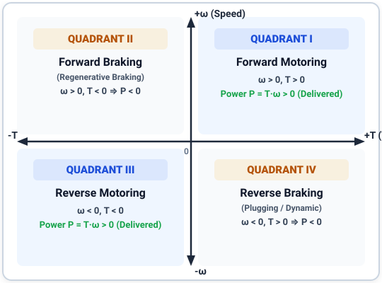
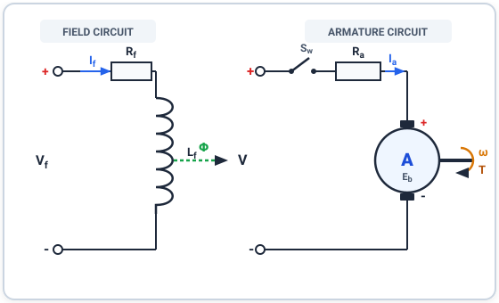

# ELECTRIC DRIVES (7th Sem)
{: .page-title }

### MID SEMESTER Q&A
{: .page-subtitle }

## Q1. Describe the 4-quadrant operation of an electrical drive. <small>(5 marks · Mid Sem)</small>

???+ info "Note"
    

    

    An electric drive operates in four distinct quadrants on the torque-speed plane depending on the sign of angular speed ($\omega$) and electromagnetic torque ($T$):

    * **Quadrant I (Forward Motoring):** $\omega > 0$ and $T > 0$. The motor delivers positive mechanical power to the load ($P = T\omega > 0$). Examples include an electric vehicle accelerating forward or a crane hoist lifting a load.
    * **Quadrant II (Forward Braking / Generating):** $\omega > 0$ and $T < 0$. The motor rotates in the forward direction while developing negative (opposing) torque ($P = T\omega < 0$). Mechanical power from the load is converted back into electrical power through regenerative braking.
    * **Quadrant III (Reverse Motoring):** $\omega < 0$ and $T < 0$. Both speed and torque are reversed, delivering positive mechanical power in the reverse direction ($P = T\omega > 0$).
    * **Quadrant IV (Reverse Braking):** $\omega < 0$ and $T > 0$. The motor rotates in the reverse direction while developing positive opposing torque ($P = T\omega < 0$) to decelerate or control lowering motion.

    

    

    { loading=lazy }

    

    

    *Source: G.K. Dubey, Fundamentals of Electrical Drives, Ch. 1*

## Q2. Derive the torque-speed equation for a separately excited DC motor. <small>(5 marks · Mid Sem)</small>

???+ info "Note"
    

    

    **Assumptions:** Steady-state operation, constant field excitation ($I_f = \text{const} \implies \Phi = \text{const}$), and negligible armature reaction.

    1. **Armature Circuit Voltage Equation:**
       Under steady-state DC conditions, the armature terminal voltage $V$ is balanced by back EMF $E_b$ and armature resistance drop:
       $$ V = E_b + I_a R_a $$
       where $I_a$ is armature current and $R_a$ is armature winding resistance.

    2. **Back EMF Relation:**
       $$ E_b = K_b \Phi \omega = K \Phi \omega $$
       where $K$ is the motor design constant ($K = \frac{P Z}{2 \pi A}$), $\Phi$ is the magnetic flux per pole, and $\omega$ is angular speed in rad/s.

    3. **Electromagnetic Torque Expression:**
       $$ T = K_t \Phi I_a = K \Phi I_a \implies I_a = \frac{T}{K \Phi} $$

    4. **Substitution & Derivation:**
       Substituting $E_b$ and $I_a$ into the voltage equation:
       $$ V = K \Phi \omega + \left(\frac{T}{K \Phi}\right) R_a $$

    5. **Final Torque-Speed Governing Equation:**
       Solving for angular speed $\omega$:
       $$ \omega = \frac{V}{K \Phi} - \frac{R_a}{(K \Phi)^2} T $$

    * **Ideal No-Load Speed:** $\omega_0 = \frac{V}{K \Phi}$ at zero torque ($T = 0$).
    * **Speed Droop:** The speed drops linearly with torque with slope $m = -\frac{R_a}{(K \Phi)^2}$.

    

    

    { loading=lazy }

    

    

    *Source: G.K. Dubey, Fundamentals of Electrical Drives, Ch. 2*
