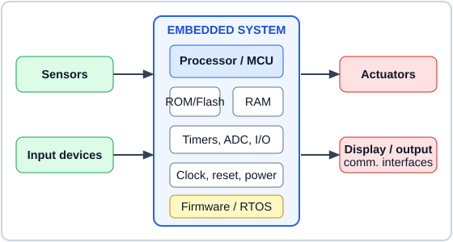
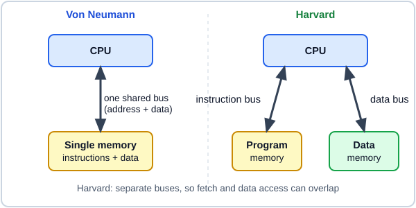
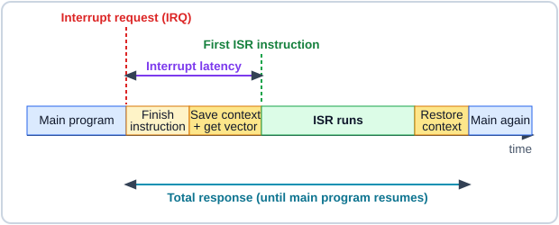
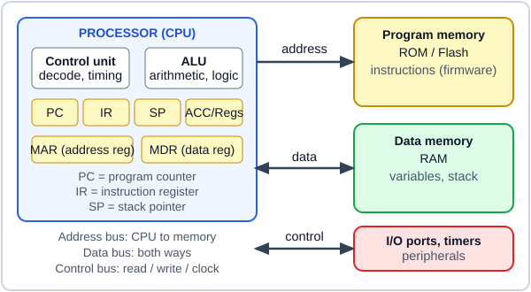
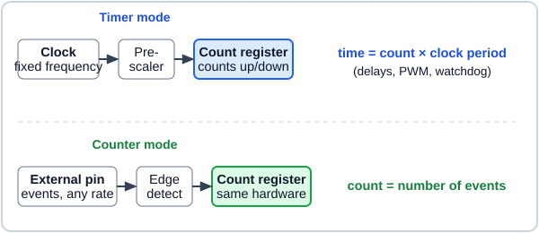

# Embedded System — Mid Sem

## Syllabus

Practice these questions only.

<!--
TO ADD QUESTIONS: write each question like this (plain Markdown, nothing else needed):

## Q12. Question text here <small>(5 marks · Mid Sem)</small>

Answer text. See AGENTS.md section 6 for pictures, video, tables and the rules.
-->

## Q1. Identify the components of an embedded system. <small>(2 marks · Mid Sem)</small>

*Illustration: block view of an embedded system*

- **Hardware:** processor or microcontroller, memory (ROM / Flash and RAM), sensors and input devices, actuators and output devices, timers, ADC / DAC and I/O ports, plus clock, reset and power supply.
- **Software:** firmware (and an RTOS if used) stored in memory, which makes the hardware perform its one dedicated task.

## Q2. What are the various classifications of embedded systems? <small>(2 marks · Mid Sem)</small>

- **By generation and complexity:** 1st generation (4/8-bit), 2nd (8-bit microcontrollers), 3rd (16/32-bit, DSP, ASIC) and 4th (SoC, multicore); also small-scale, medium-scale and sophisticated systems.
- **By behaviour and use:** real-time (hard and soft) versus non-real-time, event-triggered versus time-triggered, and standalone, networked or mobile systems.

## Q3. Identify the different processors used in embedded systems. <small>(2 marks · Mid Sem)</small>

- **Processing units:** general purpose microprocessor, microcontroller (8051, PIC, AVR, ARM) and digital signal processor (DSP).
- **Application specific and programmable:** ASIC, ASIP, FPGA / PLD and System on Chip (SoC).

## Q4. Define interrupt latency. <small>(2 marks · Mid Sem)</small>

- Interrupt latency is the time from the **arrival of an interrupt request** to the **first instruction of its interrupt service routine (ISR)**.
- It includes finishing the current instruction, saving the context, fetching the vector address, and any time interrupts are masked. A smaller value means a faster response.

## Q5. Differentiate between CISC and RISC processors. <small>(2 marks · Mid Sem)</small>

- **CISC:** large, complex instruction set with variable length instructions; many addressing modes; most instructions access memory and take several clock cycles; fewer registers (e.g. 8051, x86).
- **RISC:** small, simple instruction set with fixed length instructions; few addressing modes; only LOAD / STORE access memory and most instructions take one cycle; many registers and easy pipelining (e.g. ARM, AVR, PIC).

## Q6. What are the important embedded processor chips? <small>(2 marks · Mid Sem)</small>

- **8-bit and 16-bit controllers:** Intel 8051, PIC (Microchip), AVR (ATmega328), TI MSP430, Motorola 68HC11.
- **32-bit, DSP and IoT chips:** ARM Cortex-M (e.g. STM32), TI TMS320 DSP, ESP8266 / ESP32.

## Q7. Draw and compare the von-Neumann and Harvard architectures. <small>(5 marks · Mid Sem)</small>

*Illustration: von Neumann (one memory, one bus) and Harvard (separate memories and buses)*

- **Memory:** von Neumann uses one memory for program and data; Harvard uses separate program and data memories.
- **Buses:** von Neumann has one shared address and data bus; Harvard has separate buses for each memory.
- **Speed:** in von Neumann an instruction fetch and a data access cannot overlap (bus bottleneck); in Harvard they happen in parallel, so it is faster and suits pipelining.
- **Hardware:** von Neumann is simpler and cheaper; Harvard needs more buses and pins, so it is more complex.
- **Use:** von Neumann in general purpose computers (x86); Harvard in microcontrollers and DSPs (8051, PIC, AVR).

## Q8. Explain in detail about interrupt latency and its solutions. <small>(5 marks · Mid Sem)</small>

*Illustration: timeline from interrupt request to ISR and back*

- **Meaning:** interrupt latency is the delay between the interrupt request and the first instruction of the ISR.
- **Causes:** finishing a long current instruction, interrupts masked in a critical section, a higher-priority interrupt running first, and memory wait states.
- **Fixed overheads:** saving the context (PC, flags, registers) and fetching the ISR address from the vector table.
- **Solution 1:** keep the ISR short (do urgent work only, defer the rest to the main program) and keep interrupt-disabled sections short.
- **Solution 2:** use priorities and nested interrupts, a vectored interrupt controller, register banks for fast context switch, fast memory for the vector table and ISR, and DMA to avoid an interrupt per byte.

## Q9. Illustrate briefly the various memories used in embedded systems. <small>(5 marks · Mid Sem)</small>

- **ROM family (non-volatile):** masked ROM (factory programmed) and PROM (user programmed once).
- **EPROM and EEPROM:** EPROM is erased by UV light; EEPROM is erased electrically byte by byte, used for small settings.
- **Flash:** erased in blocks; the most common memory for firmware.
- **RAM (volatile):** SRAM is fast with no refresh, used for registers and small data memory; DRAM is dense and cheap but needs refresh.
- **Others:** NVRAM / FRAM (keeps data without power), cache (small and very fast), CPU registers and external storage such as SD cards.

## Q10. Illustrate the simple view of the organization of processor and memory in a system. <small>(10 marks · Mid Sem)</small>

*Illustration: CPU, memory, I/O and the three buses*

- **Control unit:** decodes each instruction and generates the timing and control signals.
- **ALU:** performs arithmetic and logic operations on the data.
- **Registers:** the accumulator and general registers hold working data.
- **PC and IR:** the program counter holds the address of the next instruction; the instruction register holds the one being executed.
- **SP, MAR and MDR:** the stack pointer points to the top of the stack in RAM; the memory address register holds the address to access; the memory data register holds the data read or written.
- **Program memory:** ROM / Flash stores the firmware instructions.
- **Data memory:** RAM stores variables, the stack and temporary results; I/O ports and timers are reached through the same buses.
- **Address bus:** one way, CPU to memory and I/O; $n$ lines can address $2^n$ locations.
- **Data bus and control bus:** the data bus carries instructions and data both ways; the control bus carries read, write, clock, reset and interrupt signals.
- **Working:** the cycle is fetch (PC address, read the instruction into IR, PC increments), decode, execute (ALU, store the result), then repeat.

## Q11. Explain the functional difference between timers and counters. <small>(10 marks · Mid Sem)</small>

*Illustration: the same count register driven by a clock (timer) or by external events (counter)*

- **Common hardware:** both are a register that counts up (or down) one step for every pulse it receives; only the pulse source differs.
- **Timer clock source:** the register is clocked by the internal clock, which has a fixed, known frequency, often through a prescaler.
- **Timer function:** because the pulse period is known, the count measures time: time = count × clock period.
- **Timer events:** it overflows or matches a compare value after a fixed time and can raise an interrupt.
- **Timer uses:** delay generation, periodic tasks, baud-rate generation, PWM and watchdog.
- **Counter clock source:** the register is clocked by an external signal on a pin, on each rising or falling edge.
- **Counter function:** the pulses can arrive at any rate, so the count measures the number of events, not time.
- **Counter uses:** counting products on a conveyor, shaft revolutions or measuring the frequency of a pulse signal.
- **Mode selection:** a control bit selects timer or counter mode (e.g. the C/T bit in the 8051 TMOD register).
- **Link between them:** a counter fed with a signal of known frequency works as a timer, which is why one unit does both jobs.
