# HRD & Organisational Behaviour — Mid Sem

## Syllabus

1. Organizational Behaviour — definition, importance, history, fundamental concepts
2. Personality and Attitudes
3. Perception
4. Motivation — Maslow, McGregor and other theories
5. Group Behaviour
6. Communication
7. Leadership
8. Organizational Politics
9. Conflict Management
10. Organizational Design

**Main textbook:** Stephen P. Robbins, Timothy A. Judge — *Organizational Behavior* (Pearson)

## Q1. Explain the various Barriers to Effective Communication (Physical, Semantic, Language, Psychological, Perception, Cultural, Information Overload) and the ways to overcome them. <small>(10 marks · Mid Sem · Module 6)</small>

*Module 6 — Communication: Communication Process, Barriers & Overcoming Barriers*

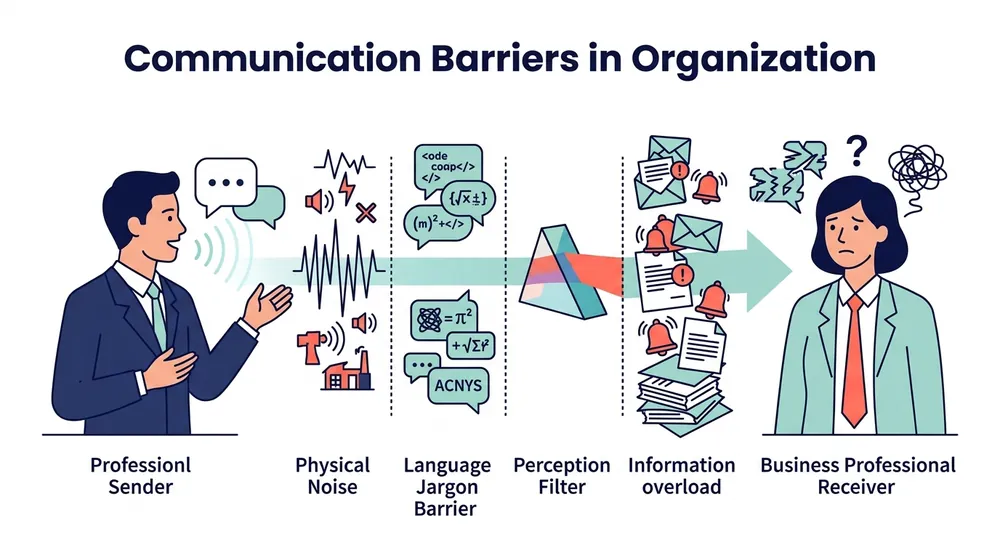{ loading=lazy }
*Illustration: Key barriers to communication in the workplace (physical noise, semantic confusion, psychological state, cultural filters) and methods to overcome them*

Communication fails when noise or filters distort the message between the sender and the receiver. To answer in the exam, remember the memory hook **7 Barriers (`P-S-L-P-P-C-I`) + 3 Fixes (`S-L-F`)**:

1. **Physical Barriers (Environment & Distance):** These are physical obstacles in the workplace that block messages—such as loud factory floor noise, closed office doors, faulty microphones, poor internet connections, or employees sitting in different buildings and time zones.
2. **Semantic Barriers (Word Meaning Confusion):** "Semantics" refers to the meaning of words; this barrier occurs when the same word, symbol, or acronym carries completely different meanings for the sender and receiver (e.g., a manager saying finish *"as soon as possible"* meaning today, while the subordinate interprets it as next week).
3. **Language & Jargon Barriers:** Using complex technical jargon, heavy unfamiliar accents, or non-native phrasing creates confusion—for instance, an engineer explaining a software crash using low-level code slang to a business manager who does not know technical terminology.
4. **Psychological & Emotional Barriers:** An individual's current mental or emotional state distorts objective comprehension; an employee who is angry, anxious, burned out, or fearful of a punitive manager cannot focus on or objectively decode the message.
5. **Perception Barriers (Filtering & Stereotyping):** Every person perceives through their own psychological lens; listeners often exhibit **selective perception** (hearing only what confirms their existing beliefs) or stereotyping the speaker before evaluating the factual content.
6. **Cultural Barriers:** In diverse global organizations, employees bring contrasting cultural norms regarding non-verbal body language, eye contact, and etiquette (for example, direct eye contact signifies confidence in Western cultures but may be perceived as disrespectful in others).
7. **Information Overload:** When an employee receives an unmanageable volume of emails, chat alerts, technical reports, and meeting requests simultaneously, cognitive capacity is exceeded, leading to missed deadlines, ignored notices, and fatigue.
8. **Way to Overcome 1 — Keep Language Simple & Clear:** Senders must eliminate unnecessary jargon, use clear active-voice phrasing, and tailor the complexity of the vocabulary directly to the background of the audience.
9. **Way to Overcome 2 — Practice Active Listening & Empathy:** Both parties should give full undivided attention without interrupting, mentally put themselves in the speaker's position (empathetic listening), and suspend emotional defensiveness.
10. **Way to Overcome 3 — Use Closed-Loop Feedback & Appropriate Channels:** Senders must ask confirmation questions to verify comprehension (**two-way feedback**) and match the channel to the message urgency (e.g., face-to-face or phone call for sensitive interpersonal matters instead of long email threads).

*Source: Robbins & Judge, Organizational Behavior — Chapter on Communication*

## Q2. Discuss the different Directions of Communication in an organization and analyse the Role/Importance of Communication in Organisational Behaviour. <small>(10 marks · Mid Sem · Module 6)</small>

*Module 6 — Communication: Direction of Flow & Importance in OB*

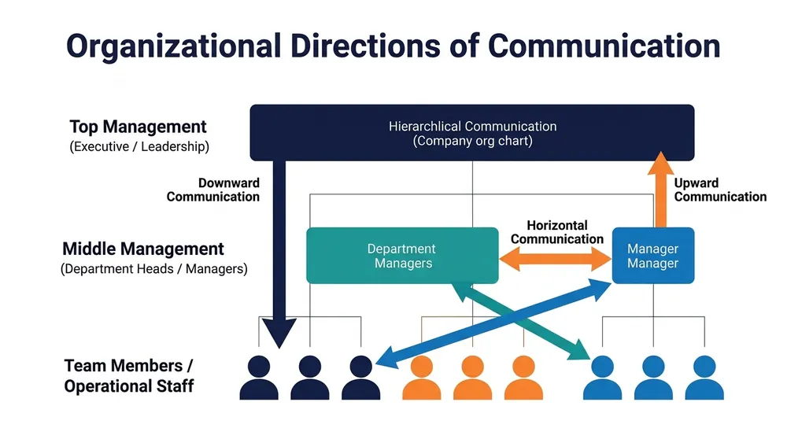{ loading=lazy }
*Illustration: Downward (top-to-bottom), Upward (bottom-to-top), Horizontal (peer-to-peer), and Diagonal cross-departmental communication flows*

Communication serves as the nervous system of an enterprise. Use the memory hook **4 Directions (`D-U-H-D`) + 6 Roles in OB (`G-D-M-T-C-C`)**:

1. **Downward Communication (Top to Bottom):** Information flows from managerial leadership down to subordinates along the hierarchy; used to transmit job instructions, organizational policies, performance targets, and strategic vision.
2. **Upward Communication (Bottom to Top):** Information travels from operational subordinates to managers; essential for progress updates, grievance reporting, suggestion box feedback, and employee engagement surveys.
3. **Horizontal / Lateral Communication (Peer to Peer):** Communication occurring among colleagues or managers at the identical hierarchical rank (e.g., Marketing Head coordinating with Production Head) to align workflows and resolve interdepartmental bottlenecks.
4. **Diagonal / Crosswise Communication (Across Levels & Departments):** Direct interaction between staff members in different departments and at different hierarchical ranks without strictly traversing intermediate chain-of-command nodes (e.g., a software developer consulting a Finance Director on project billing).
5. **Role in OB 1 — Clarifies Goals & Performance Expectations:** Clear communication informs every employee exactly what tasks to execute, which quality standards apply, and how individual output impacts enterprise goals.
6. **Role in OB 2 — Facilitates Sound Managerial Decision-Making:** Unfiltered upward and lateral information flow provides leadership with accurate operational data, customer feedback, and risk alerts required to make evidence-based decisions.
7. **Role in OB 3 — Enhances Motivation & Workplace Morale:** Providing positive recognition, clear developmental feedback, and transparent reward criteria reinforces high performance and intrinsic motivation.
8. **Role in OB 4 — Fosters Teamwork & Eliminates Grapevine Rumours:** Open, transparent organizational channels reduce anxiety, dispel unofficial grapevine gossip, and build psychological trust among team members.
9. **Role in OB 5 — Prevents and De-escalates Interpersonal Conflict:** Clarifying ambiguities around roles, timelines, and resource ownership early prevents minor operational differences from degenerating into dysfunctional interpersonal clashes.
10. **Role in OB 6 — Powers Change Management & Reduces Resistance:** When organizational restructuring or new technologies occur, empathetic leadership communication explains the strategic necessity, alleviating employee anxiety and resistance.

*Source: Robbins & Judge, Organizational Behavior — Chapter on Communication*

## Q3. Explain the Communication Process with a neat diagram and state the importance of Noise and Feedback. <small>(5 marks · Mid Sem · Module 6)</small>

*Module 6 — Communication: The Shannon-Weaver / OB Communication Model*

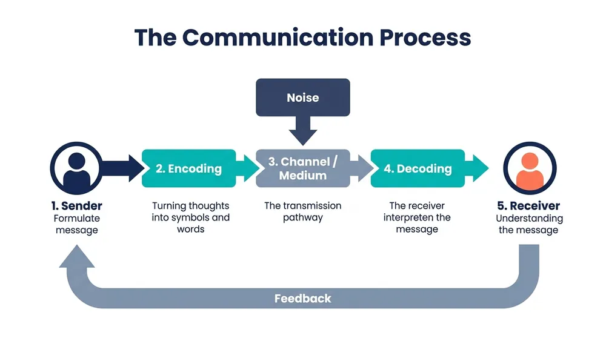{ loading=lazy }
*Illustration: Communication loop showing Sender, Encoding, Channel/Medium, Decoding, Receiver, Noise interference, and the Feedback return loop*

The communication process is a dynamic, circular model consisting of 5 essential stages and components:

1. **Sender & Encoding:** The process initiates when the **Sender** conceives a concept or message and encodes that internal thought into symbolic form (words, diagrams, numeric tables, or gestures) suitable for transmission.
2. **Message & Medium (Channel):** The **Message** represents the physical product generated by encoding; the **Channel** is the carrier or medium (email, written memorandum, phone call, or face-to-face conference) selected to transfer it.
3. **Receiver & Decoding:** The **Receiver** is the intended destination target of the message; **Decoding** is the psychological process where the receiver interprets and translates the symbols back into thought.
4. **Noise (Interference):** **Noise** represents any unwanted disruption—ambient acoustic noise, linguistic jargon, poor internet connectivity, or emotional bias—that distorts message clarity anywhere along the transmission pathway.
5. **Feedback Loop:** **Feedback** is the check on how successfully transmission took place; by communicating a reaction or verification back to the sender, the receiver closes the loop and confirms shared understanding.

*Source: Robbins & Judge, Organizational Behavior — Chapter on Communication*

## Q4. Define Communication and list two elements of the communication process. <small>(2 marks · Mid Sem · Module 6)</small>

*Module 6 — Communication: Core Definition*

* **Definition of Communication:** Communication is the two-way transactional process of transmitting information, ideas, feelings, and mutual understanding from one person (the sender) to another (the receiver).
* **Two Key Elements:**
    1. **Sender:** The originator who conceives the idea and encodes it into transmittable symbols.
    2. **Feedback:** The receiver's response returned to the sender, verifying whether the message was accurately decoded.

## Q5. Differentiate between Downward and Upward Communication with two examples of each. <small>(2 marks · Mid Sem · Module 6)</small>

*Module 6 — Communication: Directional Comparison*

* **Downward Communication:** Information flowing down the formal chain of command from management to lower-level employees to direct work; *Examples:* (1) Company policy circulars, (2) Quarterly performance targets.
* **Upward Communication:** Information flowing upward from subordinates to managerial superiors to provide ground-level intelligence; *Examples:* (1) Weekly project status reports, (2) Formal employee grievances or suggestion box ideas.

## Q6. Define Horizontal and Diagonal Communication. <small>(2 marks · Mid Sem · Module 6)</small>

*Module 6 — Communication: Lateral & Cross-Functional Flows*

* **Horizontal Communication:** The lateral exchange of messages between colleagues or department heads occupying the **same organizational hierarchical rank** (e.g., Production Manager coordinating with Quality Control Manager) to achieve cross-functional task synchronization.
* **Diagonal Communication:** The cross-functional exchange of information between personnel situated at **different hierarchical ranks and in different functional departments** (e.g., an IT support engineer communicating directly with the Head of Sales) to bypass bureaucratic delays.

## Q7. Discuss the different Theories and Styles of Leadership in detail. <small>(10 marks · Mid Sem · Module 7)</small>

*Module 7 — Leadership: Classic & Modern Theories and Core Styles*

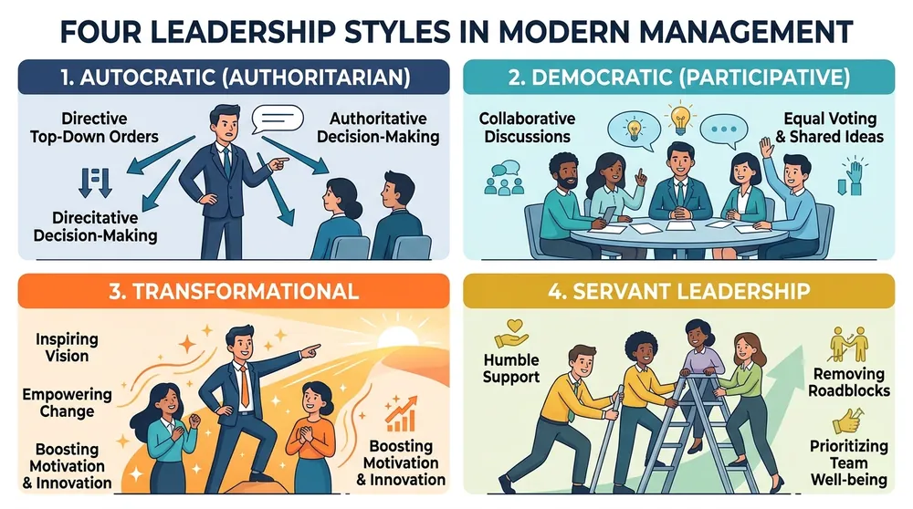{ loading=lazy }
*Illustration: Classical and modern leadership theories (Trait, Behavioural, Contingency, Situational) and contrasting leadership styles (Autocratic, Democratic, Transformational, Servant)*

Leadership is the capacity to influence and direct a group toward organizational objectives. Remember the memory hook **4 Classic Theories (`T-B-C-S`) + 2 Basic Styles (`A-D`) + 4 Modern Styles (`T-T-S-A`)**:

1. **Trait Theory ("Leaders are Born, Not Made"):** Early 20th-century approach proposing that effective leaders possess innate genetic traits and personality characteristics—including high cognitive intelligence, emotional resilience, extraversion, integrity, and drive—that distinguish them from non-leaders.
2. **Behavioural Theory ("Leaders are Made by Learned Actions"):** Posits that leadership efficacy is rooted in observable behaviours rather than fixed biology; classic Ohio State and Michigan studies categorized behaviours into **Initiating Structure** (task/production focus) and **Consideration** (people/relationship focus).
3. **Contingency Theory (Fiedler's Model):** Asserts that no single leadership style is universally optimal; organizational performance depends on matching a leader's fixed motivational style (measured via the Least Preferred Coworker / LPC scale) to situational favorableness (leader-member relations, task structure, position power).
4. **Situational Leadership Model (Hersey & Blanchard):** Argues that adaptable leaders dynamically match their behaviour (Telling, Selling, Participating, or Delegating) to the **follower readiness level**—defined as the developmental maturity, task ability, and willingness of subordinates.
5. **Autocratic (Authoritarian) Leadership Style:** The leader retains centralized decision-making authority, dictates task protocols without consulting subordinates, and expects strict compliance; effective during crises or with novice staff, but stifles creativity.
6. **Democratic (Participative) Leadership Style:** The leader actively involves subordinates in decision deliberations, invites diverse viewpoints, and fosters consensus; enhances employee job satisfaction, buy-in, and team innovation.
7. **Transactional Leadership Style:** Rooted in formal authority and an economic exchange relationship; the leader specifies explicit performance targets, dispenses rewards for compliance (**contingent rewards**), and intervenes only when standards are breached (**management by exception**).
8. **Transformational Leadership Style:** The leader inspires followers to transcend narrow self-interest for the collective enterprise vision through charisma, emotional intellectual stimulation, and personal mentoring (the 4 I's).
9. **Servant Leadership Style:** Articulated by Robert Greenleaf; inverts the traditional leadership pyramid by positioning the leader as a humble steward whose primary duty is serving, empowering, and developing subordinates first.
10. **Authentic Leadership Style:** Leaders exhibit high self-awareness, relational transparency, and steadfast moral consistency; they openly acknowledge human limitations, act ethically in public and private, and foster high trust.

*Source: Robbins & Judge, Organizational Behavior — Chapter on Leadership*

## Q8. Differentiate between Transactional and Transformational Leadership with examples, and explain the Importance of Leadership & its Role in Change Management. <small>(10 marks · Mid Sem · Module 7)</small>

*Module 7 — Leadership: Comparative Models & Leading Change*

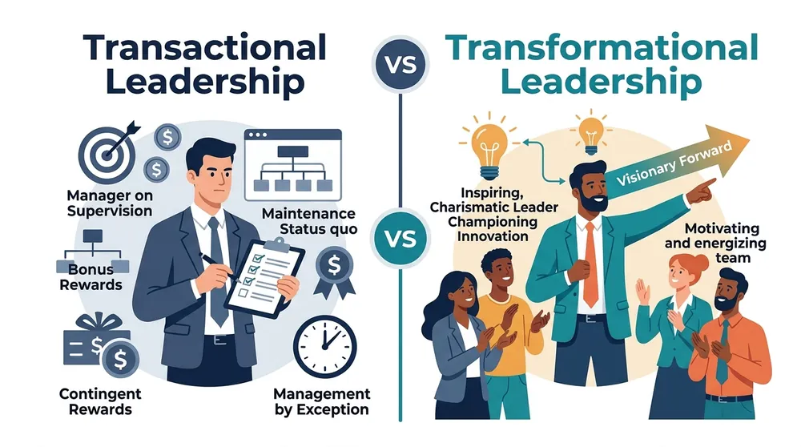{ loading=lazy }
*Illustration: Side-by-side comparison of Transactional leadership (routine maintenance, carrot-and-stick incentives) vs. Transformational leadership (inspiring vision, 4 I's, cultural transformation)*

Leadership drives both operational consistency and strategic renewal. Remember the memory hook **5 Comparison Dimensions + 5 Value/Change Dimensions**:

1. **Core Operational Focus (Stability vs. Transformation):** **Transactional leaders** concentrate on maintaining day-to-day stability, standard operating procedures, and predictability; **Transformational leaders** focus on long-range vision, paradigm shifts, and organizational renewal.
2. **Motivational Mechanism (Extrinsic vs. Intrinsic):** **Transactional** approaches utilize extrinsic "carrot-and-stick" incentives (commissions, bonuses, or corrective discipline); **Transformational** approaches tap into intrinsic motivation, aligning work with purpose, values, and pride.
3. **The 4 I's of Transformational Leadership:** Transformational leaders drive change using (a) *Idealized Influence* (role modelling), (b) *Inspirational Motivation* (compelling vision), (c) *Intellectual Stimulation* (challenging status quo), and (d) *Individualized Consideration* (coaching).
4. **Attitude Toward Existing Organizational Rules:** **Transactional** managers enforce existing rules and optimize within established boundaries (reactive); **Transformational** leaders actively disrupt obsolete practices and invent new methods (proactive).
5. **Real-World Examples:** An operations supervisor tracking daily manufacturing quotas against piece-rate incentives exemplifies **Transactional** leadership; leaders such as Satya Nadella shifting Microsoft from internal bureaucracy to a "learn-it-all" cloud-first culture exemplify **Transformational** leadership.
6. **Importance 1 — Strategic Alignment & Direction:** Effective leadership translates broad corporate missions into operational targets, ensuring every employee and department pulls in a unified strategic direction.
7. **Importance 2 — Team Cohesion & Psychological Morale:** Leaders unify diverse personalities into high-performing teams, sustaining resilience, optimism, and engagement through adverse business headwinds.
8. **Role in Change 1 — Articulating the Need and Vision for Change:** Because humans naturally fear uncertainty, leaders formulate an urgent, persuasive narrative explaining *why* the status quo is untenable and *how* the future state benefits everyone.
9. **Role in Change 2 — Mitigating Resistance Through Empathy & Involvement:** Rather than relying on coercive decrees, transformational leaders actively listen to employee concerns, provide required retraining, and involve teams in transition design.
10. **Role in Change 3 — Anchoring Changes in Corporate Culture:** Leaders celebrate early transition wins, reinforce desired new behaviours with formal metrics, and institutionalize change into permanent cultural rituals.

*Source: Robbins & Judge, Organizational Behavior — Chapter on Leadership*

## Q9. Critically evaluate Servant Leadership and Authentic Leadership with examples. <small>(5 marks · Mid Sem · Module 7)</small>

*Module 7 — Leadership: Modern Ethical & People-Centric Frameworks*

{ loading=lazy }
*Illustration: Conceptual attributes of Servant Leadership (stewardship, developing people) and Authentic Leadership (relational transparency, ethical moral compass)*

Modern organizational dynamics increasingly prioritize human-centric and ethical leadership:

1. **Servant Leadership Philosophy:** Formulated by Robert Greenleaf, this model inverts classical authority; the leader's primary goal is to **serve the developmental, physical, and psychological needs of followers**, facilitating their growth so they perform at their best (*Example:* A technical manager spending late hours shielding engineers from political noise and providing coding mentorship).
2. **Key Capabilities of Servant Leaders:** Emphasizes active listening, empathy, emotional healing, stewardship of institutional resources, and community building within the organization.
3. **Authentic Leadership Philosophy:** Centers on transparency, ethical integrity, and deep self-awareness; authentic leaders lead from core personal convictions, openly admit errors, and maintain behavioural consistency across private and public spheres (*Example:* A CEO publicly accepting accountability for an unsuccessful product launch rather than blaming division staff).
4. **Key Capabilities of Authentic Leaders:** High self-awareness of strengths and vulnerabilities, balanced processing of opposing evidence, internalized ethical moral standards, and relational transparency.
5. **Critical Evaluation (Strengths & Limitations):** Both paradigms generate extraordinary employee retention, psychological safety, and reciprocal loyalty; however, both can suffer operational sluggishness during severe emergency crises that demand unilateral, top-down autocratic execution.

*Source: Robbins & Judge, Organizational Behavior — Chapter on Leadership*

## Q10. Define Leadership and list two functions of a leader. <small>(2 marks · Mid Sem · Module 7)</small>

*Module 7 — Leadership: Definition & Roles*

* **Definition of Leadership:** Leadership is the interpersonal influence process of inspiring, guiding, and enabling individuals and groups to willingly direct their energies toward the attainment of shared organizational objectives.
* **Two Functions of a Leader:**
    1. **Setting Strategic Direction:** Formulating and communicating a compelling, coherent future vision for the team.
    2. **Empowering and Motivating People:** Coaching team members, removing operational barriers, and sustaining morale during adversity.

## Q11. State two traits of a leader and define the Behavioural Theory of Leadership. <small>(2 marks · Mid Sem · Module 7)</small>

*Module 7 — Leadership: Traits & Behavioural Premise*

* **Two Key Leadership Traits:** (1) **High Emotional Intelligence / Integrity** (truthfulness, self-regulation, and trust-building), and (2) **Cognitive Decisiveness / Self-Confidence** (sound judgment under ambiguous operating conditions).
* **Behavioural Theory of Leadership:** A school of management thought proposing that leadership effectiveness is determined by **specific observable behaviours and actions** rather than inherited traits—meaning that successful leadership capabilities can be systematically taught and mastered.

## Q12. Explain in detail the Factors Contributing to Organizational Politics (Individual and Organizational Factors) with examples. <small>(10 marks · Mid Sem · Module 8)</small>

*Module 8 — Organizational Politics: Etiology & Contributing Factors*

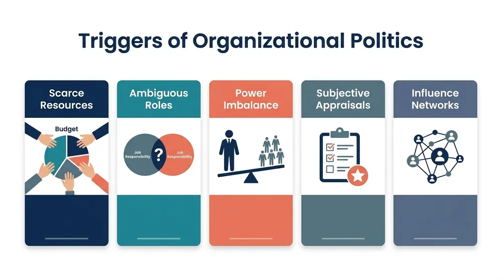{ loading=lazy }
*Illustration: Triggers of office politics: resource scarcity, role ambiguity, power asymmetries, subjective evaluation metrics, and informal influence cliques*

Organizational politics comprises activities undertaken by individuals to acquire, develop, and use power to advance personal or group agendas outside formal protocols. Remember the memory hook **6 Organizational Factors (`S-A-P-P-C-S`) + 4 Individual/Social Factors (`A-I-T-L`)**:

1. **Scarcity of Tangible Resources:** When budgets, headcount allocations, promotion vacancies, or equipment access are limited, departments and managers engage in intense lobbying, information hoarding, and coalition games to capture the scarce resource.
2. **Role Ambiguity and Vague Performance Expectations:** When job responsibilities, project ownership, or promotional criteria are poorly defined, political actors exploit grey zones to take credit for collaborative successes and displace accountability for failures.
3. **Power Asymmetries and Rigid Hierarchy:** Pronounced imbalances in formal authority incentivize subordinate employees to utilize flattery (**ingratiation**), form unofficial defensive alliances, or cater to managerial gatekeepers for protection.
4. **Subjective Performance Appraisal Systems:** When salary hikes and career progressions hinge on discretionary managerial impressions rather than quantifiable metrics, employees prioritize "impression management" (projecting visibility) over substantive output.
5. **Organizational Culture (Low Openness & High Zero-Sum Competition):** If a corporate environment fosters zero-sum rivalry and punishes open mistakes, employees naturally adopt Machiavellian political manoeuvres for survival.
6. **Organizational Structure (Rigid Silos & Tall Pyramids):** Tall departmental structures create isolated operational silos; employees are forced to trade informal political favours across departments to expedite approvals blocked by red tape.
7. **Personal Ambition & Machiavellianism (High Mach Personality):** Individuals driven by unconstrained ambition or possessing high Machiavellian traits view manipulation, deceit, and tactical alliances as legitimate pathways to rapid career progression.
8. **Informal Influence Networks & In-Group Cliques:** Informal social coalitions—such as alumni networks or inner-circle patronage cliques—trade mutual favours behind closed doors to steer promotions and project assignments to their favoured members.
9. **Low Organizational Trust:** In environments where leadership or colleagues are perceived as untrustworthy, employees act defensively, conceal sensitive data, and play covert political games to protect their tenure.
10. **Role Modelling by Senior Executives:** When senior executives visibly promote favourites, solicit sycophantic flattery, or backstab peers, junior personnel adopt identical political behaviours as the perceived currency for success.

*Source: Robbins & Judge, Organizational Behavior — Chapter on Power and Politics*

## Q13. Evaluate both the Positive and Negative sides of Organizational Politics. <small>(5 marks · Mid Sem · Module 8)</small>

*Module 8 — Organizational Politics: Dual-Impact Assessment*

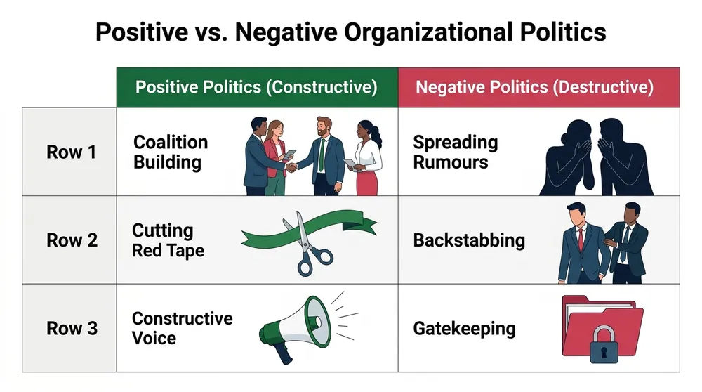{ loading=lazy }
*Illustration: Contrast between constructive political skill (coalition building, cutting red tape) and destructive political games (backstabbing, gatekeeping, toxic rumours)*

Organizational politics is a double-edged sword that can either lubricate organizational gridlocks or poison workplace culture:

1. **Definition of Organizational Politics:** The use of informal power and interpersonal influence tactics to achieve outcomes not sanctioned by formal organizational processes.
2. **Negative Consequence 1 — Depressed Morale & Elevated Employee Turnover:** When meritorious output is subordinated to sycophancy and political favouritism, high performers experience cynicism, job stress, and eventually exit the firm.
3. **Negative Consequence 2 — Information Distortion & Productivity Waste:** Destructive political games lead to data hoarding, backstabbing, and interdepartmental sabotage, diverting vital human hours from customer value creation to self-protection.
4. **Positive Dimension 1 — Cutting Red Tape & Accelerating Innovation:** Constructive political skill enables visionary managers to build cross-functional coalitions, bypass inert bureaucracy, and secure funding for innovative projects.
5. **Positive Dimension 2 — Giving Voice to Marginalized Issues:** Informal alliances and coalition lobbying often elevate neglected frontline realities and operational risks to executive awareness when formal vertical channels are unresponsive.

*Source: Robbins & Judge, Organizational Behavior — Chapter on Power and Politics*

## Q14. Discuss how Leaders can reduce negative Political Behaviour in an organization. <small>(5 marks · Mid Sem · Module 8)</small>

*Module 8 — Organizational Politics: Managerial Strategies for Mitigation*

{ loading=lazy }
*Illustration: Managerial interventions to curb toxic politics: transparent evaluation KPIs, eliminating role ambiguity, and establishing objective resource distribution*

Leaders can systematically minimize toxic workplace politics through transparent governance and structural clarity:

1. **Implement Objective, Measurable Performance Appraisals:** Tie career promotions, bonuses, and recognitions directly to verifiable quantitative KPIs and 360-degree feedback, eliminating room for subjective favouritism.
2. **Clarify Job Roles and Authority Boundaries:** Define explicit job descriptions, project deliverables, and decision rights to eradicate role ambiguity and eliminate opportunities for political turf wars.
3. **Ensure Transparent & Criteria-Based Resource Allocation:** Publish clear, data-driven criteria for capital budget allocation and headcount distribution in open forums, removing behind-the-scenes lobbying.
4. **Cultivate High Organizational Trust & Psychological Safety:** Encourage open dialogue, reward candid bad-news reporting, and penalize toxic credit-stealing and malicious office gossip.
5. **Exhibit Ethical Leadership & Zero Tolerance for Sycophancy:** Executives must consistently role-model transparency, reject flattering in-groups, and demonstrate that competence is the only currency for career advancement.

*Source: Robbins & Judge, Organizational Behavior — Chapter on Power and Politics*

## Q15. Define Organizational Politics and give two examples of political behaviour. <small>(2 marks · Mid Sem · Module 8)</small>

*Module 8 — Organizational Politics: Core Definition & Tactics*

* **Definition of Organizational Politics:** The informal, unsanctioned activities and influence strategies used by organizational members to obtain, develop, and exercise power to achieve desired self-interested or group outcomes.
* **Two Examples of Political Behaviour:**
    1. **Ingratiation (Flattery):** Excessively complimenting or doing personal favours for a superior to gain unfair advantage during appraisal cycles.
    2. **Information Gatekeeping / Hoarding:** Deliberately withholding crucial project documentation from peer teams to make oneself appear indispensable.

## Q16. What is meant by Influence Networks and Lack of Trust in organizational politics? <small>(2 marks · Mid Sem · Module 8)</small>

*Module 8 — Organizational Politics: Network & Trust Dimensions*

* **Influence Networks:** Informal webs of interpersonal relationships, friendships, and backstage coalitions within a company that individuals leverage to trade favours, circumvent official protocol, and influence managerial decisions.
* **Lack of Trust in Politics:** A toxic psychological state where employees believe leadership and peers act deceitfully or unfairly, compelling personnel to hoard data, act with defensive paranoia, and play political survival games.

## Q17. Differentiate between the Traditional and Modern Views of Conflict, compare Functional vs. Dysfunctional Conflict, and explain the 5 Stages of the Conflict Process with examples. <small>(10 marks · Mid Sem · Module 9)</small>

*Module 9 — Conflict Management: Philosophical Views, Typologies & 5-Stage Process*

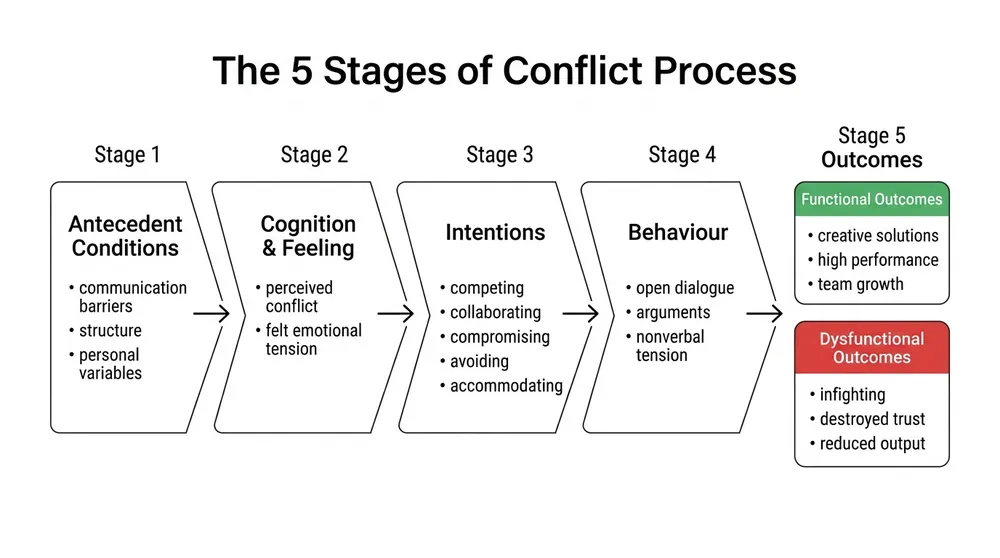{ loading=lazy }
*Illustration: 5-stage conflict process (Antecedent conditions -> Cognition/Feeling -> Intentions -> Visible behaviour -> Outcomes) leading to functional or dysfunctional results*

Conflict is an interactive process where one party perceives that another has adversely affected, or is about to adversely affect, something of value. Remember the memory hook **2 Views + 3 Functional/Dysfunctional Dimensions + 5 Process Stages (`S1` to `S5`)**:

1. **Traditional View of Conflict ("All Conflict is Bad"):** The early 20th-century human relations perspective held that all conflict is inherently harmful, counterproductive, a symptom of poor leadership, and must be completely avoided or suppressed immediately.
2. **Modern / Interactionist View of Conflict ("Constructive Conflict Drives Growth"):** The contemporary OB perspective recognizes conflict as inevitable and posits that a **moderate level of constructive debate is essential** to prevent complacency (groupthink), stimulate innovation, and drive organizational vitality.
3. **Functional Conflict (Task & Constructive Focus):** Healthy, task-oriented disagreements focused on achieving goals more effectively (e.g., software architects passionately debating two database schemas, resulting in an optimized architecture).
4. **Dysfunctional Conflict (Interpersonal & Destructive Focus):** Unhealthy, emotional relationship friction driven by personality clashes and egos (e.g., two division heads refusing to communicate because of mutual resentment, resulting in stalled projects).
5. **Core Criterion for Differentiating Functional vs. Dysfunctional:** Evaluated by outcome impact: *"Does the dispute stimulate cognitive debate that enhances team decision quality (Functional), or does it consume emotional energy and paralyze organizational performance (Dysfunctional)?"*
6. **Conflict Process Stage 1 — Potential Opposition / Incompatibility (Antecedent Conditions):** The presence of structural conditions that create conflict opportunities: (a) *Communication faults* (semantic noise), (b) *Structure* (jurisdictional ambiguities, goal incompatibility, scarce resources), or (c) *Personal variables* (divergent value systems).
7. **Conflict Process Stage 2 — Cognition and Personalization (Perceived vs. Felt Conflict):**
    * **Perceived Conflict:** Cognitive awareness that incompatibility conditions exist without emotional distress.
    * **Felt Conflict:** When the conflict becomes personalized and emotionally internalized, triggering stress, hostility, or anxiety.
8. **Conflict Process Stage 3 — Intentions (Strategic Orientations):** Decisions to act in a given way based on degree of assertiveness and cooperativeness: *Competing, Collaborating, Compromising, Avoiding,* or *Accommodating*.
9. **Conflict Process Stage 4 — Behaviour (Visible Manifestation):** The overt phase where conflict becomes observable through statements, actions, non-verbal hostility, public argumentation, and defensive reactions.
10. **Conflict Process Stage 5 — Outcomes (Functional or Dysfunctional Consequence):** The resulting aftermath—yielding either **functional outcomes** (innovative solutions, stronger cohesion) or **dysfunctional outcomes** (broken communication, hostile climate, employee attrition).

*Source: Robbins & Judge, Organizational Behavior — Chapter on Conflict and Negotiation*

## Q18. Define Negotiation, explain the 5 Steps of the Negotiation Process, and analyse the 5 Negotiation Strategies with illustrations. <small>(10 marks · Mid Sem · Module 9)</small>

*Module 9 — Conflict Management: Bargaining Frameworks & 5 Strategies*

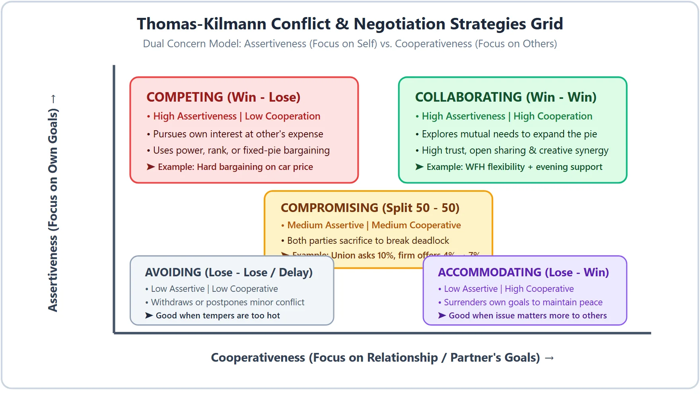{ loading=lazy }
*Illustration: Thomas-Kilmann / Dual Concern Model mapping Assertiveness vs. Cooperativeness across Competing, Collaborating, Compromising, Avoiding, and Accommodating*

Negotiation is a joint decision-making process through which two or more parties allocate resources or resolve disputes. Remember the memory hook **5 Process Steps (`P-G-C-B-C`) + 5 Strategies (`Win-Lose`, `Win-Win`, `50-50`, `Lose-Win`, `Lose-Lose`)**:

1. **Step 1 of Negotiation Process — Preparation and Planning:** Undertaking comprehensive reconnaissance before talks begin—clarifying core objectives, assessing counterpart positions, and determining one's **BATNA** (*Best Alternative to a Negotiated Agreement*).
2. **Step 2 — Definition of Ground Rules:** Formalizing procedural protocols—deciding who negotiates, establishing meeting venues, setting time constraints, and agreeing on initial agenda boundaries.
3. **Step 3 — Clarification and Justification:** Both parties state their opening proposals, followed by educating, explaining, and justifying demands using data, precedent, and documentation rather than emotional confrontation.
4. **Step 4 — Bargaining and Problem-Solving:** The transactional core of negotiation where reciprocal concessions, creative trade-offs, and package deals are explored to bridge the gap.
5. **Step 5 — Closure and Implementation:** Finalizing the mutual agreement, formalizing legal or operational contract documentation, and setting compliance milestones.
6. **Strategy 1 — Competing / Distributive Bargaining (`Win - Lose`):** High assertiveness, low cooperation; treated as zero-sum fixed-pie negotiation where one party's financial or operational gain represents the opponent's direct loss (*Example:* Price haggling on used machinery).
7. **Strategy 2 — Collaborating / Integrative Bargaining (`Win - Win`):** High assertiveness, high cooperation; parties share underlying concerns transparently to expand the pie so both achieve optimal long-term outcomes (*Example:* Granting flexible remote working in exchange for expanded international support hours).
8. **Strategy 3 — Compromising Strategy (`Split 50 - 50`):** Moderate assertiveness and cooperation; both parties concede ground to achieve an expeditious intermediate settlement (*Example:* Settle a salary dispute halfway between management's offer and union's demand).
9. **Strategy 4 — Accommodating Strategy (`Lose - Win`):** Low assertiveness, high cooperation; one party willingly sacrifices its preferences to preserve interpersonal relationship harmony or defer to a superior concern of the other.
10. **Strategy 5 — Avoiding Strategy (`Lose - Lose / Delay`):** Low assertiveness, low cooperation; consciously withdrawing from or postponing engagement when the matter is trivial, facts are incomplete, or emotional tempers require cooling.

*Source: Robbins & Judge, Organizational Behavior — Chapter on Conflict and Negotiation*

## Q19. Discuss the Advantages and Disadvantages of the Compromising Strategy in Negotiation. <small>(5 marks · Mid Sem · Module 9)</small>

*Module 9 — Conflict Management: Compromising Evaluation*

{ loading=lazy }
*Illustration: Central placement of Compromising on the assertiveness-cooperativeness matrix, showing mutual sacrifice to break negotiation deadlocks*

Compromising represents an intermediate, give-and-take strategy where both sides relinquish something of value:

1. **Nature of Compromise:** Neither party achieves total victory; parties split the difference or make mutual concessions to reach an acceptable, pragmatic settlement.
2. **Advantage 1 — Breaks Deadlocks Under Time Pressure:** When parties of equal negotiating power are stalemated and deadlines loom, compromise unlocks stalled negotiations quickly.
3. **Advantage 2 — Protects Interpersonal Relationships & Perceived Equity:** Because both sides sacrifice symmetrically, neither party suffers humiliating total defeat, keeping future working ties intact.
4. **Disadvantage 1 — Sub-optimal Satisfaction for Both Parties:** Since both sides surrender core desires, both may walk away with lingering dissatisfaction or residual resentment.
5. **Disadvantage 2 — Prevents Creative Integrative (Win-Win) Breakthroughs:** Rushing to an easy 50-50 compromise discourages negotiators from probing deeper into integrative options that could have expanded the value pie.

*Source: Robbins & Judge, Organizational Behavior — Chapter on Conflict and Negotiation*

## Q20. Define Conflict and list two Antecedent Conditions (causes) of conflict. <small>(2 marks · Mid Sem · Module 9)</small>

*Module 9 — Conflict Management: Definition & Triggers*

* **Definition of Conflict:** A dynamic process in which one party perceives that another party has negatively affected, or is about to negatively affect, something the first party cares about.
* **Two Antecedent Conditions of Conflict:**
    1. **Resource Scarcity:** Severe competition between teams over limited budgetary funds, physical equipment, or personnel.
    2. **Jurisdictional / Role Ambiguity:** Unclear task boundaries that create turf friction or buck-passing between departments.

## Q21. Differentiate between Collaborative Bargaining and Competitive Bargaining. <small>(2 marks · Mid Sem · Module 9)</small>

*Module 9 — Conflict Management: Bargaining Comparison*

* **Collaborative (Integrative) Bargaining:** A **`Win - Win`** problem-solving approach where parties build mutual trust, share information openly, and expand the resource pie to satisfy both parties' underlying needs.
* **Competitive (Distributive) Bargaining:** A **`Win - Lose`** adversarial approach operating on a fixed-pie assumption where each party aggressively seeks to capture maximum value at the direct expense of the counterpart.

## Q22. Explain the different Organizational Structures (Functional, Divisional, Matrix, Flat, Hierarchical, Network) in detail and discuss their Effects on Human Behaviour. <small>(10 marks · Mid Sem · Module 10)</small>

*Module 10 — Organizational Design: Structural Typologies & Behavioral Implications*

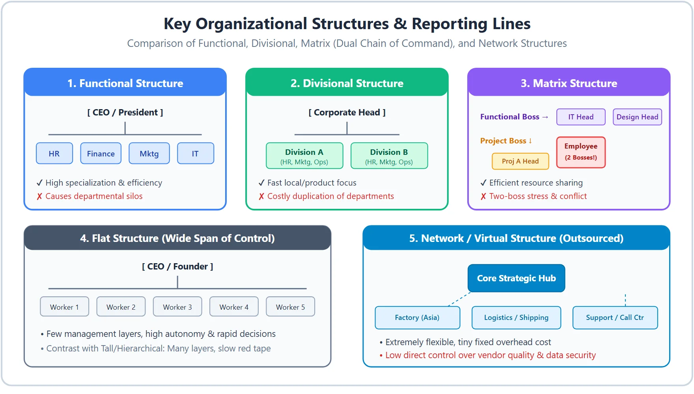{ loading=lazy }
*Illustration: Architectural comparison of Functional, Divisional, Matrix (dual chain of command), Flat, and Network organizational structures*

Organizational structure formally dictates how job tasks are divided, grouped, and coordinated. Remember the memory hook **6 Structures (`F-D-M-F-H-N`) + 4 Behavioural Effects (`M-S-C-A`)**:

1. **Functional Structure (Grouped by Skill Specialization):** Organizes personnel by common technical disciplines (e.g., dedicated Marketing, Finance, HR, and Engineering departments); maximizes operational efficiency and technical depth, but generates departmental silos.
2. **Divisional Structure (Grouped by Product, Geography, or Client):** Partitions the enterprise into self-contained operational divisions (e.g., Consumer Electronics vs Industrial Systems, or Asia-Pacific vs North America), each housing its own functional support units; delivers product agility, but duplicates overhead.
3. **Matrix Structure (Dual Reporting Lines — Two Bosses):** Blends functional and project command lines; specialists report concurrently to both a **Functional Department Head** and a **Project / Product Manager**; optimizes expert resource deployment, but triggers role conflict.
4. **Flat Structure (Few Hierarchical Layers, Wide Span of Control):** Features minimal vertical management layers between executive leadership and frontline staff; fosters autonomy, fast communication, and empowerment in agile startups.
5. **Hierarchical / Tall Structure (Many Layers, Narrow Span of Control):** Resembles a traditional pyramid with tight supervisory oversight and formal chains of command; provides clear career ladders, but slows communication via bureaucratic red tape.
6. **Network / Virtual Structure (Core Hub + Outsourced Partners):** A streamlined central executive nucleus that maintains strategic core competencies while outsourcing manufacturing, distribution, IT, and customer care to global partners; maximizes flexibility, but reduces control.
7. **Behavioural Effect 1 — On Motivation & Psychological Autonomy:** **Flat and decentralized structures** satisfy employee intrinsic needs for autonomy and self-determination, whereas **tall hierarchical structures** induce feelings of powerlessness and mechanistic compliance.
8. **Behavioural Effect 2 — Role Stress & Two-Boss Ambiguity in Matrix Models:** Violating the classical "Unity of Command" principle causes employees in **Matrix structures** to endure acute role conflict, deadline friction, and managerial loyalty dilemmas.
9. **Behavioural Effect 3 — Silo Mentalities vs. Collaborative Cohesion:** **Functional structures** encourage insular "turf mentalities" where employees prioritize department loyalty over corporate goals; **Divisional and Cross-Functional models** enhance client-centric teamwork.
10. **Behavioural Effect 4 — Career Predictability vs. Perceived Security:** **Tall structures** offer predictable status markers and structured promotion pathways; **Network and Virtual structures** generate high developmental agility at the cost of lower perceived long-term job security.

*Source: Robbins & Judge, Organizational Behavior — Chapter on Organizational Structure*

## Q23. Explain the concepts of Organizational Culture (and its Elements) and Organizational Climate (and its Impact on Employees), and evaluate the Relationship/Difference between them. <small>(10 marks · Mid Sem · Module 10)</small>

*Module 10 — Organizational Design: Culture vs. Climate Foundations*

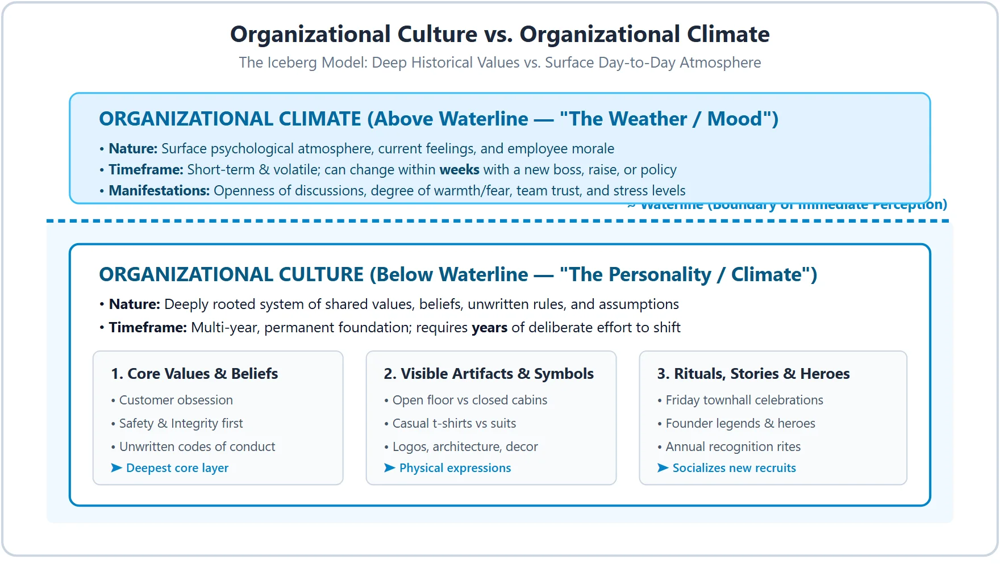{ loading=lazy }
*Illustration: The Iceberg Model: Deep, historical Culture (values, artifacts, rituals) below the waterline vs. immediate surface Climate (office mood, morale, trust) above*

Culture and climate represent the deep personality and surface mood of an enterprise. Remember the memory hook **4 Culture Elements + 3 Climate/Impact Points + 3 Culture vs. Climate Comparison Dimensions**:

1. **Concept of Organizational Culture ("The Deep Personality"):** A system of shared values, basic assumptions, beliefs, and unwritten norms that governs how members perceive, think, and interact within the firm (e.g., Apple's culture of secretive perfectionism).
2. **Element of Culture 1 — Core Values & Philosophical Beliefs:** The foundational guiding axioms of an organization—such as integrity, extreme customer obsession, meritocracy, or safety.
3. **Element of Culture 2 — Visible Artifacts & Physical Symbols:** Tangible manifestations including office layouts (open workstations vs private executive suites), dress codes (casual vs formal), branding, and emotional workspace aesthetics.
4. **Element of Culture 3 — Rituals, Organizational Stories & Heroes:** Recurring ceremonies (annual awards, hackathons) and folklore celebrating company founders (**heroes**) that socialize new recruits into expected cultural conduct.
5. **Concept of Organizational Climate ("The Current Weather / Mood"):** The shared, recurring perceptions of employees regarding immediate organizational policies, practices, and interpersonal warmth experienced in day-to-day operations.
6. **Impact of a Positive Organizational Climate:** Fosters high job engagement, organizational citizenship behaviour (helping peers voluntarily), psychological safety, and low turnover intentions.
7. **Impact of a Toxic / Negative Organizational Climate:** Promotes chronic occupational stress, defensive communication, absenteeism, quiet quitting, and elevated attrition.
8. **Culture vs. Climate 1 — Analogy (Personality vs. Mood):** **Culture** is equivalent to an individual's enduring personality (or regional climate over decades); **Climate** is equivalent to daily emotional moods (or today's weather).
9. **Culture vs. Climate 2 — Depth & Time Horizon of Change:** **Culture** is deeply embedded, historically rooted, and takes *years* of deliberate systemic leadership intervention to reshape; **Climate** is transient and can change within *weeks* following executive changes, pay raises, or policy updates.
10. **Interrelationship Between Culture and Climate:** Culture serves as the foundation from which climate emerges; a robust, empowering culture naturally yields an open, high-trust climate. Conversely, persistent negative climates eventually erode and corrupt the underlying culture.

*Source: Robbins & Judge, Organizational Behavior — Chapter on Organizational Culture*

## Q24. Analyse the Advantages and Disadvantages of Matrix and Network Structures. <small>(5 marks · Mid Sem · Module 10)</small>

*Module 10 — Organizational Design: Matrix vs Network Evaluation*

{ loading=lazy }
*Illustration: Structural mechanics of Matrix (dual reporting lines) and Network (outsourced modular hub) designs*

Both Matrix and Network structures represent modern adaptations to fast-moving market environments:

1. **Matrix Structure Architecture:** Combines functional and product/project command structures, requiring specialists to maintain dual accountability to two simultaneous superiors.
2. **Matrix Advantages:** Optimizes efficient utilization of scarce technical specialists across multiple concurrent projects and maximizes cross-functional knowledge transfer.
3. **Matrix Disadvantages:** Violates the classical "unity of command" principle, precipitating manager jurisdictional power struggles, conflicting priorities, and elevated employee stress.
4. **Network Structure Architecture & Advantages:** A lean executive headquarters outsources manufacturing, logistics, IT, and distribution to global vendors; offers extreme flexibility, zero capital overhead lock-in, and instant scalability.
5. **Network Disadvantages:** Weak direct quality and data security control over third-party vendors, high vulnerability to supply-chain disruptions, and fractured organizational identity.

*Source: Robbins & Judge, Organizational Behavior — Chapter on Organizational Structure*

## Q25. Define Organizational Structure and differentiate between Functional and Divisional Structure. <small>(2 marks · Mid Sem · Module 10)</small>

*Module 10 — Organizational Design: Structure Definitions*

* **Definition of Organizational Structure:** The formal institutional framework outlining how managerial power, task allocations, coordination mechanisms, and reporting lines are configured across the enterprise.
* **Functional vs. Divisional Structure:**
    * **Functional Structure:** Groups employees according to shared technical specializations (e.g., Marketing, HR, Finance, Operations) into dedicated departments.
    * **Divisional Structure:** Partitions the organization into autonomous business units based on distinct products, customer categories, or geographical markets, with each division managing its own functional resources.

## Q26. Differentiate between Flat Structure and Hierarchical (Tall) Structure. <small>(2 marks · Mid Sem · Module 10)</small>

*Module 10 — Organizational Design: Span of Control Comparison*

* **Flat Structure:** Features **minimal managerial tiers** and an expansive span of control, encouraging rapid communication, autonomy, decentralized decision-making, and agility.
* **Hierarchical (Tall) Structure:** Features **multiple supervisory layers** and narrow spans of control, characterized by formal chains of command, close supervision, and slower bureaucratic information processing.
